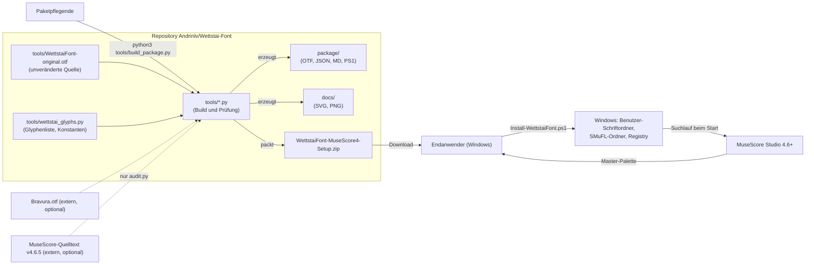
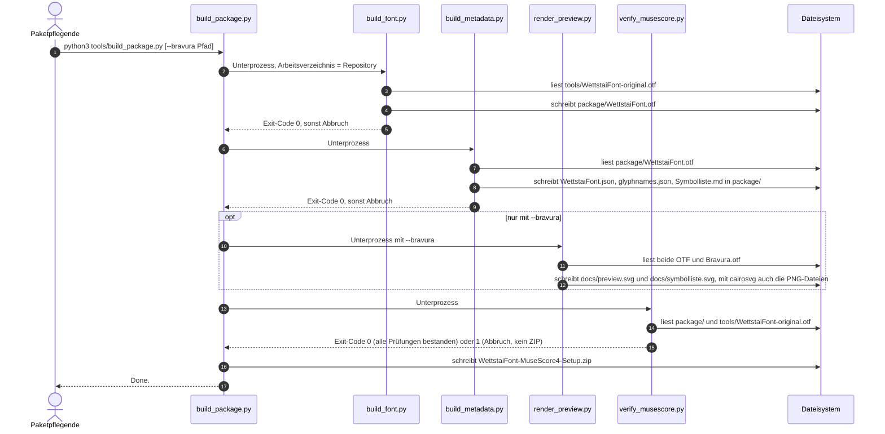
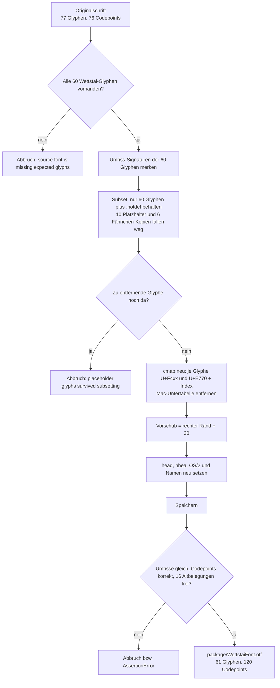
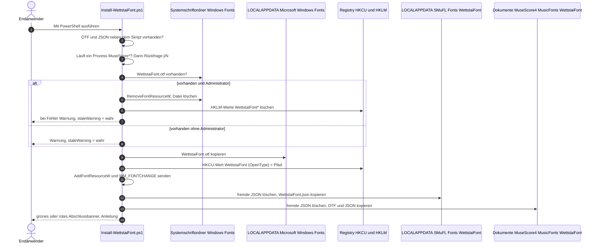
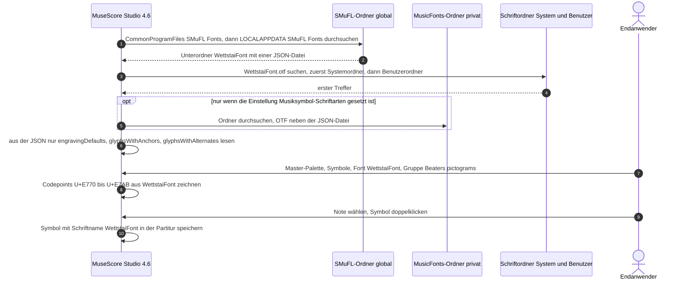
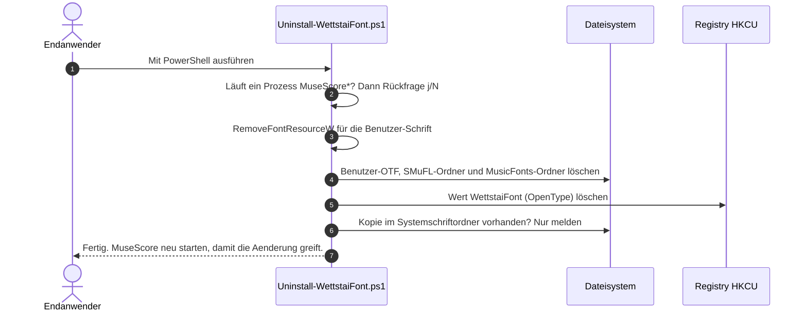
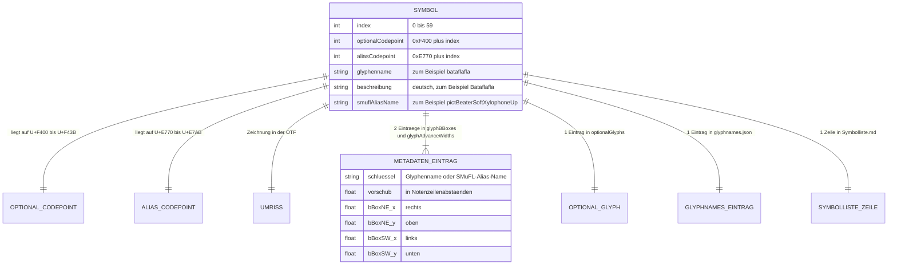

# WettstaiFont – Projektdokumentation

**Stand:** 16.10.2026 · Branch `claude/musescore-fonts-check-bp3zt4` · Commit `0f16e1ba29bc23e7e614faa88b1ffeaa2c5fe05f` (identisch mit `main` und `origin/main`)

## Zielpublikum

Diese Dokumentation richtet sich an Entwicklerinnen und Entwickler, die das Repository `Andrinlv/Wettstai-Font` übernehmen, das Schriftpaket neu bauen, prüfen, anpassen, verteilen oder bei Installationsproblemen unterstützen. Vorausgesetzt werden Grundkenntnisse in Python, PowerShell und Git; Kenntnisse über Schriftdateien oder MuseScore sind nicht nötig, die benötigten Begriffe erklärt das [Glossar](#23-glossar).

## Benutzung dieses Dokuments

- Wer das Paket nur installieren oder bauen will, beginnt mit [Kapitel 2 – Schnellstart](#2-schnellstart).
- Wer verstehen will, wie Repository, Werkzeuge, Installer und MuseScore zusammenspielen, liest [Kapitel 4](#4-architektur) und [Kapitel 7](#7-zentrale-abläufe-und-datenflüsse).
- Alle Einstellmöglichkeiten stehen in [Kapitel 12](#12-konfigurationsreferenz), die Anleitungen zum Ändern in [Kapitel 13](#13-neu-konfigurieren--schritt-für-schritt-anleitungen).
- Fehlermeldungen und ihre Behebung stehen in [Kapitel 21](#21-fehlerbehebung), bekannte Schwächen in [Kapitel 22](#22-bekannte-einschränkungen-risiken-und-auffälligkeiten).
- Jede Aussage nennt die Quelldatei, meist mit Zeilennummer (Schreibweise `datei:zeile`). Zeilennummern beziehen sich auf den oben genannten Commit.
- Aussagen, die nicht aus dem Code stammen, sondern aus der bestehenden Dokumentation (`README.md`, `package/LIESMICH.md`), sind mit «Aus bisheriger Dokumentation übernommen» gekennzeichnet. Schlussfolgerungen ohne direkten Beleg sind mit «Annahme» und dem jeweiligen Indiz gekennzeichnet.
- Befehle wurden gegen die Projektdateien geprüft, aber für diese Dokumentation nicht ausgeführt (siehe [Anhang C](#anhang-c--abdeckungs--und-verifikationsbericht)).

## Inhaltsverzeichnis

1. [Projektüberblick](#1-projektüberblick)
2. [Schnellstart](#2-schnellstart)
3. [Technologie-Stack](#3-technologie-stack)
4. [Architektur](#4-architektur)
5. [Verzeichnis- und Dateistruktur](#5-verzeichnis--und-dateistruktur)
6. [Module und Komponenten](#6-module-und-komponenten)
7. [Zentrale Abläufe und Datenflüsse](#7-zentrale-abläufe-und-datenflüsse)
8. [Datenmodell und Persistenz](#8-datenmodell-und-persistenz)
9. [Schnittstellen](#9-schnittstellen)
10. [Benutzeroberfläche](#10-benutzeroberfläche)
11. [Sicherheit, Zugriffskontrolle und Datenschutz](#11-sicherheit-zugriffskontrolle-und-datenschutz)
12. [Konfigurationsreferenz](#12-konfigurationsreferenz)
13. [Neu konfigurieren – Schritt-für-Schritt-Anleitungen](#13-neu-konfigurieren--schritt-für-schritt-anleitungen)
14. [Entwicklungsumgebung, Build und Tooling](#14-entwicklungsumgebung-build-und-tooling)
15. [Tests und Qualitätssicherung](#15-tests-und-qualitätssicherung)
16. [Deployment und Betrieb](#16-deployment-und-betrieb)
17. [Logging, Monitoring und Fehlerbehandlung](#17-logging-monitoring-und-fehlerbehandlung)
18. [Hintergrundprozesse und Zeitsteuerung](#18-hintergrundprozesse-und-zeitsteuerung)
19. [Abhängigkeiten und externe Dienste](#19-abhängigkeiten-und-externe-dienste)
20. [Weiterentwicklung](#20-weiterentwicklung)
21. [Fehlerbehebung](#21-fehlerbehebung)
22. [Bekannte Einschränkungen, Risiken und Auffälligkeiten](#22-bekannte-einschränkungen-risiken-und-auffälligkeiten)
23. [Glossar](#23-glossar)
- [Anhang A – Dateiverzeichnis](#anhang-a--dateiverzeichnis)
- [Anhang B – Befehlsreferenz](#anhang-b--befehlsreferenz)
- [Anhang C – Abdeckungs- und Verifikationsbericht](#anhang-c--abdeckungs--und-verifikationsbericht)
- [Anhang D – Offene Fragen](#anhang-d--offene-fragen)

---

## 1. Projektüberblick

### 1.1 Zweck

Das Projekt liefert die Musiksymbol-Schrift **WettstaiFont** für die Notenschrift der Basler Trommel («Wettstai», in der bestehenden Dokumentation auch «Hieroglyphen-Schrift» genannt, `README.md:3`) als SMuFL-Schrift für **MuseScore Studio 4.6 oder neuer** unter Windows 10/11 (`package/Install-WettstaiFont.ps1:3`, `README.md:4`).

Das Repository enthält:

- die reparierte Schriftdatei mit ihren Metadaten (`package/`),
- einen PowerShell-Installer und -Deinstaller für Windows (`package/*.ps1`),
- Python-Werkzeuge, die die Schrift reproduzierbar aus der unveränderten Originalschrift (`tools/WettstaiFont-original.otf`) bauen, die Metadaten erzeugen, Vorschaubilder zeichnen, das Verteil-ZIP packen und alles gegen das Ladeverhalten von MuseScore prüfen (`tools/`),
- das fertige Verteilpaket `WettstaiFont-MuseScore4-Setup.zip` und Vorschaubilder (`docs/`).

Die ursprünglich hochgeladene Fassung (Commit `49023bc`, 19.05.2026) funktionierte in MuseScore nicht. Die neun Ursachen sind in `README.md:32-46` aufgelistet. Die Befunde 1–3, 7 und 8 begründet der Docstring von `tools/build_font.py:2-19`, den Befund 6 der Docstring von `tools/build_metadata.py:2-18`, die Befunde 4, 5 und 9 die Kommentare in `package/Install-WettstaiFont.ps1:20-37` und `:105-112`; die vollständige Liste mit den heutigen Gegenmassnahmen steht in [Abschnitt 4.4](#44-design-entscheidungen-und-zielkonflikte). Der heutige Stand (Commits `3044c53`, `22af6fc`, `93e3ae6`, zusammengeführt über die Pull Requests #1 und #2 am 13.08.2026) behebt sie.

### 1.2 Funktionen aus Sicht der Benutzenden

| Funktion | Umsetzung | Beleg |
|---|---|---|
| 60 Symbole der Basler Trommelnotation in MuseScore einfügen | Jedes Symbol liegt zusätzlich auf einem Codepoint `U+E770`–`U+E7AB`, den MuseScore kennt; in der Master-Palette erscheinen sie in der Gruppe «Beaters pictograms» | `tools/wettstai_glyphs.py:81-119`, `tools/build_font.py:112-125`; Bedienweg: Aus bisheriger Dokumentation übernommen (`README.md:85-94`) |
| Normale Notation bleibt unverändert | Die Schrift belegt keinen Standard-Codepoint ausser dem Alias-Block. Die normale Notation kommt weiter aus der Musiksymbol-Schrift der Partitur (ab Werk Leland). Nur wenn `WettstaiFont` selbst als Musiksymbol-Schrift eingestellt ist, zeichnet MuseScore Schlüssel, Notenköpfe, Pausen und Fähnchen mit der Rückfallschrift Bravura | `tools/build_font.py:83-110`, `README.md:96-99`, `package/Install-WettstaiFont.ps1:236-238`, `tools/verify_musescore.py:183-195`, `:342-355` |
| Symbole für andere SMuFL-Programme | Die Symbole bleiben zusätzlich auf den SMuFL-Optional-Codepoints `U+F400`–`U+F43B` und sind in `optionalGlyphs` der Metadaten beschrieben | `tools/build_font.py:114-116`, `tools/build_metadata.py:128-135` |
| Installation ohne Administratorrechte | Schrift für das aktuelle Benutzerkonto, Metadaten im SMuFL-Ordner des Benutzers | `package/Install-WettstaiFont.ps1:158-200` |
| Aufräumen einer alten, systemweiten Installation | Erkennen unter `C:\Windows\Fonts`, Entfernen bei Administratorrechten, sonst Warnung | `package/Install-WettstaiFont.ps1:105-156`, `:210-226` |
| Deinstallation | Entfernt Schriftdatei, Metadaten-Ordner, MusicFonts-Ordner und Registry-Wert | `package/Uninstall-WettstaiFont.ps1:28-76` |

Die 60 Symbole sind in `tools/wettstai_glyphs.py:18-79` definiert und in `package/Symbolliste.md` tabelliert. Sie gehören zu diesen Gruppen (Beschreibungen wörtlich aus dem Code): Bataflafla; Batafla links/rechts; Coupe de charge; Doppel-Doppelschlag links/rechts; Double (Variante 2), Double links/rechts; Dupf links/rechts; Endstraich links/rechts; Maermeli links/rechts; Muehlerad; Paradiddle links/rechts; Ruf 3, 4, 5, 7, 9, 11, 13, 15, 17, 19 und 21 jeweils links/rechts; Schlepp-3erli links/rechts; Schlepp-5er; Schlepp-9er; Schlepp links/rechts; Straich-3 links/rechts; U-Doppel-Doppelschlag links/rechts; U-Endstraich links/rechts; Ruf 5 punktiert links/rechts; Notenwert Achtel, Sechzehntel und Quintole je in zwei Varianten.

### 1.3 Benutzende und Rollen

Das Projekt kennt keine Benutzerkonten, Rollen oder Berechtigungen im Code. Es gibt zwei Personengruppen:

| Gruppe | Arbeitet mit | Umgebung |
|---|---|---|
| Endanwenderinnen und -anwender (Trommlerinnen und Trommler, die mit MuseScore Noten setzen) | `WettstaiFont-MuseScore4-Setup.zip`, PowerShell-Skripte, MuseScore Studio | Windows 10/11 (`package/Install-WettstaiFont.ps1:3`) |
| Paketpflegende (Zielpublikum dieses Dokuments) | Python-Werkzeuge in `tools/`, Git | Jedes System mit Python 3 und `fontTools`; Windows nur zum Testen der Installation |

### 1.4 Entwicklungsstand

| Merkmal | Wert | Beleg |
|---|---|---|
| Schriftversion | `2.0.0` (in der Schrift: `fontRevision` 2.0, Name-ID 5 `Version 2.000`) | `tools/wettstai_glyphs.py:144`, `tools/build_font.py:154`, `:177-185` |
| Letzte inhaltliche Änderung | Commit `93e3ae6` vom 13.08.2026, zusammengeführt als `0f16e1b` (Pull Request #2) | `git log` |
| Tags und Releases | keine Git-Tags vorhanden | `git tag -l` |
| Test in echtem MuseScore | nicht erfolgt; geprüft wurde gegen den Quelltext von MuseScore v4.6.5 und mit Simulationen – Aus bisheriger Dokumentation übernommen | `README.md:333-337` |
| Automatisierte Pipeline | keine (kein CI-/CD-Konfigurationsordner) | Verzeichnisinhalt, siehe [Kapitel 16](#16-deployment-und-betrieb) |

### 1.5 Kennzahlen

| Kennzahl | Wert |
|---|---|
| Dateien im Repository (getrackt) | 22 |
| Python-Dateien | 7 (2'112 Zeilen), davon 6 ausführbare Skripte und 1 gemeinsames Modul |
| PowerShell-Skripte | 2 (326 Zeilen) |
| Markdown-Dateien | 3 (`README.md`, `package/LIESMICH.md`, `package/Symbolliste.md`) |
| JSON-Dateien | 2 (`package/WettstaiFont.json`, `package/glyphnames.json`) |
| Binärdateien | 2 Schriftdateien (OTF), 2 PNG-Bilder, 1 ZIP-Archiv |
| SVG-Dateien | 2 (generiert) |
| Sonstige | 1 (`.gitignore`) |
| Symbole in der Schrift | 60 (61 Glyphen inklusive `.notdef`) |
| Belegte Codepoints in der Schrift | 120 (60 SMuFL-Optional plus 60 MuseScore-Alias) |
| Unabhängig ausführbare Teile | 6 Python-Skripte, 2 PowerShell-Skripte |

## 2. Schnellstart

Das Projekt hat keine Server-Anwendung. «Laufende Instanz» bedeutet hier zweierlei: ein frisch gebautes und geprüftes Schriftpaket (Weg A, jedes Betriebssystem) und eine in MuseScore benutzbare, installierte Schrift (Weg B, Windows).

### 2.1 Voraussetzungen

| Voraussetzung | Version | Wofür | Beleg |
|---|---|---|---|
| Git | keine Vorgabe im Projekt | Repository klonen; `tools/audit.py` ruft `git` auf | `tools/audit.py:112-114` |
| Python 3 | im Projekt nicht festgelegt; Annahme: mindestens 3.7 (Indiz: `from __future__ import annotations` in allen Skripten, `capture_output=True` bei `subprocess.run` in `tools/audit.py:113`) | alle Werkzeuge in `tools/` | Shebang `#!/usr/bin/env python3` in Zeile 1 der sechs Skripte `tools/audit.py`, `tools/build_font.py`, `tools/build_metadata.py`, `tools/build_package.py`, `tools/render_preview.py`, `tools/verify_musescore.py` (das Modul `tools/wettstai_glyphs.py` hat keine) |
| Python-Paket `fontTools` | im Projekt nicht festgelegt (kein Manifest, kein Lockfile; siehe [Anhang D](#anhang-d--offene-fragen)) | Schrift lesen, verkleinern, schreiben | `tools/build_font.py:31-34`, `README.md:318` |
| Python-Paket `cairosvg` | optional, nicht festgelegt | nur für PNG-Ausgabe der Vorschaubilder | `tools/render_preview.py:191-197` |
| `Bravura.otf` mit `bravura_metadata.json` im selben Ordner | optional | Vorschaubilder (`--bravura`) und Audit-Abschnitt F | `tools/render_preview.py:9-12`, `tools/audit.py:460-461` |
| Checkout des MuseScore-Quelltexts (`musescore/MuseScore`) auf Tag `v4.6.5` | optional | Audit-Abschnitt E (`--musescore`); ohne Checkout wird Abschnitt E übersprungen | `tools/audit.py:9`, `:342-348`, `:757-758` |
| Windows 10 oder 11 mit Windows PowerShell | – | Installation beim Endnutzer | `package/Install-WettstaiFont.ps1:3` |
| MuseScore Studio | 4.6 oder neuer; ältere 4.x-Versionen laden laut bisheriger Dokumentation keine fremden SMuFL-Schriften – Aus bisheriger Dokumentation übernommen | Benutzung der Schrift | `README.md:59-60` |

### 2.2 Weg A – Paket bauen und prüfen

1. Repository klonen und in das Verzeichnis wechseln:

   ```bash
   git clone https://github.com/Andrinlv/Wettstai-Font
   cd Wettstai-Font
   ```

2. `fontTools` installieren (Befehl wie in `README.md:318`):

   ```bash
   pip install fonttools
   ```

3. Optional `cairosvg` installieren, falls Sie die Vorschaubilder als PNG neu erzeugen wollen:

   ```bash
   pip install cairosvg
   ```

4. Alles neu bauen:

   ```bash
   python3 tools/build_package.py
   ```

   Das Skript ruft nacheinander `tools/build_font.py`, `tools/build_metadata.py`, `tools/verify_musescore.py` auf und packt danach das ZIP (`tools/build_package.py:66-79`). Ohne `--bravura` erscheint die Zeile `(no --bravura given, skipping preview rendering)` und `docs/` bleibt unverändert.

5. Erfolg prüfen:
   - Die Prüfung endet mit `All checks passed (0 warning(s)).` (`tools/verify_musescore.py:375`).
   - Danach erscheinen `  WettstaiFont-MuseScore4-Setup.zip: 7 files, <Grösse> bytes` und `Done.` (`tools/build_package.py:63`, `:79`).
   - Schlägt eine Prüfung fehl, bricht `build_package.py` mit `tools/verify_musescore.py failed with exit code 1` ab und baut kein ZIP (`tools/build_package.py:38-40`).

6. Kontrollieren, dass der Build nichts verändert hat:

   ```bash
   git status --short
   ```

   Da der Build deterministisch ist (`tools/build_font.py:78-81`, `tools/build_package.py:48-60`), sollte die Ausgabe leer sein. Der dabei entstehende Ordner `tools/__pycache__/` ist in `.gitignore` ausgeschlossen. Für `WettstaiFont.otf`, `WettstaiFont.json`, `glyphnames.json` und `Symbolliste.md` prüft `tools/audit.py` (Abschnitt B) die Byte-Gleichheit ausdrücklich; für das ZIP ist sie eine Annahme (Indiz: feste Zeitstempel und Attribute in `tools/build_package.py:57-59`).

### 2.3 Weg B – Schrift unter Windows installieren und in MuseScore prüfen

1. MuseScore Studio vollständig beenden. Der Installer prüft, ob ein Prozess `MuseScore*` läuft. Falls ja, meldet er `MuseScore laeuft noch (PID: <Prozessnummern>).` und fragt `Trotzdem fortfahren? (j/N)`; jede Antwort ausser `j` oder `J` beendet das Skript mit Exit-Code 1 (`package/Install-WettstaiFont.ps1:69-77`).
2. `WettstaiFont-MuseScore4-Setup.zip` aus dem Repository-Stamm herunterladen und **vollständig** entpacken. Das Skript sucht `WettstaiFont.otf` und `WettstaiFont.json` im eigenen Ordner (`$PSScriptRoot`) und bricht sonst mit `Datei nicht gefunden: <Pfad>` ab (`package/Install-WettstaiFont.ps1:56-67`).
3. Im entpackten Ordner `WettstaiFont-MuseScore4-Setup` mit der rechten Maustaste auf `Install-WettstaiFont.ps1` klicken und «Mit PowerShell ausführen» wählen (Aus bisheriger Dokumentation übernommen, `README.md:65`).
4. Blockiert PowerShell die Ausführung, öffnen Sie PowerShell in diesem Ordner und führen Sie aus:

   ```powershell
   Set-ExecutionPolicy -Scope Process Bypass
   .\Install-WettstaiFont.ps1
   ```

5. Ausgabe kontrollieren: Es erscheinen die Schritte `[0/3]` bis `[3/3]` (`package/Install-WettstaiFont.ps1:113`, `:159`, `:196`, `:203`), danach in Grün das Banner `Installation abgeschlossen` und die Hinweise unter `So geht es weiter:` (`:221-243`). Erscheint stattdessen in Rot `Installation abgeschlossen - ABER:` (`:211-220`), liegt noch eine alte Kopie unter `C:\Windows\Fonts`; das Vorgehen beschreibt [Kapitel 21](#21-fehlerbehebung).
6. `Enter` drücken, um das Fenster zu schliessen (`Read-Host "Enter zum Beenden"`, `package/Install-WettstaiFont.ps1:245`).
7. Dateien prüfen (PowerShell):

   ```powershell
   Test-Path "$env:LOCALAPPDATA\SMuFL\Fonts\WettstaiFont\WettstaiFont.json"
   Test-Path "$env:LOCALAPPDATA\Microsoft\Windows\Fonts\WettstaiFont.otf"
   ```

   Beide Befehle müssen `True` ausgeben (Zielpfade: `package/Install-WettstaiFont.ps1:161`, `:166`, `:198`).
8. MuseScore Studio starten und in MuseScore prüfen (Aus bisheriger Dokumentation übernommen, `README.md:85-94`): **Ansicht → Master-Palette** (`Umschalt + F9`) → links **Symbole** → oben im Auswahlfeld **`WettstaiFont`** wählen → links die Gruppe **Beaters pictograms**. Dort müssen die Wettstai-Zeichen statt der Schlägel-Piktogramme erscheinen.

## 3. Technologie-Stack

Das Projekt hält keine Versionen fest: Es gibt weder `requirements.txt`, `pyproject.toml`, `setup.py`, `Pipfile` noch ein Lockfile. Wo unten «nicht festgelegt» steht, ist die Version aus dem Projekt nicht bestimmbar (siehe [Anhang D](#anhang-d--offene-fragen)).

### 3.1 Sprachen und Laufzeitumgebungen

| Komponente | Version | Rolle im Projekt | Beleg |
|---|---|---|---|
| Python 3 | nicht festgelegt; Annahme: mindestens 3.7 (siehe [Abschnitt 2.1](#21-voraussetzungen)) | Sprache aller Build- und Prüfwerkzeuge | `tools/*.py` |
| Windows PowerShell | nicht festgelegt; Annahme: Windows PowerShell 5.1 (Indiz: Kommentar `tools/audit.py:705-706` begründet die ASCII-Pflicht der Skripte mit dem Verhalten von «Windows PowerShell 5.1») | Installer und Deinstaller beim Endnutzer | `package/*.ps1` |
| .NET-Klassen in PowerShell | – | `System.Security.Principal.WindowsPrincipal`, `WindowsIdentity`, `WindowsBuiltInRole` (Administratorprüfung), `System.Environment.GetFolderPath('MyDocuments')` (Dokumente-Ordner), `IntPtr` | `package/Install-WettstaiFont.ps1:120-122`, `:181-188`, `:205`; `package/Uninstall-WettstaiFont.ps1:30` |
| Win32-API (per `Add-Type` / P/Invoke) | – | `gdi32.dll`: `AddFontResourceW`, `RemoveFontResourceW`; `user32.dll`: `SendMessageTimeout` | `package/Install-WettstaiFont.ps1:126-130`, `:177-188`; `package/Uninstall-WettstaiFont.ps1:35-41` |

### 3.2 Python-Bibliotheken

| Bibliothek | Version | Verwendete Teile | Verwendet in |
|---|---|---|---|
| `fontTools` | nicht festgelegt | `fontTools.ttLib.TTFont`; `fontTools.subset` (`Options`, `Subsetter`); `fontTools.pens.boundsPen.BoundsPen`; `fontTools.pens.recordingPen.RecordingPen`; `fontTools.pens.svgPathPen.SVGPathPen` | `build_font.py:31-34`, `build_metadata.py:30-31`, `render_preview.py:24-26`, `verify_musescore.py:47-49`, `audit.py:30-32` |
| `cairosvg` (optional) | nicht festgelegt | `cairosvg.svg2png`; wird erst bei Bedarf importiert, fehlt es, entsteht nur das SVG | `render_preview.py:191-197`, `:239-245` |
| Python-Standardbibliothek | mit Python | `argparse`, `hashlib`, `io`, `json`, `pathlib`, `re`, `shutil`, `subprocess`, `sys`, `tempfile`, `zipfile`, `__future__` | siehe [Kapitel 19](#19-abhängigkeiten-und-externe-dienste) |

### 3.3 Formate und Standards

| Format / Standard | Ausprägung im Projekt | Beleg |
|---|---|---|
| OpenType mit CFF-Umrissen (`.otf`, Kennung `OTTO`) | 1000 Einheiten pro Geviert (`unitsPerEm`) | Tabellenverzeichnis beider OTF-Dateien; `tools/wettstai_glyphs.py:145` |
| SMuFL (Standard Music Font Layout) | Codepoints, Metadaten-JSON (`fontName`, `engravingDefaults`, `glyphBBoxes`, `optionalGlyphs`), Einheit «Notenzeilenabstand» = ¼ Geviert = 250 Einheiten | `tools/wettstai_glyphs.py:146-147`, `tools/build_metadata.py:84-86` |
| JSON | UTF-8, Einrückung 2, abschliessender Zeilenumbruch | `tools/build_metadata.py:152-157` |
| Markdown (GitHub Flavored) | Dokumentation und generierte Symbolliste | `README.md`, `package/*.md` |
| SVG / PNG | Vorschaubilder, von `render_preview.py` erzeugt | `docs/` |
| ZIP (Deflate) | Verteilpaket mit festen Zeitstempeln | `tools/build_package.py:43-63` |

### 3.4 Werkzeuge und externe Bezugsgrössen

| Werkzeug / System | Version | Rolle | Beleg |
|---|---|---|---|
| Git | nicht festgelegt | Versionsverwaltung; `audit.py` nutzt `git status`, `git rev-parse`, `git diff`, `git ls-tree` und im MuseScore-Checkout `git describe --tags` | `tools/audit.py:112-131`, `:346-347` |
| GitHub | – | Hosting des Repositorys `Andrinlv/Wettstai-Font`, Pull Requests #1 und #2 | `git log`, `git remote -v` |
| MuseScore Studio | Zielsystem 4.6 und neuer; Prüfreferenz Quelltext-Tag `v4.6.5` | Lädt die Schrift; seine Laderegeln bestimmen Paketaufbau und Codepoints | `tools/verify_musescore.py:4-34`, `tools/audit.py:346-348` |
| Bravura | nicht festgelegt | Rückfallschrift von MuseScore; im Projekt nur optional für Vorschaubilder und Audit-Vergleich | `tools/render_preview.py:9-12`, `tools/audit.py:460-461` |
| FontForge | – | Annahme: Werkzeug, mit dem die Originalschrift erstellt wurde (Indiz: Tabelle `FFTM` und Herstellerkennung `PfEd` in `tools/WettstaiFont-original.otf`); im Projekt nicht verwendet | Tabellenverzeichnis und OS/2-Tabelle der Originalschrift |

## 4. Architektur

### 4.1 Systemkontext

Das Projekt besteht aus einer Build-Seite (Python-Werkzeuge, laufen bei den Paketpflegenden) und einer Auslieferungsseite (ZIP mit Schrift, Metadaten und PowerShell-Skripten, läuft beim Endnutzer). MuseScore Studio ist ein externes System: Seine Laderegeln bestimmen, wie die Schrift und der Installer aufgebaut sein müssen. Der MuseScore-Quelltext ist nicht Teil des Repositorys; die Regeln sind in `tools/verify_musescore.py:4-34` beschrieben und werden von `tools/audit.py` (Abschnitt E) gegen einen separaten Checkout geprüft.



### 4.2 Komponenten und Verantwortlichkeiten

| Komponente | Verantwortung | Liest | Schreibt | Details |
|---|---|---|---|---|
| `tools/wettstai_glyphs.py` | Gemeinsame Quelle der Skripte `build_font.py`, `build_metadata.py`, `render_preview.py` und `verify_musescore.py` für Glyphenliste, Alias-Zuordnung, zu entfernende Glyphen, Schriftname, Version und Masseinheiten; `audit.py`, `build_package.py` und die PowerShell-Skripte führen Schriftname und Konstanten eigenständig (`tools/audit.py:44-54`, `tools/build_package.py:21-33`, `package/Install-WettstaiFont.ps1:42`, `package/Uninstall-WettstaiFont.ps1:13`) | – | – | [6.1](#61-toolswettstai_glyphspy) |
| `tools/build_font.py` | Baut `package/WettstaiFont.otf` aus der Originalschrift | `tools/WettstaiFont-original.otf` | `package/WettstaiFont.otf` | [6.2](#62-toolsbuild_fontpy) |
| `tools/build_metadata.py` | Erzeugt SMuFL-Metadaten, Glyphennamen und Symbolliste aus der gebauten Schrift | `package/WettstaiFont.otf` | `package/WettstaiFont.json`, `package/glyphnames.json`, `package/Symbolliste.md` | [6.3](#63-toolsbuild_metadatapy) |
| `tools/render_preview.py` | Zeichnet Vorher/Nachher-Bild und Symbolübersicht | beide OTF, optional Bravura | `docs/preview.svg`, `docs/preview.png`, `docs/symbolliste.svg`, `docs/symbolliste.png` | [6.4](#64-toolsrender_previewpy) |
| `tools/verify_musescore.py` | Prüft Paket, Schrift und Metadaten gegen die Laderegeln von MuseScore | `package/`, Originalschrift | – (nur Konsolenausgabe) | [6.5](#65-toolsverify_musescorepy) |
| `tools/build_package.py` | Orchestriert den gesamten Build und packt das ZIP | `package/` | `WettstaiFont-MuseScore4-Setup.zip` (und indirekt alles oben) | [6.6](#66-toolsbuild_packagepy) |
| `tools/audit.py` | Unabhängige Gesamtprüfung von Repository, Reproduzierbarkeit, Schrift, Metadaten, Installer-Logik, ZIP und Dokumentation | Repository, optional MuseScore-Checkout und Bravura | nur temporäre Dateien | [6.7](#67-toolsauditpy) |
| `package/Install-WettstaiFont.ps1` | Installiert die Schrift beim Endnutzer und räumt Altlasten auf | `WettstaiFont.otf`, `WettstaiFont.json` neben dem Skript | Benutzer-Schriftordner, SMuFL-Ordner, MusicFonts-Ordner, Registry `HKCU`; löscht veraltete `*.json` in SMuFL- und MusicFonts-Ordner (`:93-98`) und mit Administratorrechten `C:\Windows\Fonts\WettstaiFont.otf` samt den `HKLM`-Werten `WettstaiFont*` (`:124-144`) | [6.8](#68-packageinstall-wettstaifontps1) |
| `package/Uninstall-WettstaiFont.ps1` | Entfernt die Installation | – | löscht die installierten Dateien und den Registry-Wert | [6.9](#69-packageuninstall-wettstaifontps1) |

### 4.3 Muster im Code

- **Eine Quelle für die Konstanten der Build- und Prüfskripte.** `build_font.py`, `build_metadata.py`, `render_preview.py` und `verify_musescore.py` importieren Glyphenliste und Konstanten aus `tools/wettstai_glyphs.py`. Dazu fügen sie das eigene Verzeichnis in `sys.path` ein (`sys.path.insert(0, str(Path(__file__).resolve().parent))`; `tools/build_font.py:36`, `tools/build_metadata.py:33`, `tools/render_preview.py:28`, `tools/verify_musescore.py:51`). `tools/build_package.py` braucht das Modul nicht und führt die Dateinamen selbst (`tools/build_package.py:21-33`). `tools/audit.py` verwendet es bewusst nicht und führt eigene Konstanten (`tools/audit.py:4-11`, `:43-58`).
- **Generierte Dateien werden eingecheckt.** `package/WettstaiFont.otf`, `package/WettstaiFont.json`, `package/glyphnames.json`, `package/Symbolliste.md`, `docs/*` und das ZIP sind Build-Ergebnisse und liegen trotzdem im Repository (`README.md:295-315`, `tools/build_package.py:2`).
- **Deterministischer Build.** Feste Zeitstempel in Schrift und ZIP machen die Ergebnisse byte-reproduzierbar (`tools/build_font.py:78-81`, `tools/build_package.py:48-60`).
- **Mehrstufige Prüfung.** Selbstprüfung im Build (`tools/build_font.py:191-205`), Regelprüfung (`tools/verify_musescore.py`) als Abbruchbedingung im Build (`tools/build_package.py:77`) und unabhängiger Audit (`tools/audit.py`).
- **Simulation statt Zielsystem.** Das Verhalten von MuseScore wird nicht ausgeführt, sondern nachgebildet: Glyphenauflösung in `tools/render_preview.py:43-68`, Suchlauf über eine simulierte Windows-Platte in `tools/audit.py:541-673`.
- **Prüfung von Skripttexten per Textsuche.** `verify_musescore.py` und `audit.py` prüfen die PowerShell-Skripte, indem sie nach festen Zeichenketten suchen (`tools/verify_musescore.py:151-175`, `tools/audit.py:664-673`). Das ist zerbrechlich (siehe [Kapitel 22](#22-bekannte-einschränkungen-risiken-und-auffälligkeiten)).

### 4.4 Design-Entscheidungen und Zielkonflikte

Die Tabelle fasst die neun Befunde aus `README.md:36-46` und alle weiteren im Code erkennbaren Entscheidungen zusammen. «Begründung» stammt aus Code-Kommentaren oder der bisherigen Dokumentation; fehlt sie, steht «Begründung nicht dokumentiert».

| Nr. | Entscheidung | Behebt / bewirkt | Begründung (Quelle) | Zielkonflikt |
|---|---|---|---|---|
| 1 | Alle 60 Symbole zusätzlich auf `U+E770`–`U+E7AB` (SMuFL-Bereich «Beaters pictograms») legen | Befund 1: Symbole auf `U+F400`+ sind in MuseScore nicht erreichbar | MuseScores Symbolumfang endet bei `U+EF08`, `optionalGlyphs` wird ignoriert; der Bereich ist perkussionsnah, gross genug und wird in Basler Trommelnoten nicht gebraucht (`tools/wettstai_glyphs.py:3-13`, `README.md:276-281`) | In der Palette tragen die Felder die Namen der Schlägel-Symbole; eine Partitur speichert den SMuFL-Namen, ohne die Schrift erscheinen dort Schlägel-Piktogramme (`README.md:283-286`) |
| 2 | Die Original-Codepoints `U+F400`–`U+F43B` beibehalten | Standardkonformität für andere Programme | «damit die Schrift für Dorico, Finale und andere SMuFL-Programme standardkonform bleibt» (`README.md:133-135`) | Jede Glyphe hat zwei Codepoints |
| 3 | Zehn Platzhalter-Glyphen entfernen (`uniE000`–`uniE002`, `gClef`, `cClef`, `fClef`, `timeSig0`–`timeSig2`, `noteheadBlack`) | Befund 2: schwarze Kästen statt Schlüssel, Taktzahlen, Notenköpfe | MuseScore weicht nur bei fehlenden Glyphen auf Bravura aus (`tools/wettstai_glyphs.py:121-124`) | keiner |
| 4 | Sechs Fähnchen-Belegungen `U+E240`–`U+E245` entfernen | Befund 3: Fähnchen werden zu gepunkteten Strichen | Kopien der Wert-Zeichen hätten jedes Fähnchen ersetzt (`tools/wettstai_glyphs.py:132-138`) | Ob die Belegung beabsichtigt war, ist offen (`README.md:170-172`, [Anhang D](#anhang-d--offene-fragen)) |
| 5 | Installer schreibt in erster Linie `%LOCALAPPDATA%\SMuFL\Fonts\WettstaiFont\`; MusicFonts-Ordner nur als Reserve | Befund 4: der MusicFonts-Ordner wird ab Werk nicht durchsucht | `package/Install-WettstaiFont.ps1:20-32` | Reserve-Weg wirkt erst nach Einstellung in MuseScore |
| 6 | Genau eine JSON-Datei pro Schriftordner, alte JSON-Dateien werden gelöscht | Befund 5: MuseScore nimmt eine beliebige JSON-Datei | `package/Install-WettstaiFont.ps1:34-37`, `:79-81` | Fremde `*.json` im Zielordner werden ohne Rückfrage gelöscht |
| 7 | Metadaten aus der gebauten Schrift erzeugen | Befund 6: falsches Format, falsche Einheiten, vertauschte Werte | «so the numbers cannot drift away from the outlines again» (`tools/build_metadata.py:17-18`) | keiner |
| 8 | Vorschubbreite = rechter Rand der Zeichnung + 30 Einheiten | Befund 7: Vorschub 45–833 bei Zeichnungen bis 4199 Einheiten | «advance width must cover the ink» (`tools/build_font.py:127`); der Wert 30: Begründung nicht dokumentiert | keiner |
| 9 | Vertikale Metriken: Oberlänge = max(höchster Punkt + 25, 1000), Unterlänge = min(tiefster Punkt − 25, −250) | Befund 8: `hhea.ascent` 2181, `sTypoDescender` 0 | «Leave a little headroom so GDI/Qt never clip» (`tools/build_font.py:146-147`) | keiner |
| 10 | Installer sucht und entfernt eine Kopie in `C:\Windows\Fonts` | Befund 9: diese Kopie würde die neue verdecken | `package/Install-WettstaiFont.ps1:105-112` | Entfernen braucht Administratorrechte; ohne sie nur Warnung |
| 11 | Zeichnungen (Umrisse) werden nie verändert | Treue zum gelieferten Original | `tools/build_font.py:5`, Prüfung `:191-196` | Unterschiedliche Höhenlage der Symbole bleibt bestehen (`README.md:341-345`) |
| 12 | `engravingDefaults` = Bravura-Werte | Einheitliche Linienstärken mit der Rückfallschrift | `tools/build_metadata.py:47-49` | keiner |
| 13 | Unicode-Bereich im OS/2 nur Bit 60 (Private Use Area) | Korrekte Deklaration | `tools/build_font.py:169` | keiner |
| 14 | Mac-cmap-Untertabelle (Plattform 1) entfernen | Keine fehlerhaften Einträge | «nothing in this font is Mac-roman encodable» (`tools/build_font.py:120-121`) | keiner |
| 15 | MuseScore-Alias in `glyphnames.json` unter `museScoreCodepoint`, nicht `alternateCodepoint` | Keine Verwechslung mit einem SMuFL-Feld | `tools/build_metadata.py:138-141` | keiner |
| 16 | Installation nur für das aktuelle Benutzerkonto | Kein Administrator nötig | `package/Install-WettstaiFont.ps1:14-15` | keiner |
| 17 | `AddFontResourceW` und Rundruf `WM_FONTCHANGE` nach der Installation | Kein Ab- und Anmelden nötig | `package/Install-WettstaiFont.ps1:175` | Bei Fehler nur Hinweis, Installation läuft weiter |
| 18 | Textdateien im ZIP mit CRLF | Lesbar in Notepad und ISE | `tools/build_package.py:53-54` | ZIP-Inhalt und `package/` unterscheiden sich in den Zeilenenden |
| 19 | Feste Zeitstempel (ZIP: 01.01.2026 00:00:00; OTF: `head.modified` der Originalschrift) | Reproduzierbarkeit | `tools/build_package.py:48-49`, `tools/build_font.py:78-80`; das Datum selbst: Begründung nicht dokumentiert | ZIP-Einträge zeigen nicht das echte Erstelldatum |
| 20 | PowerShell-Skripte nur ASCII (Umlaute als «ae», «oe», «ue») | Kein Zeichensalat in Windows PowerShell 5.1 ohne BOM | `tools/audit.py:705-706` | Meldungen ohne Umlaute |
| 21 | Prüfung durch Simulation statt Test in echtem MuseScore | Keine Windows- und MuseScore-Umgebung verfügbar (Aus bisheriger Dokumentation übernommen, `README.md:333-337`) | – | Restrisiko bis zum ersten echten Test |
| 22 | Metadaten (`glyphAdvanceWidths`, `glyphBBoxes`) beschreiben jede Glyphe unter ihrem Wettstai-Namen und unter dem SMuFL-Namen ihres Alias-Codepoints | Beide Namenswege sind beschrieben | «Every glyph is reachable under two names» (`tools/build_metadata.py:104-108`) | 120 statt 60 Einträge je Abschnitt |
| 23 | Der Deinstaller meldet eine systemweite Kopie unter `C:\Windows\Fonts` nur und entfernt sie nicht | Deinstallation ohne Administratorrechte | «braucht Administratorrechte und wird hier nur gemeldet» (`package/Uninstall-WettstaiFont.ps1:67-76`) | Die Kopie muss von Hand entfernt werden (siehe [Kapitel 22](#22-bekannte-einschränkungen-risiken-und-auffälligkeiten), F12) |
| 24 | `OS/2.fsType` = 0 | Schrift installierbar, keine Einbettungsbeschränkung | `tools/build_font.py:174`, geprüft in `tools/audit.py:228`; Begründung nicht dokumentiert | keiner |

## 5. Verzeichnis- und Dateistruktur

### 5.1 Annotierter Verzeichnisbaum

```text
Wettstai-Font/
├── .gitignore                         schliesst Python-Bytecode aus (__pycache__/, *.pyc)
├── README.md                          bestehende Projektbeschreibung: Befunde, Installation, Bedienung
├── WettstaiFont-MuseScore4-Setup.zip  Verteilpaket für Endanwender (generiert, 7 Dateien)
├── docs/                              Vorschaubilder (alle generiert von tools/render_preview.py)
│   ├── preview.png                    Vorher/Nachher-Simulation, 1440 × 990 Pixel
│   ├── preview.svg                    Vektorquelle dazu, 960 × 660
│   ├── symbolliste.png                Übersicht aller 60 Symbole, 1500 × 2142 Pixel
│   └── symbolliste.svg                Vektorquelle dazu, 1300 × 1856
├── package/                           Inhalt des Verteilpakets, einzeln versioniert
│   ├── Install-WettstaiFont.ps1       Installer für Windows (von Hand gepflegt)
│   ├── LIESMICH.md                    Kurzanleitung für Endanwender (von Hand gepflegt)
│   ├── Symbolliste.md                 Tabelle aller Symbole (generiert von build_metadata.py)
│   ├── Uninstall-WettstaiFont.ps1     Deinstaller für Windows (von Hand gepflegt)
│   ├── WettstaiFont.json              SMuFL-Metadaten (generiert von build_metadata.py)
│   ├── WettstaiFont.otf               reparierte Schrift (generiert von build_font.py)
│   └── glyphnames.json                Glyphennamen mit beiden Codepoints (generiert von build_metadata.py)
└── tools/                             Build- und Prüfwerkzeuge (Python)
    ├── WettstaiFont-original.otf      unveränderte Originalschrift, einzige Quelle der Zeichnungen
    ├── audit.py                       unabhängiger Gesamt-Audit (bei vollständigen Eingaben 134 PASS/FAIL-Prüfungen und 1 PASS/WARN-Auswertung)
    ├── build_font.py                  baut package/WettstaiFont.otf
    ├── build_metadata.py              erzeugt WettstaiFont.json, glyphnames.json, Symbolliste.md
    ├── build_package.py               ruft alle Schritte auf und packt das ZIP
    ├── render_preview.py              erzeugt die Bilder in docs/
    ├── verify_musescore.py            prüft das Paket gegen MuseScores Laderegeln (28 Prüfungen)
    └── wettstai_glyphs.py             gemeinsames Modul: Glyphenliste und Konstanten
```

### 5.2 Zweck der Verzeichnisse

| Verzeichnis | Zweck | Von Hand gepflegt | Generiert |
|---|---|---|---|
| Wurzel | Einstieg (`README.md`), Verteilpaket, Git-Einstellungen | `README.md`, `.gitignore` | `WettstaiFont-MuseScore4-Setup.zip` |
| `docs/` | Bilder für `README.md` (eingebunden in `README.md:12`, `:110`) | – | alle 4 Dateien |
| `package/` | Genau die 7 Dateien, die ins ZIP kommen (`tools/build_package.py:25-33`); so sind Änderungen am Paketinhalt im Git-Verlauf einzeln sichtbar (`README.md:298`) | `Install-WettstaiFont.ps1`, `Uninstall-WettstaiFont.ps1`, `LIESMICH.md` | `WettstaiFont.otf`, `WettstaiFont.json`, `glyphnames.json`, `Symbolliste.md` |
| `tools/` | Werkzeuge und die Quellschrift | alle `.py`-Dateien, `WettstaiFont-original.otf` | – (zur Laufzeit entsteht `tools/__pycache__/`, ignoriert) |

### 5.3 Wichtige Einzeldateien

| Datei | Bedeutung |
|---|---|
| `tools/WettstaiFont-original.otf` | Byte-identisch mit der OTF aus dem ursprünglichen Upload (Commit `49023bc`, ZIP-Eintrag `WettstaiFont-MuseScore4-Setup/WettstaiFont.otf`, 21'016 Bytes). Alle Zeichnungen stammen von hier; die Werkzeuge behandeln sie als unverändertes Original («untouched original», `tools/build_font.py:2`, `tools/audit.py:7`). Die Umriss-Vergleiche in `tools/verify_musescore.py:264-275` und `tools/audit.py:288-293` messen die gebaute Schrift an dieser Datei und schlagen nach einer Änderung nur fehl, bis `package/WettstaiFont.otf` neu gebaut ist; `tools/build_font.py:191-196` vergleicht nur Quelle und Neubau desselben Laufs. Nach einem Neubau decken nur die festen Sollwerte in `tools/audit.py` Abschnitt D (`:264-334`) bestimmte Änderungen auf. |
| `tools/wettstai_glyphs.py` | Zentrale Stelle für Änderungen an Glyphenliste, Alias-Bereich, Schriftname und Version. |
| `package/Install-WettstaiFont.ps1` | Zusammen mit `package/Uninstall-WettstaiFont.ps1` die einzige Komponente, die beim Endnutzer Code ausführt; nur der Installer legt dabei Dateien und Registry-Werte an. |
| `WettstaiFont-MuseScore4-Setup.zip` | Wird in `README.md:9` direkt verlinkt; ist damit der Auslieferungsweg. |

Die vollständige Datei-für-Datei-Liste mit Kapitelverweisen steht in [Anhang A](#anhang-a--dateiverzeichnis).

## 6. Module und Komponenten

Alle Python-Skripte haben einen Docstring mit Zweck und Aufruf, einen `main()`-Einstieg hinter `if __name__ == "__main__":` und die Shebang-Zeile `#!/usr/bin/env python3`. Sie lösen ihre Standardpfade relativ zur eigenen Datei auf (`HERE = Path(__file__).resolve().parent`, `REPO = HERE.parent`), funktionieren also unabhängig vom aktuellen Arbeitsverzeichnis.

### 6.1 `tools/wettstai_glyphs.py`

**Verantwortung:** Gemeinsames Modul ohne eigene Ausführung. Es definiert, welche Glyphen die Schrift enthält, auf welche Codepoints sie gelegt werden, welche Glyphen der Originalschrift entfernt werden, sowie Name, Version und Masseinheiten der Schrift (Docstring `:1-14`, Definitionen `:16-149`).

**Öffentliche Schnittstelle:**

| Name | Zeile | Typ / Wert | Bedeutung | Importiert von |
|---|---|---|---|---|
| `WETTSTAI_GLYPHS` | 18-79 | Liste von 60 Tupeln `(Codepoint, Glyphenname, deutsche Beschreibung)`, Codepoints `0xF400`–`0xF43B` | Kanonische Reihenfolge der Symbole; bestimmt die Alias-Zuordnung (Index *i* → `0xE770 + i`) | `build_font.py`, `build_metadata.py`, `render_preview.py`, `verify_musescore.py` |
| `ALIAS_BLOCK_START` | 82 | `0xE770` | Erster Codepoint des MuseScore-Alias-Blocks | `verify_musescore.py`, intern |
| `ALIAS_BLOCK_END` | 83 | `0xE7EF` | Letzter erlaubter Alias-Codepoint (inklusive) | nur intern in `alias_codepoint()` |
| `ALIAS_SMUFL_NAMES` | 88-119 | Liste von 60 SMuFL-Namen von `pictBeaterSoftXylophoneUp` bis `pictBeaterHardYarnDown` | SMuFL-Name des Codepoints `0xE770 + i`; wird in Metadaten und Symbolliste geschrieben | `build_metadata.py`, `verify_musescore.py` |
| `PLACEHOLDER_GLYPHS` | 125-130 | `uniE000`, `uniE001`, `uniE002`, `gClef`, `cClef`, `fClef`, `timeSig0`, `timeSig1`, `timeSig2`, `noteheadBlack` | Platzhalter der Originalschrift, die entfernt werden | `build_font.py` |
| `FLAG_OVERRIDE_GLYPHS` | 139-141 | `uniE240`, `uniE241`, `uniE242`, `uniE243`, `uniE244`, `uniE245` | Kopien der Wert-Zeichen auf den Fähnchen-Codepoints, die entfernt werden | `build_font.py` |
| `FONT_NAME` | 143 | `"WettstaiFont"` | Schriftname; muss dem Ordnernamen bei der Installation entsprechen | `build_font.py`, `build_metadata.py`, `verify_musescore.py` |
| `FONT_VERSION` | 144 | `"2.0.0"` | Schriftversion; Major.Minor gehen in `head.fontRevision`, Name-IDs 3 und 5 und `fontVersion` der Metadaten | `build_font.py`, `build_metadata.py` |
| `UNITS_PER_EM` | 145 | `1000` | Einheiten pro Geviert | `build_font.py` |
| `STAFF_SPACE` | 147 | `UNITS_PER_EM / 4.0` = `250.0` | Ein SMuFL-Notenzeilenabstand in Schrifteinheiten | `build_metadata.py`, `verify_musescore.py` |
| `RIGHT_SIDEBEARING` | 149 | `30` | Rechter Seitenabstand, der beim Neuberechnen der Vorschubbreite auf den gerundeten rechten Rand der Zeichnung (`xMax`) addiert wird (`tools/build_font.py:135`); der linke Seitenabstand steckt damit in der Vorschubbreite | `build_font.py` |
| `alias_codepoint(index)` | 152-157 | Funktion → `int` | Liefert `ALIAS_BLOCK_START + index`; über `ALIAS_BLOCK_END` hinaus `ValueError("alias block overflow at index {index}")` | alle vier oben genannten Werkzeuge |
| `glyph_rows()` | 160-163 | Generator von 6-Tupeln | Liefert Index, Optional-Codepoint, Alias-Codepoint, Name, Beschreibung, SMuFL-Alias-Name | von keiner Datei verwendet (toter Code, [Kapitel 22](#22-bekannte-einschränkungen-risiken-und-auffälligkeiten)) |

**Randfälle und Einschränkungen:**

- Der Alias-Block fasst höchstens 128 Symbole (`0xE770` bis `0xE7EF`); mehr löst den `ValueError` aus.
- Dass `ALIAS_SMUFL_NAMES` gleich lang ist wie `WETTSTAI_GLYPHS`, prüft der Code nicht; eine kürzere Liste führt in `build_metadata.py:106` zu einem `IndexError`.
- Ob die Namen in `ALIAS_SMUFL_NAMES` zu den Codepoints in MuseScore passen, prüft kein Werkzeug. `tools/audit.py` Abschnitt E prüft mit einem MuseScore-Checkout nur, dass die 60 Alias-Codepoints gültige MuseScore-SymIds sind, zur Gruppe «Beaters pictograms» gehören und dort die ersten 60 Felder belegen (`tools/audit.py:378-397`); die Namen selbst vergleicht er nicht, und `tools/audit.py` importiert `wettstai_glyphs.py` nicht.
- In `WETTSTAI_GLYPHS` steht beim Ruf 21 «rechts» vor «links» (`:57-58`, `0xF426` `ruf21Rechts`, `0xF427` `ruf21Links`), bei allen anderen Paaren «links» zuerst; die Schreibweise der Namen ist bei `udoppelDWLinks` / `uDoppelDWRechts` uneinheitlich (`:67-68`). Beides entspricht der Originalschrift und darf nicht geändert werden, ohne die Glyphennamen der Schrift mitzuändern.

### 6.2 `tools/build_font.py`

**Verantwortung:** Baut `package/WettstaiFont.otf` aus der Originalschrift und repariert dabei Belegung, Vorschubbreiten und Metriken, ohne Umrisse zu verändern (Docstring `:2-22`).

**Öffentliche Schnittstelle (Befehlszeile):**

| Argument | Typ | Standard | Wirkung |
|---|---|---|---|
| `-i`, `--input` | Pfad | `tools/WettstaiFont-original.otf` (`DEFAULT_SRC`, `:50`) | Quellschrift |
| `-o`, `--output` | Pfad | `package/WettstaiFont.otf` (`DEFAULT_OUT`, `:51`) | Zielschrift; fehlende Ordner werden angelegt (`:187`) |

**Interne Logik von `build(src, out)` (`:66-213`):**

1. Quelle öffnen, prüfen, dass alle 60 Glyphen aus `WETTSTAI_GLYPHS` vorhanden sind, sonst Abbruch `source font is missing expected glyphs: <Liste der fehlenden Namen>` (`:67-72`).
2. Für jede dieser Glyphen eine SHA-256-Signatur der Umrisse festhalten (`outline_signature()`, `:54-57`, `:75`).
3. Quelle erneut öffnen, diesmal mit `recalcTimestamp=False`, damit `head.modified` unverändert bleibt (`:78-81`).
4. Für jede zu entfernende Glyphe (`PLACEHOLDER_GLYPHS` + `FLAG_OVERRIDE_GLYPHS`), die nicht vorhanden ist, `  note: '<name>' not present in source, nothing to drop` ausgeben (`:83-87`).
5. Mit `fontTools.subset` nur die 60 Glyphen behalten (plus `.notdef`). Gesetzte Optionen (`:89-101`): `glyph_names=True`, `notdef_glyph=True`, `notdef_outline=True`, `recalc_bounds=True`, `recalc_timestamp=False`, `drop_tables=[]`, `name_IDs=["*"]`, `name_legacy=True`, `name_languages=["*"]`, `layout_features=["*"]`, `hinting=True`, `legacy_kern=True`. Überlebt eine zu entfernende Glyphe, Abbruch `placeholder glyphs survived subsetting: <Liste der Namen>` (`:107-110`).
6. cmap neu aufbauen: Jede Glyphe auf ihren `0xF4xx`-Codepoint und auf `alias_codepoint(index)`; Untertabellen der Plattform 1 (Mac) werden geleert und entfernt (`:112-125`).
7. Vorschubbreiten setzen (Umgrenzung über die Hilfsfunktion `glyph_bounds()`, `:60-63`, mit `BoundsPen`): `advance = round(xMax) + RIGHT_SIDEBEARING`, linker Seitenabstand = `round(xMin)`; Glyphen ohne Umriss bleiben unverändert (`:127-136`).
8. Gesamtausdehnung aller Glyphen bestimmen und Metriken setzen (`:138-174`): `head.unitsPerEm` = 1000, `head.xMin/yMin/xMax/yMax` = Ausdehnung, `head.fontRevision` = 2.0; `hhea.ascent` = max(yMax + 25, 1000), `hhea.descent` = min(yMin − 25, −250), `hhea.lineGap` = 0; `OS/2.sTypoAscender` = 1000, `sTypoDescender` = Wert von `hhea.descent`, `sTypoLineGap` = 0, `usWinAscent` = Wert von `hhea.ascent`, `usWinDescent` = Betrag von `hhea.descent`, `usFirstCharIndex`/`usLastCharIndex` = kleinster/grösster Codepoint, `ulUnicodeRange1..4` = nur Bit 60, `fsType` = 0.
9. Name-IDs 3 und 5 auf `WettstaiFont 2.0` und `Version 2.000` setzen, für Plattform 3 in UTF-16BE, sonst Latin-1 (`:176-185`).
10. Speichern, dann Ergebnis prüfen (`:187-205`): Umrisse unverändert (sonst `outlines changed during rebuild (must never happen): <Liste der Namen>`), beide Codepoints jeder Glyphe richtig belegt, die 16 früher belegten Codepoints frei (`assert` mit Meldungen `U+XXXX -> <ist>, expected <soll>` bzw. `U+XXXX is still mapped (<name>)`).
11. Zusammenfassung ausgeben (`:207-212`), wörtlich: `  outlines preserved : <n>/<n>`, `  glyphs in font     : <n>`, `  cmap entries       : <n> (60 optional + 60 alias)` (der Zusatz in Klammern ist fest eingetragen, unabhängig von der tatsächlichen Anzahl), `  bbox               : <xMin> <yMin> <xMax> <yMax>`, `  ascent/descent     : <Oberlänge> / <Unterlänge>`, `  file size          : <n> bytes`.

**Hilfsfunktionen:** `outline_signature(font, glyph_name)` (`:54-57`) bildet den SHA-256-Wert der mit `RecordingPen` aufgezeichneten Umrisse; `glyph_bounds(font, glyph_name)` (`:60-63`) misst mit `BoundsPen` die Umgrenzung einer Glyphe und liefert `None` für Glyphen ohne Umriss (verwendet in `:130` und `:139`).

**Ausgaben von `main()`:** `Building <Dateiname Ziel> from <Dateiname Quelle>` (nur Dateinamen, keine Pfade) vor und `OK` nach dem Build (`:222-224`). Annahme: Die Bibliothek `fontTools.subset` meldet zusätzlich auf der Standardfehlerausgabe `FFTM NOT subset; don't know how to subset; dropped` (Indizien: die Originalschrift enthält die Tabelle `FFTM`, die gebaute nicht; die Meldung erschien bei der Ausführung während der Reparatur am 13.08.2026). Die Meldung ist harmlos.

**Abhängigkeiten:** `fontTools`, `tools/wettstai_glyphs.py`.

**Randfälle und Einschränkungen:**

- Die Codepoint-Endprüfungen (`:198-205`) nutzen `assert`; mit `python3 -O` gestartet entfallen sie. Der Umriss-Vergleich (`:194-196`) nutzt `SystemExit` und bleibt wirksam.
- Die Liste der 16 freizuhaltenden Codepoints steht in `:203-204` ein zweites Mal als Zahlen, unabhängig von `PLACEHOLDER_GLYPHS` und `FLAG_OVERRIDE_GLYPHS`.
- Die in `:131` gelesene Variable `lsb` wird nicht verwendet.
- Das Ergebnis enthält die Tabellen `CFF `, `OS/2`, `cmap`, `head`, `hhea`, `hmtx`, `maxp`, `name`, `post`; die Originaltabellen `FFTM` und `GDEF` fallen weg.

### 6.3 `tools/build_metadata.py`

**Verantwortung:** Erzeugt aus einer gebauten Schrift die SMuFL-Metadaten `WettstaiFont.json`, die Datei `glyphnames.json` und die Tabelle `Symbolliste.md` (Docstring `:2-21`; Symbolliste `:159`, `:167-187`).

**Öffentliche Schnittstelle (Befehlszeile):**

| Argument | Typ | Standard | Wirkung |
|---|---|---|---|
| `-f`, `--font` | Pfad | `package/WettstaiFont.otf` (`DEFAULT_FONT`, `:45`) | Schrift, aus der gemessen wird. **Alle drei Ausgabedateien landen im Ordner dieser Schrift** (`out_dir = font_path.parent`, `:151`) |

**Funktionen:**

| Funktion | Zeilen | Aufgabe |
|---|---|---|
| `sp(units)` | 84-86 | Schrifteinheiten in Notenzeilenabstände: `round(units / 250, 4)` |
| `collect(font)` | 89-110 | Misst für jede der 60 Glyphen Umgrenzung und Vorschub und legt beides zweimal ab: unter dem Wettstai-Namen und unter dem SMuFL-Alias-Namen (120 Einträge je Block) |
| `build(font_path)` | 113-164 | Stellt die Metadaten zusammen und schreibt die drei Dateien |
| `write_symbol_table(path)` | 167-187 | Schreibt die Markdown-Tabelle mit Kopftext und 60 Zeilen |
| `main()` | 190-196 | Befehlszeile; gibt `Generating SMuFL metadata from <Datei>` und `OK` aus |

**Konstante `ENGRAVING_DEFAULTS` (`:50-81`):** 30 Schlüssel, davon 29 Zahlenwerte in Notenzeilenabständen und `textFontFamily` als Liste. Die Werte stammen laut Kommentar von Bravura (`:47-49`). Die vollständige Liste steht in [Abschnitt 12.4](#124-konstanten-in-den-python-werkzeugen).

**Ausgaben (`:161-164`):** `  WettstaiFont.json : 120 advance widths, 120 bboxes, 60 optional glyphs`, `  glyphnames.json  : 60 entries`, `  Symbolliste.md   : 60 rows`.

**Abhängigkeiten:** `fontTools`, `tools/wettstai_glyphs.py`, Standardbibliothek `json`.

**Randfälle und Einschränkungen:**

- Glyphen ohne Umriss erhalten die Umgrenzung `(0, 0, 0, 0)` (`:97`).
- Die Dateien werden ohne Rückfrage überschrieben.
- Das Format der Ausgabedateien beschreibt [Kapitel 8](#8-datenmodell-und-persistenz).

### 6.4 `tools/render_preview.py`

**Verantwortung:** Zeichnet zwei Bilder: eine Vorher/Nachher-Simulation dessen, was MuseScore mit der alten und der neuen Schrift darstellt, und eine Übersicht aller 60 Symbole (Docstring `:2-16` und Docstring von `render_symbol_sheet()`, `:201`). Die Simulation wendet die Regel «zuerst die gewählte Musikschrift, sonst Bravura» an (`:4-7`).

**Öffentliche Schnittstelle (Befehlszeile):**

| Argument | Typ | Standard | Wirkung |
|---|---|---|---|
| `--original` | Pfad | `tools/WettstaiFont-original.otf` (`:250`) | Schrift für die obere («VORHER») Hälfte |
| `--fixed` | Pfad | `package/WettstaiFont.otf` (`:251`) | Schrift für die untere («NACHHER») Hälfte und die Symbolübersicht |
| `--bravura` | Pfad | keiner (`:252-253`, Hilfetext `path to Bravura.otf (MuseScore's fallback font)`) | Rückfallschrift für Standardzeichen; ist der Pfad angegeben, aber keine Datei, Abbruch `Bravura not found: <Pfad>` (`:257-258`) |
| `-o`, `--out` | Pfad | `docs/` (`:254`) | Ausgabeordner, wird angelegt (`:164`) |

**Klassen und Funktionen:**

| Name | Zeilen | Aufgabe |
|---|---|---|
| `GlyphSource` | 43-68 | Löst einen Codepoint auf: zuerst in der Musikschrift, sonst in der Rückfallschrift; liefert SVG-Pfad, Einheiten pro Geviert, Umgrenzung und ob die Glyphe aus der Musikschrift stammt, oder `None` |
| `Canvas` | 71-118 | Sammelt SVG-Elemente: `glyph()` (setzt eine Glyphe mit SMuFL-Ursprung an x/y, 1 Geviert = 4 Notenzeilenabstände), `line()`, `text()` (Schrift `DejaVu Sans, Helvetica, sans-serif`), `rect()`, `to_svg()` (weisser Hintergrund) |
| `draw_mock_score()` | 121-160 | Ein Notensystem: 5 Linien, Violinschlüssel, Taktangabe 2/4, vier Achtelnoten mit Hals und Fähnchen, optional je ein Wettstai-Symbol über jeder Note, Schlussstrich als Linie |
| `render()` | 163-197 | Bild 960 × 660: oben (Systemoberkante y=190) Originalschrift ohne Wettstai-Symbole, Trennlinie bei y=300, unten (y=500) neue Schrift mit den Alias-Codepoints der Symbole mit Index 0, 18, 15 und 44 (`bataflafla`, `ruf3Links`, `muehlerad`, `schleppLinks`); schreibt `preview.svg` und, wenn `cairosvg` vorhanden ist, `preview.png` mit 1440 Pixel Breite |
| `render_symbol_sheet()` | 200-245 | Übersicht 5 Spalten × 12 Zeilen, Zellen 260 × 150, Bild 1300 × 1856; Titel `WettstaiFont - alle 60 Symbole`; je Zelle Glyphe (Skalierung höchstens 0.14), Beschreibung, Glyphenname, Zeile `MuseScore U+XXXX  -  SMuFL U+XXXX`; schreibt `symbolliste.svg` und, wenn `cairosvg` importiert werden kann, `symbolliste.png` mit 1500 Pixel Breite (sonst `  cairosvg not installed - PNG skipped`) |
| `main()` | 248-260 | Befehlszeile; bricht mit `Bravura not found: <Pfad>` ab, wenn `--bravura` angegeben, aber keine Datei ist, und ruft dann `render()` und `render_symbol_sheet()` auf |

Feste Bildtexte (`:174-186`): `VORHER - Originalpaket`, `Notenschluessel, Taktzahl 2 und Notenkoepfe sind schwarze Kaesten, die Faehnchen gepunktete Striche. Wettstai-Symbole: gar nicht einfuegbar.`, `NACHHER - repariertes Paket`, `Normale Notation kommt aus Bravura, die Wettstai-Symbole stehen ueber den Noten (bataflafla, ruf3Links, muehlerad, schleppLinks).`

Layout-Konstanten: `SPATIUM = 26.0` Pixel pro Notenzeilenabstand, `STAFF_LINE = 0.13`, `STEM_WIDTH = 0.12` (`:34-36`); SMuFL-Codepoints `GCLEF` `0xE050`, `TIMESIG2` `0xE082`, `TIMESIG4` `0xE084`, `NOTEHEAD_BLACK` `0xE0A4`, `FLAG8TH_UP` `0xE240`, `BARLINE` `0xE030` (`:39-40`).

**Ausgaben:** `  wrote <Pfad>` je erzeugter Datei; ohne `cairosvg` `  cairosvg not installed - PNG skipped` (`:189-197`, `:238-245`).

**Abhängigkeiten:** `fontTools`, optional `cairosvg`, `tools/wettstai_glyphs.py`, optional Bravura.

**Randfälle und Einschränkungen:**

- Ohne `--bravura` werden Standardzeichen, die die gewählte Schrift nicht hat, **gar nicht** gezeichnet (`GlyphSource.resolve()` liefert `None`, `Canvas.glyph()` gibt `0.0` zurück, `:60-61`, `:79-81`). Der Docstring behauptet dagegen graue Umrisse (`:11-12`), siehe [Kapitel 22](#22-bekannte-einschränkungen-risiken-und-auffälligkeiten).
- Fehlende Dateien bei `--original` oder `--fixed` werden nicht abgefangen (`:47`, `:202`); das Werkzeug bricht mit einem unbehandelten Python-Traceback ab, statt wie bei `--bravura` eine eigene Meldung auszugeben.
- Die PNG-Dateien werden nur aktualisiert, wenn `cairosvg` installiert ist; sonst bleiben alte PNG-Dateien neben neuen SVG-Dateien stehen.
- Die beiden Bildunterschriften der Simulation sind feste Texte (`:175-176`, `:183-185`) und werden nicht aus der tatsächlichen Glyphenauflösung abgeleitet. Ohne `--bravura` oder mit anderen Schriften behauptet das Bild deshalb weiterhin «Normale Notation kommt aus Bravura» bzw. «schwarze Kaesten».
- `BARLINE` und die Parameter `scale_sp` und `colour` von `Canvas.glyph()` werden nicht genutzt; die Füllfarbe in `:84` ist in beiden Zweigen `#1a1a1a`.

### 6.5 `tools/verify_musescore.py`

**Verantwortung:** Prüft das Paket gegen die Laderegeln von MuseScore Studio, wie sie der Docstring (`:4-34`) aus dem MuseScore-Quelltext (Tag `v4.6.5`) wiedergibt. Diese Regeln sind im Repository selbst nicht überprüfbar. `tools/audit.py` Abschnitt E prüft einen Teil davon gegen einen MuseScore-Checkout: 13 Textstellen im Quelltext (`tools/audit.py:416-434`) sowie die adressierbaren Codepoints aus `fonts/smufl/glyphnames.json` und `symid_p.h`. Die Regeln zu «Text» im Ordnernamen, zum Dateinamen `<FolderName>.otf` und zu `computeMetrics()` werden dort nicht geprüft.

**Öffentliche Schnittstelle (Befehlszeile):**

| Argument | Typ | Standard | Wirkung |
|---|---|---|---|
| `-p`, `--package` | Pfad | `package/` (`PACKAGE`, `:63`) | Ordner mit `WettstaiFont.otf`, `WettstaiFont.json` und `Install-WettstaiFont.ps1` |

Die Originalschrift für den Umriss-Vergleich ist fest `tools/WettstaiFont-original.otf` (`ORIGINAL`, `:64`) und nicht per Argument änderbar.

**Klassen und Funktionen:**

| Name | Zeilen | Aufgabe |
|---|---|---|
| `Report` | 93-111 | Sammelt `failures` und `warnings`; `check()` gibt `[PASS]`/`[FAIL]` aus und merkt Fehlschläge, `warn()` gibt `[WARN]` aus, `section()` druckt einen Abschnittstitel mit Unterstreichung |
| `outline_signature()` | 114-117 | SHA-256-Wert der mit `RecordingPen` aufgezeichneten Umrisse einer Glyphe |
| `bounds_of()` | 120-123 | Umgrenzung einer Glyphe mit `BoundsPen` |
| `check_package_layout()` | 131-175 | Abschnitt 1, Prüfungen Nr. 1–9 |
| `check_font()` | 178-277 | Abschnitt 2, Prüfungen Nr. 10–19; gibt die geöffnete Schrift zurück; Warnung `original font not found at <Pfad>, skipping outline diff`, wenn die Originalschrift fehlt (`:275`) |
| `check_metadata()` | 280-339 | Abschnitt 3, Prüfungen Nr. 20–28 |
| `print_resolution_table()` | 342-355 | Abschnitt 4, Auflösungstabelle (keine Prüfung) |
| `main()` | 358-376 | Befehlszeile, Reihenfolge der Abschnitte, Abschlusszeile, Exit-Code 0 oder 1 |

Abschnittstitel in der Ausgabe, wörtlich: `1. Folder layout (EngravingFontsController::scanDirectory)` (`:132`), `2. Font file (EngravingFont::computeMetrics / useFallbackFont)` (`:179`), `3. SMuFL metadata (EngravingFont::ensureLoad)` (`:281`), `4. What MuseScore draws with WettstaiFont selected` (`:343`, mit 50 Bindestrichen unterstrichen). Die letzte Zeile von Abschnitt 4 lautet `  U+E770..U+E7AB Wettstai symbols -> WettstaiFont (60 glyphs, Master Palette -> Beaters pictograms)` (`:353-355`).

**Prüfungen (28, in dieser Reihenfolge):**

| Nr. | Abschnitt | Bezeichnung in der Ausgabe | Bedingung | Zeilen |
|---|---|---|---|---|
| 1 | 1 | `font/folder name does not contain 'Text'` | `FONT_NAME` enthält nicht «Text» | 134-138 |
| 2–3 | 1 | `WettstaiFont.otf present in the package`, `WettstaiFont.json present in the package` | Dateien existieren | 139-140 |
| 4 | 1 | `installed font folder holds exactly one *.json` | Konstante `INSTALLED_FONT_FOLDER_FILES` enthält genau eine JSON-Datei | 142-149 |
| 5 | 1 | `Install-WettstaiFont.ps1 present` | Datei existiert; sonst entfallen Nr. 6–9 | 151-153 |
| 6 | 1 | `installer copies only the OTF and the one metadata JSON` | Skripttext enthält `-Files @($jsonFile)` und `-Files @($otfFile, $jsonFile)` | 158-161 |
| 7 | 1 | `installer clears stale *.json from the font folders` | Skripttext enthält `Filter "*.json"` und `Remove-Item` | 162-166 |
| 8 | 1 | `installer writes the global SMuFL folder` | Skripttext enthält `SMuFL\Fonts` | 167-171 |
| 9 | 1 | `installer registers the OTF where findFontPathGlobal() looks` | Skripttext enthält `Microsoft\Windows\Fonts` | 172-175 |
| 10 | 2 | `no standard MuseScore symbol is overridden` | Keine belegten Codepoints in `U+E000`–`U+EF08` ausser dem Alias-Block | 183-195 |
| 11 | 2 | `all 60 symbols mapped into MuseScore's symbol space` | Jeder Alias-Codepoint zeigt auf die richtige Glyphe | 197-208 |
| 12 | 2 | `SMuFL optional codepoints U+F400..U+F43B intact` | Jeder Optional-Codepoint zeigt auf die richtige Glyphe | 210-218 |
| 13 | 2 | `advance widths cover the ink of every glyph` | Vorschub ≥ rechter Rand der Zeichnung | 220-234 |
| 14 | 2 | `unitsPerEm is 1000` | `head.unitsPerEm == 1000` | 238-239 |
| 15 | 2 | `hhea ascent/descent enclose every glyph` | `hhea` umfasst `head`-Umgrenzung | 240-244 |
| 16 | 2 | `OS/2 win metrics enclose every glyph` | `usWinAscent`/`usWinDescent` umfassen die Umgrenzung | 245-249 |
| 17 | 2 | `OS/2 sTypoDescender reaches the lowest glyph` | `sTypoDescender <= head.yMin` | 250-254 |
| 18 | 2 | `family name matches the folder name` | Name-ID 1 (Plattform 3) = `WettstaiFont` | 256-262 |
| 19 | 2 | `all 60 outlines identical to the original artwork` | Umriss-Signaturen gleich; fehlt die Originalschrift, stattdessen Warnung `original font not found at <Pfad>, skipping outline diff` | 264-275 |
| 20 | 3 | `fontName matches` | `fontName == "WettstaiFont"` | 288-289 |
| 21–23 | 3 | `'engravingDefaults' present and an object`, `'glyphsWithAnchors' present and an object`, `'glyphsWithAlternates' present and an object` | Schlüssel vorhanden und Objekt | 292-293 |
| 24 | 3 | `no non-SMuFL keys in the metadata` | Keiner der Schlüssel `glyphs`, `glyphClasses`, `ranges`, `smuflVersion` | 296-298 |
| 25 | 3 | `engravingDefaults are in staff spaces` | Alle Zahlenwerte im Bereich 0 < Wert ≤ 5 | 302-306 |
| 26 | 3 | `glyphBBoxes match the font, in staff spaces` | Für beide Namen je Glyphe `bBoxNE`/`bBoxSW` = Messung / 250, auf 4 Stellen gerundet | 308-327 |
| 27 | 3 | `glyphAdvanceWidths match the font, in staff spaces` | Vorschub / 250, auf 4 Stellen gerundet | 322-329 |
| 28 | 3 | `optionalGlyphs lists all 60 symbols with U+ codepoints` | 60 Einträge, alle mit Präfix `U+` | 331-339 |

Ist die Metadaten-Datei kein gültiges JSON, wird statt Nr. 20–28 nur `metadata parses as JSON` als fehlgeschlagen gemeldet (`:282-286`).

Abschnitt 4 (`print_resolution_table()`, `:342-355`) ist keine Prüfung, sondern zeigt, woher MuseScore die Beispielzeichen `U+E050` (`gClef`), `U+E062` (`fClef`), `U+E0A4` (`noteheadBlack`), `U+E080` (`timeSig0`), `U+E240` (`flag8thUp`) und `U+E4E5` (beschriftet `rest8th`) sowie den Alias-Block bezieht.

**Ausgabeformat:** Kopfzeile `Verifying <Paketordner> against MuseScore Studio 4.6 loading rules` (`:363`); Zeilen `  [PASS] <Bezeichnung> - <Detail>`, `  [FAIL] <Bezeichnung> - <Detail>` und `  [WARN] <Text>`; ohne Detail entfällt der Teil ` - <Detail>`; Abschnittstitel mit einer Unterstreichung aus Bindestrichen (`:109-111`); in Abschnitt 4 Zeilen `  U+<Codepoint> <Beschriftung> -> <Quelle>`, wobei die Quelle `WettstaiFont (<Glyphe>)` oder `Bravura (fallback)` ist (`:350-355`); Abschlusszeile `All checks passed (<n> warning(s)).` mit Exit-Code 0 oder `FAILED: <n> check(s) - ['<Bezeichnung 1>', '<Bezeichnung 2>']` (Python-Listendarstellung der fehlgeschlagenen Bezeichnungen) mit Exit-Code 1 (`:371-376`).

**Abhängigkeiten:** `fontTools`, `tools/wettstai_glyphs.py`, Standardbibliothek `json`, `hashlib`.

**Randfälle und Einschränkungen:**

- Fehlt `WettstaiFont.otf` im Paketordner, meldet das Skript zwar Nr. 2 als `[FAIL]`, bricht danach aber in `check_font()` mit einem Python-Traceback ab (`:180`, die Datei wird ungeschützt geöffnet); die Prüfungen Nr. 10–28, Abschnitt 4 und die Abschlusszeile entfallen. Dasselbe gilt für eine fehlende `WettstaiFont.json` nach Nr. 3 (`:283`, abgefangen wird nur `json.JSONDecodeError`).
- Ist die Metadaten-Datei kein gültiges UTF-8, bricht das Skript mit `UnicodeDecodeError` ab; ist ihr oberstes Element kein Objekt (zum Beispiel eine Liste), mit `AttributeError` bei `metadata.get` (`:282-288`, abgefangen wird nur `json.JSONDecodeError`).
- Fehlt eine der 60 Glyphen in der Paketschrift, melden Nr. 11 und 12 `[FAIL]`, danach bricht das Skript aber in Nr. 13 mit `KeyError` ab (`:220-229`).
- Prüfung Nr. 4 prüft nur eine Konstante im Skript und kann nicht fehlschlagen; Nr. 6–9 suchen nur nach Textstellen im Installer (siehe [Kapitel 22](#22-bekannte-einschränkungen-risiken-und-auffälligkeiten)).

### 6.6 `tools/build_package.py`

**Verantwortung:** Führt den gesamten Build in fester Reihenfolge aus und erzeugt das Verteilpaket (Docstring `:2-8`).

**Öffentliche Schnittstelle (Befehlszeile):**

| Argument | Typ | Standard | Wirkung |
|---|---|---|---|
| `--bravura` | Pfad | keiner (`:68`) | Wird an `render_preview.py --bravura` weitergereicht; ohne Angabe entfällt das Zeichnen der Vorschaubilder |

**Ablauf von `main()` (`:66-79`):**

1. `run("build_font.py")`
2. `run("build_metadata.py")`
3. mit `--bravura`: `run("render_preview.py", "--bravura", <Pfad>)`; sonst Ausgabe `(no --bravura given, skipping preview rendering)`
4. `run("verify_musescore.py")`
5. `build_zip()`
6. Ausgabe `Done.`

`run(script, *args)` (`:36-40`) gibt zuerst `$ python3 tools/<script> <args>` aus, startet das Skript mit dem gleichen Python-Interpreter (`sys.executable`) und dem Repository als Arbeitsverzeichnis und bricht bei einem Exit-Code ungleich 0 mit `tools/<script> failed with exit code <n>` ab. Damit ist `verify_musescore.py` eine harte Bedingung: Schlägt eine Prüfung fehl, entsteht kein neues ZIP.

`build_zip()` (`:43-63`):

- prüft, dass alle Dateien aus `CONTENTS` in `package/` liegen, sonst Abbruch `missing package files: <Liste der Dateien>`;
- schreibt `WettstaiFont-MuseScore4-Setup.zip` neu, jede Datei unter dem Ordner `WettstaiFont-MuseScore4-Setup/`, in der Reihenfolge `LIESMICH.md`, `Install-WettstaiFont.ps1`, `Uninstall-WettstaiFont.ps1`, `WettstaiFont.otf`, `WettstaiFont.json`, `glyphnames.json`, `Symbolliste.md` (`CONTENTS`, `:25-33`);
- wandelt bei `.ps1`- und `.md`-Dateien alle Zeilenenden in CRLF um;
- setzt für jeden Eintrag Datum 01.01.2026 00:00:00, Kompression Deflate und Unix-Rechte `0644`;
- gibt `  WettstaiFont-MuseScore4-Setup.zip: 7 files, <Grösse> bytes` aus.

**Abhängigkeiten:** die anderen Werkzeuge (als Unterprozesse), Standardbibliothek `subprocess`, `zipfile`. `tools/audit.py` wird **nicht** aufgerufen.

**Einschränkungen:** Der Ausgabeordner der Vorschaubilder und die Pfade der Teilschritte sind nicht einstellbar; es gelten immer deren Standardwerte.

### 6.7 `tools/audit.py`

**Verantwortung:** Unabhängiger Gesamt-Audit. Das Skript verwendet `tools/wettstai_glyphs.py` absichtlich nicht, sondern leitet Aussagen, wo möglich («Where possible», `:5`), neu aus Primärquellen ab: aus der Originalschrift, aus Datendateien und Quelltext eines MuseScore-Checkouts, aus Bravuras Metadaten und aus den gebauten Dateien (Docstring `:2-15`); einzelne Bezugswerte sind fest im Skript eingetragen (siehe unten). Es verändert keine Projektdateien; der Neubau (Abschnitt B, `:155`) und die simulierten Windows-Platten (Abschnitt G, `:617`, `:631`, `:639`, `:654`) liegen in temporären Ordnern (`tempfile.TemporaryDirectory`).

**Öffentliche Schnittstelle (Befehlszeile):**

| Argument | Typ | Standard | Hilfetext | Wirkung |
|---|---|---|---|---|
| `--musescore` | Pfad | keiner | `checkout of musescore/MuseScore at tag v4.6.5` | Aktiviert Abschnitt E. Ohne Angabe oder wenn `<Pfad>/fonts/smufl/glyphnames.json` fehlt: `SKIP  cross-check against MuseScore's data files  [no --musescore checkout given]` |
| `--bravura` | Pfad | keiner | `path to Bravura.otf (its metadata sits next to it)` | Aktiviert in Abschnitt F den Vergleich mit `<Ordner von Bravura.otf>/bravura_metadata.json`. Ohne Angabe oder wenn `<Pfad>` keine Datei ist (`:460`): `SKIP  compare key set against Bravura's metadata  [no --bravura given]` |

**Feste Bezugswerte im Skript (`:34-58`):** Pfade `PACKAGE`, `ORIGINAL`, `BUILT`, `METADATA`, `GLYPHNAMES`, `ZIP_PATH`; `HIJACKED` (16 Codepoints mit Namen); `ALIAS_FIRST` = `0xE770`, `ALIAS_COUNT` = 60; `STAFF_SPACE` = 250.0; `MUSESCORE_ENGRAVING_DEFAULTS` (wird in Abschnitt E aus dem MuseScore-Quelltext gefüllt). Weitere feste Erwartungen stehen direkt in den Prüfungen: Branchname `claude/musescore-fonts-check-bp3zt4` (`:120`), `head.fontRevision` 2.0 (`:247`), Originalwerte 146/190/762/472, 45–833, 4199, 2181, 0, −297 (`:280`, `:298`, `:302`, `:307`, `:309`, `:313`), CFF-Name sowie Name-IDs 1, 6 und 16 gleich `WettstaiFont` (`:216`, `:243-244`), Tag `v4.6.5` (`:348`), Schwellen «mehr als 2500 adressierbare SymIds» (`:366`) und «höchster Codepoint unter `0xF000`» (`:368`), 19 Pflichtpfade (`:132-142`), Pflichttabellen (`:184`), `fsType` 0 (`:228`), Unicode-Bit 60 (`:229`), feste ZIP-Dateiliste mit 7 Namen (`:679-682`), Dokumentationszahlen `2932`, `U+EF08`, `4199`, `45 und 833` (`:749-752`). Abschnitt E prüft also nicht die Zahl 2932 selbst, sondern nur die Schwellen; die Zahl 2932 wird nur als Text im README gesucht.

**Abschnitte und Prüfungen (134 PASS/FAIL-Prüfungen bei Aufruf mit beiden Argumenten, dazu in Abschnitt E eine Auswertung, die `PASS` oder `WARN` ergibt, `:441-446`; die Schlusszeile `passed` zeigt deshalb 134 oder 135):**

| Abschnitt | Funktion | Anzahl | Prüft | Benötigt |
|---|---|---|---|---|
| `A. Repository and remote` | `audit_repo()`, `:109-148` | 6 | `working tree is clean`; `on the designated branch` (Branch muss `claude/musescore-fonts-check-bp3zt4` heissen); `local HEAD equals origin`; `no diff against HEAD`; `all expected files are committed` (19 Pfade); `no build junk committed` | `git` im `PATH`, Remote-Branch `origin/<Branch>` |
| `B. Reproducibility (rebuild from the original and compare)` | `audit_reproducible()`, `:152-176` | 6 | `build_font.py runs clean`; `build_metadata.py runs clean`; `<Datei> rebuilds byte-identical` für `WettstaiFont.otf`, `WettstaiFont.json`, `glyphnames.json`, `Symbolliste.md` | `fontTools`; baut in einen temporären Ordner |
| `C. Font file structure` | `audit_font_structure()`, `:180-260` | 25 | Tabellen, `.notdef`, 61 Glyphen, eindeutige und gültige Glyphennamen, `unitsPerEm`, Umgrenzung in `head` und CFF, `FontMatrix`, CFF-Name, `numberOfHMetrics`, Metriken, `fsType`, Unicode-Bit 60, erster/letzter Codepoint, cmap-Untertabellen, Name-IDs 1, 5, 6, 16, `fontRevision`, Neukompilierung | `fontTools` |
| `D. Against the untouched original (every repair claim)` | `audit_against_original()`, `:264-334` | 14 | Jede Reparaturaussage gegen die Originalschrift: 16 belegte Codepoints, identische Platzhalter mit Umgrenzung 146,190–762,472, keine Altbelegung mehr, 60 Glyphen mit unveränderten Umrissen, Vorschub 45–833, breiteste Zeichnung 4199, `hhea.ascent` 2181, `sTypoDescender` 0, tiefster Punkt −297, sechs Fähnchen-Glyphen als verschobene Kopien der Wert-Zeichen, Wert-Zeichen noch vorhanden | `fontTools` |
| `E. MuseScore v4.6.5 compatibility (cross-checked against its own data)` | `audit_musescore()`, `:338-446` | 22, dazu 1 Bestätigung oder Warnung | Tag des Checkouts; adressierbare Codepoints von MuseScore; keine Überdeckung; Alias-Codepoints sind echte SymIds in der Gruppe `beatersPictograms` und dort die ersten 60 Felder; Reihenfolge; genau 60 Auflösungen; 13 Textstellen im MuseScore-Quelltext; Abgleich der `engravingDefaults` | MuseScore-Checkout mit `fonts/smufl/glyphnames.json`, `fonts/smufl/ranges.json`, `src/engraving/types/symid_p.h`, `src/notation/internal/engravingfontscontroller.cpp`, `src/notation/internal/notationconfiguration.cpp`, `src/engraving/internal/engravingfont.cpp`, `src/engraving/engravingmodule.cpp`; `git describe --tags` muss `v4.6.5` liefern |
| `F. SMuFL metadata` | `audit_metadata()`, `:450-537` | 14 | UTF-8; Schlüssel gegen Bravura; Form und Werte von `glyphBBoxes` und `glyphAdvanceWidths` neu gemessen; 120 Einträge; `optionalGlyphs`; `glyphnames.json` (60 Einträge, Präfix `U+`, Codepoints, kein `alternateCodepoint`, `museScoreCodepoint` korrekt) | `fontTools`; für 2 der Prüfungen `--bravura` |
| `G. Installer simulation (MuseScore's scan over a fake Windows disk)` | `audit_install_simulation()`, `:541-673` | 11 | Nachbau des MuseScore-Suchlaufs über eine simulierte Windows-Platte in vier Fällen (siehe [Abschnitt 7.6](#76-prüfung-und-audit)) und Textstellen in beiden PowerShell-Skripten | nur Dateisystem (temporär) |
| `H. Package and ZIP` | `audit_package_and_zip()`, `:677-716` | 21 | ZIP-Prüfsummen, ein Hauptordner, keine Pfadausbrüche, Inhalt = `package/`, CRLF bzw. Byte-Gleichheit je Datei; beide PowerShell-Skripte reines ASCII mit ausgeglichenen geschweiften und runden Klammern, ausgeglichenen Here-Strings und Here-String-Enden am Zeilenanfang | – |
| `I. Documentation consistency` | `audit_docs()`, `:720-752` | 15 | Verweise in `README.md` auf existierende Dateien; 60 korrekte Zeilen in `Symbolliste.md`; Alias-Bereich, Palettengruppe und Version in `README.md` und `LIESMICH.md`; Zahlen `2932`, `U+EF08`, `4199`, `45 und 833` im README | `fontTools` |

Die Anzahlen gelten, wenn alle Vorbedingungen erfüllt sind: Schlägt `build_font.py runs clean` fehl, endet Abschnitt B sofort (`:161-163`); findet Fall 1 in Abschnitt G keine Schrift, entfallen dort zwei Prüfungen (`:623-628`); bricht ein Abschnitt mit einer Ausnahme ab (siehe Randfälle unten), endet das Skript mit einem Traceback, und alle folgenden Prüfungen sowie die Zusammenfassung entfallen.

**Bezeichnungen aller Prüfungen, wörtlich (aus dem Quelltext abgeleitet):** Platzhalter in spitzen Klammern sind die Ausdrücke, die das Skript an dieser Stelle einsetzt. Zeilen mit einer Schleife erzeugen mehrere Prüfungen; die Spalte «Hinweis» nennt die Werte.

| Abschnitt | Zeile | Bezeichnung in der Ausgabe | Hinweis |
|---|---|---|---|
| A | 116 | `working tree is clean` | – |
| A | 120 | `on the designated branch` | – |
| A | 125 | `local HEAD equals origin` | – |
| A | 129 | `no diff against HEAD` | – |
| A | 144 | `all expected files are committed` | – |
| A | 148 | `no build junk committed` | – |
| B | 161 | `build_font.py runs clean` | – |
| B | 167 | `build_metadata.py runs clean` | – |
| B | 174 | `<name> rebuilds byte-identical` | je einmal für `<name>` = `WettstaiFont.otf`, `WettstaiFont.json`, `glyphnames.json`, `Symbolliste.md` |
| C | 186 | `all required OpenType tables present` | – |
| C | 190 | `glyph 0 is .notdef` | – |
| C | 191 | `61 glyphs (.notdef + 60 symbols)` | – |
| C | 192 | `no duplicate glyph names` | – |
| C | 194 | `all glyph names are valid PostScript names` | – |
| C | 197 | `unitsPerEm 1000` | – |
| C | 204 | `head bounding box matches the outlines` | – |
| C | 211 | `CFF FontBBox encloses the outlines` | – |
| C | 214 | `CFF FontMatrix matches unitsPerEm` | – |
| C | 216 | `CFF font name` | – |
| C | 219 | `hhea.numberOfHMetrics sane` | – |
| C | 221 | `hhea metrics enclose the outlines` | – |
| C | 223 | `OS/2 win metrics enclose the outlines` | – |
| C | 226 | `sTypoDescender reaches the lowest ink` | – |
| C | 228 | `fsType 0 (installable, no embedding restriction)` | – |
| C | 229 | `OS/2 declares the Private Use Area (bit 60)` | – |
| C | 233 | `OS/2 first/last char index match the cmap` | – |
| C | 238 | `Windows Unicode BMP cmap subtable present` | – |
| C | 239 | `all cmap subtables carry the same mapping` | – |
| C | 244 | `name ID <nid> is '<expect>'` | je einmal für `<nid>` = 1, 6, 16; `<expect>` = `WettstaiFont` |
| C | 245 | `name ID 5 is a version string` | – |
| C | 247 | `head.fontRevision 2.0` | – |
| C | 257 | `font recompiles and reparses` | `PASS`, wenn die Schrift in den Speicher geschrieben und wieder gelesen werden kann |
| C | 259 | `font recompiles and reparses` | `FAIL` mit der Ausnahme als Detail; zählt mit Zeile 257 als eine Prüfung |
| D | 272 | `original occupied all 16 reported codepoints` | – |
| D | 277 | `the ten placeholders were one identical outline` | – |
| D | 280 | `placeholder box measured 146,190-762,472 as documented` | – |
| D | 285 | `none of the 16 codepoints survive in the built font` | – |
| D | 290 | `original had exactly 60 Wettstai glyphs` | – |
| D | 292 | `all 60 outlines are bit-identical to the original` | – |
| D | 298 | `original advance widths ranged 45-833 as documented` | – |
| D | 302 | `widest original drawing was 4199 units` | – |
| D | 304 | `every rebuilt advance covers its ink` | – |
| D | 307 | `original hhea.ascent was 2181` | – |
| D | 309 | `original sTypoDescender was 0` | – |
| D | 313 | `original lowest ink was -297 units` | – |
| D | 329 | `all six flag-slot glyphs were shifted copies of Wert marks` | – |
| D | 332 | `the Wert marks themselves are still in the font` | – |
| E | 343 | `cross-check against MuseScore's data files` | `SKIP` mit Grund `no --musescore checkout given`; dann entfällt der ganze Abschnitt |
| E | 348 | `MuseScore checkout is at tag v4.6.5` | – |
| E | 366 | `derived MuseScore's addressable codepoints` | – |
| E | 368 | `MuseScore cannot address anything at U+F000 or above` | – |
| E | 375 | `font overrides no MuseScore symbol outside the alias block` | – |
| E | 380 | `all 60 alias codepoints are real MuseScore SymIds` | – |
| E | 386 | `all 60 belong to the 'Beaters pictograms' palette group` | – |
| E | 395 | `the 60 symbols are the first 60 cells of that group` | – |
| E | 402 | `alias order matches the U+F400 order one-to-one` | – |
| E | 407 | `exactly 60 MuseScore symbols resolve to WettstaiFont` | – |
| E | 416 | `MusicFonts path still defaults to empty (finding 4)` | sucht `setDefaultValue(USER_MUSIC_FONTS_PATH, Val(io::path_t {}))` in `src/notation/internal/notationconfiguration.cpp` |
| E | 418 | `private folder is still skipped when that setting is empty` | sucht `if (!userFontsPath.empty()) {` in `src/notation/internal/engravingfontscontroller.cpp` |
| E | 420 | `global SMuFL folders are still scanned unconditionally` | sucht `scanDirectory(*it + "/SMuFL/Fonts", false)` in `src/notation/internal/engravingfontscontroller.cpp` |
| E | 422 | `scanDirectory still takes an arbitrary *.json (finding 5)` | sucht `QDirIterator jsonFilesIterator(fontDir, { "*.json" }, QDir::Files)` in `src/notation/internal/engravingfontscontroller.cpp` |
| E | 424 | `findFontPathGlobal still looks in the user font folder` | sucht `qgetenv("LocalAppData").replace("\\", "/") + "/Microsoft/Windows/Fonts"` in `src/notation/internal/engravingfontscontroller.cpp` |
| E | 427 | `fallback still keyed on the glyph being absent` | sucht `!sym(id).isValid()` in `src/engraving/internal/engravingfont.cpp` |
| E | 428 | `fallback font is still Bravura` | sucht `setFallbackFont("Bravura")` in `src/engraving/engravingmodule.cpp` |
| E | 430 | `ensureLoad still reads '<key>'` | je einmal für `<key>` = `glyphsWithAnchors`, `glyphsWithAlternates`, `engravingDefaults`; sucht `metadataJson.value("<key>")` in `src/engraving/internal/engravingfont.cpp` |
| E | 433 | `ensureLoad still ignores '<key>' (finding 1/6)` | je einmal für `<key>` = `optionalGlyphs`, `glyphBBoxes`, `glyphAdvanceWidths`; besteht, wenn `metadataJson.value("<key>")` in `src/engraving/internal/engravingfont.cpp` **nicht** vorkommt |
| E | 443 | `engravingDefaults MuseScore ignores (harmless, kept for other apps): <Schlüssel, durch Komma getrennt>` | `WARN`; keine PASS/FAIL-Prüfung, zählt nicht zu den 134 |
| E | 446 | `every numeric engravingDefault is one MuseScore applies` | `PASS` statt der Warnung in Zeile 443; zählt nicht zu den 134 |
| F | 455 | `metadata is valid UTF-8` | `PASS`, wenn `WettstaiFont.json` gültiges UTF-8 ist |
| F | 457 | `metadata is valid UTF-8` | `FAIL` mit der Ausnahme als Detail; zählt mit Zeile 455 als eine Prüfung |
| F | 463 | `no keys Bravura's metadata does not also use` | nur mit `--bravura` |
| F | 469 | `engravingDefaults keys are known to Bravura or to MuseScore` | nur mit `--bravura`; siehe F1 in [22.3](#223-vermutete-fehler) |
| F | 474 | `compare key set against Bravura's metadata` | `SKIP` mit Grund `no --bravura given`, wenn `--bravura` fehlt oder keine Datei ist |
| F | 482 | `every glyphBBoxes entry uses bBoxNE/bBoxSW` | – |
| F | 500 | `glyphBBoxes re-measure correctly in staff spaces` | – |
| F | 502 | `glyphAdvanceWidths re-measure correctly` | – |
| F | 506 | `metadata describes both the Wettstai and the alias names` | – |
| F | 511 | `optionalGlyphs holds all 60` | – |
| F | 514 | `every optionalGlyphs codepoint resolves to its own glyph` | – |
| F | 518 | `glyphnames.json holds all 60` | – |
| F | 520 | `glyphnames.json codepoints carry the U+ prefix` | – |
| F | 524 | `glyphnames.json codepoints match the font` | – |
| F | 530 | `no SMuFL-reserved key is repurposed in glyphnames.json` | – |
| F | 536 | `glyphnames.json alias codepoints match the font` | – |
| G | 620 | `found with factory-default settings (no preference set)` | – |
| G | 625 | `resolves the OTF from the user font folder` | – |
| G | 627 | `resolves the intended metadata file` | – |
| G | 634 | `also found through the private MusicFonts folder` | – |
| G | 643 | `installer removes the old metadata.json / glyphnames.json` | – |
| G | 646 | `the right metadata file is picked in every scanned folder` | – |
| G | 660 | `confirmed: a system-wide copy takes precedence over the user copy` | – |
| G | 665 | `installer looks for a system-wide copy` | – |
| G | 667 | `installer removes it when running elevated` | – |
| G | 669 | `installer refuses to report plain success when one is left behind` | – |
| G | 672 | `uninstaller reports a system-wide copy too` | – |
| H | 685 | `ZIP passes its own CRC check` | – |
| H | 687 | `every entry is under one top-level folder` | – |
| H | 689 | `no absolute paths or traversal in the archive` | – |
| H | 692 | `ZIP contents match the package exactly` | – |
| H | 699 | `<stem>: same content, CRLF line endings` | für jede `.ps1`- und `.md`-Datei im ZIP (`Install-WettstaiFont.ps1`, `LIESMICH.md`, `Symbolliste.md`, `Uninstall-WettstaiFont.ps1`) |
| H | 702 | `<stem>: byte-identical to package/` | für jede übrige Datei im ZIP (`WettstaiFont.json`, `WettstaiFont.otf`, `glyphnames.json`) |
| H | 709 | `<name> is pure ASCII` | je einmal für `<name>` = `Install-WettstaiFont.ps1`, `Uninstall-WettstaiFont.ps1` |
| H | 711 | `<name>: braces balanced` | wie Zeile 709 |
| H | 712 | `<name>: parentheses balanced` | wie Zeile 709 |
| H | 713 | `<name>: here-strings balanced` | wie Zeile 709 |
| H | 714 | `<name>: here-string terminators start at column 0` | wie Zeile 709 |
| I | 729 | `README links <path> and the file exists` | je einmal für `<path>` = `docs/preview.png`, `docs/symbolliste.png`, `package/Symbolliste.md`, `WettstaiFont-MuseScore4-Setup.zip` |
| I | 734 | `Symbolliste.md has 60 data rows` | – |
| I | 737 | `every Symbolliste.md row matches the font` | – |
| I | 743 | `<label> names the real alias range <alias_first>-<alias_last>` | je einmal für `<label>` = `README.md`, `LIESMICH.md`; `<alias_first>-<alias_last>` = `U+E770-U+E7AB` |
| I | 745 | `<label> names the palette group` | wie Zeile 743 |
| I | 746 | `<label> states the version requirement` | wie Zeile 743 (sucht den Text `4.6`) |
| I | 749 | `README's figures for MuseScore's symbol table are the ones checked in section E` | – |
| I | 751 | `README quotes the widest drawing (4199 units)` | – |
| I | 752 | `README quotes the original advance range` | – |

**Klasse und Hilfsfunktionen:** `Audit` (`:61-89`) mit `section()`, `ok()`, `fail()`, `check()`, `warn()` und `skip()`; `passed` zählt jeden `ok()`-Aufruf, also auch die Bestätigung in Zeile 446. `sha256()` (`:92-93`), `outline_hash()` (`:96-99`, SHA-256-Wert der Umrisse), `bounds()` (`:102-105`, Umgrenzung mit `BoundsPen`), `git()` (`:112-114`, innerhalb von `audit_repo()`; ruft `git` im Repository auf und liefert die bereinigte Standardausgabe), `normalised()` (`:316-323`, innerhalb von `audit_against_original()`; verschiebt alle Umrisspunkte auf den kleinsten x- und y-Wert, rundet sie und bildet den SHA-256-Wert, damit verschobene Kopien als gleich erkannt werden), `scan_directory()`, `scan_all()` und `build_disk()` (`:545-614`, siehe [Abschnitt 7.6](#76-prüfung-und-audit)).

**Ausgabeformat:** Kopfzeile `WettstaiFont - full audit`; Abschnittstitel mit Unterstreichung aus `=`; Zeilen `  PASS  <Bezeichnung>  [<Detail>]`, `  FAIL  <Bezeichnung>  [<Detail>]`, `  WARN  <Text>`, `  SKIP  <Bezeichnung>  [<Grund>]`; am Schluss ein Block mit `  passed   : <n>`, `  failed   : <n>`, `  warnings : <n>`, `  skipped  : <n>` sowie den Listen `FAILURES:` und `WARNINGS:` (`:776-789`). Exit-Code 1 bei mindestens einem Fehler, sonst 0 (`:790`).

**Abhängigkeiten:** `fontTools`, `git`, Standardbibliothek (`hashlib`, `io`, `json`, `re`, `shutil`, `subprocess`, `tempfile`, `zipfile`), optional MuseScore-Checkout und Bravura.

**Randfälle und Einschränkungen:**

- Abschnitt A schlägt auf jedem anderen Branch (auch `main`) und ohne gleichnamigen Remote-Branch fehl.
- Wird nur `--bravura` ohne `--musescore` angegeben, bleibt `MUSESCORE_ENGRAVING_DEFAULTS` leer und die Prüfung `engravingDefaults keys are known to Bravura or to MuseScore` meldet jeden Schlüssel aus `ENGRAVING_DEFAULTS`, der in `bravura_metadata.json` fehlt, als Fehler (`:467-472`). Annahme: Betroffen ist `thinThickBarlineSeparation` (Indizien: Kommentar `:465-466`, Bravuras Metadaten seien älter als Teile von SMuFL 1.4; Beobachtung beim Audit-Lauf am 13.08.2026; im Repository nicht überprüfbar, weil `bravura_metadata.json` nicht enthalten ist). Siehe F1 in [Abschnitt 22.3](#223-vermutete-fehler).
- Ausser `fonts/smufl/glyphnames.json` (`:342`) prüft Abschnitt E keine Datei des Checkouts vorab: Fehlt `fonts/smufl/ranges.json`, `src/engraving/types/symid_p.h` oder eine der vier `.cpp`-Dateien, bricht er mit `FileNotFoundError` ab (`:351-352`, `:410-413`); findet die Suche `enum class SymId` nicht, mit `AttributeError` (`:353`); ergeben sich keine adressierbaren Codepoints, mit `ValueError` bei `min()` (`:367`).
- Passt der MuseScore-Checkout nicht zu den Alias-Codepoints, bricht Abschnitt E mit einer Ausnahme ab statt mit einem Prüfergebnis: `KeyError` in `:384-385`, wenn ein Alias-Codepoint oder die Gruppe `beatersPictograms` fehlt, `IndexError` bei `positions[0]` in `:397`, wenn die Gruppe keinen Alias-Namen enthält.
- Fehlt `bravura_metadata.json` neben `Bravura.otf`, bricht Abschnitt F mit `FileNotFoundError` ab; ist sie kein gültiges JSON, mit `json.JSONDecodeError`.
- Fehlende Projektdateien werden nicht als `FAIL` gemeldet, sondern brechen das Skript mit einer Ausnahme ab: die vier erzeugten Paketdateien schon in Abschnitt B (`:172`), `package/WettstaiFont.otf` in Abschnitt C (`:182`), `package/WettstaiFont.json` (`:452`), `package/glyphnames.json` (`:517`), `tools/WettstaiFont-original.otf` (`:266`, `:599`), die beiden PowerShell-Skripte (`:664`, `:671`, `:708`), das ZIP (`:683`), `README.md`, `package/LIESMICH.md` und `package/Symbolliste.md` (`:722-724`). Nur die vier in `README.md` verlinkten Dateien prüft Abschnitt I mit `is_file()` (`:727-730`).
- Schlägt `build_metadata.py` in Abschnitt B fehl, meldet das Skript `build_metadata.py runs clean` als Fehler, läuft aber weiter und bricht beim Lesen der nicht erzeugten Dateien mit `FileNotFoundError` ab (`:167-172`; anders als bei `build_font.py`, wo `:161-163` die Funktion beendet).
- Enthält eines der PowerShell-Skripte ein Nicht-ASCII-Byte, meldet Abschnitt H `<Datei> is pure ASCII` als Fehler und bricht danach bei `raw.decode("ascii")` mit `UnicodeDecodeError` ab (`:709-710`).
- `:493-494` ist eine Schleife ohne Wirkung: Sie durchläuft Wettstai- und Alias-Namen, ihr Rumpf besteht nur aus `pass`; geprüft wird danach nur der Wettstai-Name.

### 6.8 `package/Install-WettstaiFont.ps1`

**Verantwortung:** Installiert die Schrift beim Endnutzer so, dass MuseScore Studio 4.6+ sie ohne weitere Einstellung findet, und räumt Reste früherer Installationen auf (Kopfkommentar `:1-38`).

**Aufruf:** ohne Parameter. Das Skript erwartet `WettstaiFont.otf` und `WettstaiFont.json` im eigenen Ordner (`$PSScriptRoot`, `:56-58`). Es setzt `$ErrorActionPreference = "Stop"` (`:40`): Unerwartete Fehler von Cmdlets ausserhalb der `try`-Blöcke beenden das Skript mit der PowerShell-Fehlermeldung.

**Hilfsfunktionen (`:44-47`):** `Write-Step` (gelb), `Write-Ok` (grün, Präfix `   OK  `), `Write-Info` (grau, Präfix `   ->  `), `Write-Problem` (rot, Präfix `   !!  `). Die Kopfzeilen (`:50-52`) und die Zeile `So geht es weiter:` (`:227`) erscheinen in Cyan, die Hinweise zum Reserve-Weg (`:240-243`) in Grau.

**Ablauf:**

| Schritt | Zeilen | Aktion | Ausgaben (wörtlich) |
|---|---|---|---|
| Kopf | 49-53 | Titel | ` WettstaiFont - Installation fuer MuseScore 4.6+` zwischen Linien aus `=` |
| Quellen prüfen | 55-67 | `Test-Path` für OTF und JSON | Bei Fehlen: `Datei nicht gefunden: <Pfad>`, `Bitte das ZIP vollstaendig entpacken und das Skript aus dem entpackten Ordner starten.`, Eingabeaufforderung `Enter zum Beenden`, Exit-Code 1 |
| Laufendes MuseScore | 69-77 | `Get-Process -Name "MuseScore*"` | `MuseScore laeuft noch (PID: <IDs>).`, `Bitte komplett beenden - MuseScore liest Schriftarten nur beim Start.`, Frage `Trotzdem fortfahren? (j/N)`; jede Antwort ausser `j` oder `J` beendet mit Exit-Code 1 |
| `[0/3]` alte systemweite Kopie | 105-156 | Prüft `$env:WINDIR\Fonts\WettstaiFont.otf`. Mit Administratorrechten: Schrift per `RemoveFontResourceW` abmelden, Datei löschen, in `HKLM:\SOFTWARE\Microsoft\Windows NT\CurrentVersion\Fonts` alle Werte löschen, deren Name mit `WettstaiFont` beginnt; schlägt das Löschen fehl, ebenfalls `$staleWarning` setzen (`:141-143`). Ohne Administratorrechte: nur melden, `$staleWarning` setzen | `[0/3] Nach einer alten systemweiten Installation suchen...`; dann `alte systemweite Schrift entfernt: <Pfad>` oder `Alte systemweite Schrift liess sich nicht entfernen: <Pfad>` oder die fünf Zeilen `GEFUNDEN: eine alte Kopie unter <Pfad>`, `MuseScore wuerde DIESE laden, nicht die neue - bitte entfernen:`, `  Einstellungen -> Personalisierung -> Schriftarten ->`, `  'WettstaiFont' anklicken -> Deinstallieren`, `(oder dieses Skript als Administrator erneut ausfuehren)`; ohne Kopie `keine alte systemweite Installation vorhanden` |
| `[1/3]` Benutzer-Schrift | 158-193 | OTF nach `$env:LOCALAPPDATA\Microsoft\Windows\Fonts\WettstaiFont.otf` kopieren (Ordner anlegen falls nötig), Registry-Wert `WettstaiFont (OpenType)` = Dateipfad (Typ String) in `HKCU:\SOFTWARE\Microsoft\Windows NT\CurrentVersion\Fonts` setzen (Schlüssel anlegen falls nötig), Schrift per `AddFontResourceW` anmelden und `WM_FONTCHANGE` (`0x001D`) an alle Fenster (`HWND_BROADCAST` `0xFFFF`) senden, Wartezeit 1000 ms, Flag `SMTO_ABORTIFHUNG` (`0x0002`) | `[1/3] Schriftart fuer den aktuellen Benutzer installieren...`; bei Fehler im Anmelden `Schrift-Cache konnte nicht sofort aktualisiert werden - notfalls neu anmelden.`; `WettstaiFont.otf -> <Pfad>` |
| `[2/3]` SMuFL-Ordner | 195-200 | `Set-FontFolder` mit Ziel `$env:LOCALAPPDATA\SMuFL\Fonts\WettstaiFont` und nur der JSON-Datei | `[2/3] SMuFL-Metadaten ablegen (dieser Weg braucht keine Einstellung)...`; je gelöschter Altdatei `alte Datei entfernt: <Name>`; `WettstaiFont.json -> <Pfad>` |
| `[3/3]` MusicFonts-Ordner | 202-208 | `Set-FontFolder` mit Ziel `<Dokumente>\MuseScore4\MusicFonts\WettstaiFont` (Dokumente-Ordner über `[Environment]::GetFolderPath('MyDocuments')`) und OTF plus JSON | `[3/3] Kopie im MuseScore-MusicFonts-Ordner anlegen...`; `WettstaiFont.otf + .json -> <Pfad>` |
| Abschluss | 210-245 | Je nach `$staleWarning` rotes oder grünes Banner, danach Anleitung | rot: ` Installation abgeschlossen - ABER:`, `Unter <Pfad> liegt noch die alte Schrift.`, `Solange sie dort liegt, laedt MuseScore weiterhin die ALTE`, `Version und nichts von dieser Reparatur ist sichtbar.`, `Bitte zuerst entfernen (siehe oben), dann MuseScore starten.`; grün: ` Installation abgeschlossen`; danach `So geht es weiter:` mit den Schritten zur Master-Palette (`:227-238`), der Hinweis auf den Reserve-Weg mit dem Pfad `<Dokumente>\MuseScore4\MusicFonts` (`:240-243`) und die Eingabeaufforderung `Enter zum Beenden` |

**Funktion `Set-FontFolder -TargetDir <Pfad> -Files <Pfade>` (`:82-103`):** legt den Zielordner an, löscht darin jede `*.json`-Datei, deren Name nicht in `-Files` vorkommt (Meldung `alte Datei entfernt: <Name>`), und kopiert die Dateien mit Überschreiben hinein.

**Windows-Schnittstellen:** `gdi32.dll` `AddFontResourceW` und `RemoveFontResourceW`, `user32.dll` `SendMessageTimeout`, eingebunden per `Add-Type` unter den Typnamen `Win32.FontApi` und `Win32.FontApiStale` (`:126-129`, `:177-183`); Registry wie oben; .NET-Prüfung der Rolle `Administrator` (`:120-122`).

**Randfälle und Einschränkungen:**

- Der Kopfkommentar beschreibt nur die Schritte [1] bis [3]; Schritt `[0/3]` ist im Kommentar `:105-112` erklärt.
- Fremde `*.json`-Dateien in den beiden Zielordnern werden ohne Rückfrage gelöscht.
- Der Ordnername `MuseScore4` ist fest eingetragen.
- Eine alte systemweite Installation wird nur am exakten Dateinamen `%WINDIR%\Fonts\WettstaiFont.otf` erkannt (`:115`, `:119`); eine Kopie unter einem anderen Dateinamen oder ein reiner `HKLM`-Eintrag bleibt unerkannt.
- Der Rückgabewert von `AddFontResourceW` (Anzahl angemeldeter Schriften, 0 bei Misserfolg) wird verworfen (`[void]`, `:184`); nur eine Ausnahme löst den Hinweis `Schrift-Cache konnte nicht sofort aktualisiert werden - notfalls neu anmelden.` aus. Die Zeile `WettstaiFont.otf -> <Pfad>` (`:193`) erscheint in jedem Fall.
- Die Fehlermeldungen in den `catch`-Blöcken nennen den Grund des Fehlers nicht (`:131`, `:141-144`, `:189-191`).
- Das Skript ist reines ASCII mit LF-Zeilenenden; im ZIP liegt es mit CRLF-Zeilenenden (siehe [Abschnitt 6.6](#66-toolsbuild_packagepy)).

### 6.9 `package/Uninstall-WettstaiFont.ps1`

**Verantwortung:** Entfernt, was der Installer für das aktuelle Benutzerkonto angelegt hat (Kopfkommentar `:1-9`).

**Aufruf:** ohne Parameter; `$ErrorActionPreference = "Stop"` (`:11`).

**Ablauf:**

| Schritt | Zeilen | Aktion | Ausgaben (wörtlich) |
|---|---|---|---|
| Kopf | 15-19 | Titel | ` WettstaiFont - Deinstallation` |
| Laufendes MuseScore | 21-26 | `Get-Process -Name "MuseScore*"` | `   !!  MuseScore laeuft noch - bitte erst beenden.`, Frage `Trotzdem fortfahren? (j/N)`; ausser `j`/`J` Exit-Code 1 |
| Schrift abmelden | 33-42 | `RemoveFontResourceW` für die Benutzer-Schrift (Typname `Win32.FontApiUninstall`); Fehler werden still ignoriert | – |
| Dateien löschen | 44-55 | `Remove-Item -Recurse -Force` für `$env:LOCALAPPDATA\Microsoft\Windows\Fonts\WettstaiFont.otf`, den ganzen Ordner `$env:LOCALAPPDATA\SMuFL\Fonts\WettstaiFont` und den ganzen Ordner `<Dokumente>\MuseScore4\MusicFonts\WettstaiFont` | je Pfad `   OK  entfernt: <Pfad>` oder `   !!  nicht entfernt (evtl. noch in Benutzung): <Pfad>` oder `   --  nicht vorhanden: <Pfad>` |
| Registry | 57-65 | Wert `WettstaiFont (OpenType)` in `HKCU:\SOFTWARE\Microsoft\Windows NT\CurrentVersion\Fonts` löschen | `   OK  Registry-Eintrag entfernt: WettstaiFont (OpenType)` oder `   --  kein Registry-Eintrag vorhanden`; existiert der Schlüssel nicht, keine Ausgabe |
| Systemweite Kopie | 67-76 | Nur melden, nicht löschen | `   !!  Systemweite Kopie noch vorhanden: <Pfad>`, `       Entfernen ueber: Einstellungen -> Personalisierung ->`, `       Schriftarten -> 'WettstaiFont' -> Deinstallieren` oder `   --  keine systemweite Kopie vorhanden` |
| Abschluss | 78-81 | – | `Fertig. MuseScore neu starten, damit die Aenderung greift.`, Eingabeaufforderung `Enter zum Beenden` |

**Einschränkungen (Unterschiede zum Installer):**

- Werte unter `HKLM` und die Datei unter `C:\Windows\Fonts` entfernt nur der Installer (mit Administratorrechten), nicht der Deinstaller.
- Der Deinstaller sendet kein `WM_FONTCHANGE`.
- Die beiden Ordner werden samt allen darin liegenden Dateien gelöscht, auch fremden.
- Eine in MuseScore gesetzte Einstellung «Musiksymbol-Schriftarten» (Reserve-Weg, [13.6](#136-reserve-installationsweg-in-musescore-aktivieren)) setzt der Deinstaller weder zurück noch erwähnt er sie; der Ordner `<Dokumente>\MuseScore4\MusicFonts` selbst bleibt bestehen.
- Der Schritt «Schrift abmelden» gibt in keinem Fall eine Meldung aus (`:33-42`).

## 7. Zentrale Abläufe und Datenflüsse

### 7.1 Gesamt-Build mit `tools/build_package.py`



Belege: `tools/build_package.py:36-40`, `:43-63`, `:66-79`.

### 7.2 Reparatur der Schrift (`tools/build_font.py`)



Belege: `tools/build_font.py:66-213`. Die Belegung vorher und nachher, gemessen an den Dateien:

| | Originalschrift | Gebaute Schrift |
|---|---|---|
| Glyphen (`maxp`) | 77 | 61 |
| Belegte Codepoints (cmap Plattform 3) | 76: `U+E000`–`U+E002`, `U+E050`, `U+E05C`, `U+E062`, `U+E080`–`U+E082`, `U+E0A4`, `U+E240`–`U+E245`, `U+F400`–`U+F43B` | 120: `U+E770`–`U+E7AB`, `U+F400`–`U+F43B` |
| cmap-Untertabellen | (0,3) Format 4; (1,0) Format 0 mit einem einzigen Eintrag (Zeichencode `0x00` → Glyphen-ID 1); (3,1) Format 4 | (0,3) Format 4; (3,1) Format 4 |
| Tabellen | `CFF `, `FFTM`, `GDEF`, `OS/2`, `cmap`, `head`, `hhea`, `hmtx`, `maxp`, `name`, `post` | `CFF `, `OS/2`, `cmap`, `head`, `hhea`, `hmtx`, `maxp`, `name`, `post` |
| Umgrenzung `head` (xMin, yMin, xMax, yMax) | 3, −297, 4199, 1181 | 3, −93, 4199, 1181 |
| `hhea` Oberlänge / Unterlänge / Zeilenabstand | 2181 / −297 / 0 | 1206 / −250 / 0 |
| `OS/2` sTypo Oberlänge / Unterlänge / Zeilenabstand | 2000 / 0 / 0 | 1000 / −250 / 0 |
| `OS/2` usWin Oberlänge / Unterlänge | 2181 / 297 | 1206 / 250 |
| `OS/2` erster / letzter Codepoint | `0xE000` / `0xF43B` | `0xE770` / `0xF43B` |
| `head.fontRevision`, Name-ID 3, Name-ID 5 | 1.0, `WettstaiFont 1.0`, `Version 001.000` | 2.0, `WettstaiFont 2.0`, `Version 2.000` |
| `head.created` / `head.modified` | 29.04.2026 09:56:58 / 01.05.2026 07:02:44 | unverändert (gleiche Werte) |
| Dateigrösse | 21'016 Bytes | 18'452 Bytes |

### 7.3 Erzeugung der Metadaten (`tools/build_metadata.py`)

1. Die gebaute Schrift wird geöffnet; für jede der 60 Glyphen werden Umgrenzung (`BoundsPen`) und Vorschub (`hmtx`) gemessen (`:89-110`).
2. Alle Masse werden durch 250 geteilt und auf 4 Nachkommastellen gerundet (`sp()`, `:84-86`).
3. Jeder Messwert wird zweimal abgelegt: unter dem Wettstai-Namen (z. B. `bataflafla`) und unter dem SMuFL-Namen des Alias-Codepoints (z. B. `pictBeaterSoftXylophoneUp`).
4. `WettstaiFont.json` wird aus diesen Messungen, den festen `ENGRAVING_DEFAULTS` und `optionalGlyphs` (aus `WETTSTAI_GLYPHS`) zusammengesetzt (`:118-136`).
5. `glyphnames.json` enthält je Glyphe Optional-Codepoint, MuseScore-Codepoint und Beschreibung (`:142-149`).
6. `Symbolliste.md` wird aus `WETTSTAI_GLYPHS` und `ALIAS_SMUFL_NAMES` geschrieben (`:167-187`).

### 7.4 Installation beim Endnutzer



Belege: `package/Install-WettstaiFont.ps1:55-245`.

### 7.5 Laden in MuseScore und Einfügen eines Symbols

Dieser Ablauf findet in MuseScore statt und ist im Repository nicht überprüfbar. Er ist im Docstring `tools/verify_musescore.py:4-34`, in den Kommentaren `package/Install-WettstaiFont.ps1:11-37`, `:105-112` und in `README.md:85-99`, `:114-262` beschrieben (Aus bisheriger Dokumentation übernommen). Die Reihenfolge der beiden SMuFL-Ordner (zuerst `CommonProgramFiles`, dann `LOCALAPPDATA`) nennt keine dieser Quellen; sie stammt aus der Nachbildung `tools/audit.py:583` (`for base in reversed([local_appdata, common_files])`).



Die Musiksymbol-Schriftart der Partitur muss nicht umgestellt werden: Noten, Schlüssel und Pausen kommen dann weiter aus Leland (`README.md:96-99`). Wird `WettstaiFont` dennoch als Musiksymbol-Schriftart eingestellt, weicht MuseScore für Zeichen, die die Schrift nicht enthält (Schlüssel, Notenköpfe, Pausen, Fähnchen), laut `tools/verify_musescore.py:26-29` auf Bravura aus.

### 7.6 Prüfung und Audit

`tools/verify_musescore.py` läuft in vier Abschnitten nacheinander (Paketaufbau, Schrift, Metadaten, Auflösungstabelle) und endet mit Exit-Code 0 oder 1 ([Abschnitt 6.5](#65-toolsverify_musescorepy)). `tools/audit.py` läuft die Abschnitte A bis I nacheinander durch ([Abschnitt 6.7](#67-toolsauditpy)).

Abschnitt G von `tools/audit.py` bildet den MuseScore-Suchlauf in Python nach (`scan_directory()`, `scan_all()`, `:545-587`) und spielt auf einer simulierten Platte (temporärer Ordner `C` mit `AppData/Local/Microsoft/Windows/Fonts`, `AppData/Local/SMuFL/Fonts/WettstaiFont`, `Documents/MuseScore4/MusicFonts/WettstaiFont` und `Windows/Fonts`) nach, was der Installer schreibt (`build_disk()`, `:589-614`). `scan_all()` durchsucht zusätzlich `C/ProgramFiles/Common Files/SMuFL/Fonts`, das auf der simulierten Platte nicht angelegt wird (`:578`, `:583-584`, `:548-549`). Vier Fälle:

| Fall | Ausgangslage | Erwartung | Zeilen |
|---|---|---|---|
| 1 | Saubere Maschine, MusicFonts-Einstellung leer | Genau eine Registrierung `WettstaiFont`; OTF aus dem Benutzer-Schriftordner; Metadaten `WettstaiFont.json` | 616-628 |
| 2 | MusicFonts-Einstellung gesetzt | Zwei Registrierungen `WettstaiFont`; geprüft wird nur ihre Anzahl und ihr Name, der Detailtext `last one wins` ist fester Text | 630-636 |
| 3 | Alte `metadata.json` und `glyphnames.json` in beiden Ordnern | Installer-Nachbildung entfernt sie; überall wird `WettstaiFont.json` gewählt | 638-647 |
| 4 | Alte Kopie in `C/Windows/Fonts` | Die Kopie gewinnt tatsächlich (bestätigt das Risiko); der Installer enthält Erkennung, Entfernung mit Administratorrechten und Warnung; der Deinstaller meldet die Kopie | 649-673 |

### 7.7 Deinstallation



Belege: `package/Uninstall-WettstaiFont.ps1:21-81`.

## 8. Datenmodell und Persistenz

### 8.1 Datenbanksystem

Nicht zutreffend. Geprüft wurde der gesamte Dateibestand: Es gibt keine Datenbank, kein ORM, keine SQL-Dateien, keine Migrationen und keine Seed-Daten. Persistiert wird ausschliesslich in Dateien: im Repository (Schrift, JSON, Markdown, Bilder, ZIP) und beim Endnutzer (installierte Dateien, Registry-Werte).

### 8.2 Logisches Datenmodell

Die zentrale Einheit ist das **Symbol** (eine Glyphe). Es ist in `tools/wettstai_glyphs.py` definiert und erscheint in den vier erzeugten Paketdateien `package/WettstaiFont.otf`, `package/WettstaiFont.json`, `package/glyphnames.json` und `package/Symbolliste.md` (diese zeigt das Diagramm) sowie in den Bildern `docs/symbolliste.svg` und `docs/symbolliste.png`.



Regeln, die der Code durchsetzt oder voraussetzt:

| Regel | Durchgesetzt durch |
|---|---|
| Genau 60 Symbole, Optional-Codepoints lückenlos `0xF400`–`0xF43B` | Daten in `tools/wettstai_glyphs.py:18-79`; `tools/verify_musescore.py:210-218` prüft, dass alle aufgeführten Optional-Codepoints in der Schrift auf ihre Glyphe zeigen, `tools/audit.py:288-290`, dass die Originalschrift genau 60 Glyphen ab `U+F400` hat. Die Lückenlosigkeit selbst prüft kein Werkzeug |
| Alias-Codepoint = `0xE770` + Index, höchstens `0xE7EF` | `tools/wettstai_glyphs.py:152-157` |
| Glyphennamen sind gültige PostScript-Namen und eindeutig | `tools/audit.py:192-194` |
| Jedes Symbol hat genau zwei Codepoints | `tools/build_font.py:113-125` (die `cmap` wird aus genau diesen zwei Einträgen je Symbol aufgebaut); geprüft wird in `:198-202` nur, dass beide auf die Glyphe zeigen |
| Umrisse entsprechen der Originalschrift | `tools/build_font.py:191-196` |

### 8.3 `package/WettstaiFont.json` (SMuFL-Metadaten)

Erzeugt von `tools/build_metadata.py:118-157`; UTF-8 ohne BOM, Einrückung 2 Leerzeichen, Nicht-ASCII-Zeichen unverändert (`ensure_ascii=False`), abschliessender Zeilenumbruch; 1'791 Zeilen, 31'609 Bytes.

| Schlüssel | Typ | Inhalt | Liest MuseScore? (laut `tools/verify_musescore.py:21-23`) |
|---|---|---|---|
| `fontName` | Zeichenkette | `"WettstaiFont"` | nicht genannt |
| `fontVersion` | Zahl | `2.0` | nicht genannt |
| `engravingDefaults` | Objekt, 30 Schlüssel | Linienstärken und Abstände in Notenzeilenabständen, `textFontFamily` als Liste; Werte in [Abschnitt 12.4](#124-konstanten-in-den-python-werkzeugen) | ja |
| `glyphAdvanceWidths` | Objekt, 120 Einträge | Name → Vorschub in Notenzeilenabständen (0.476 für `wert8el` bis 16.916 für `ruf21Rechts`) | nein |
| `glyphBBoxes` | Objekt, 120 Einträge | Name → `{"bBoxNE": [x, y], "bBoxSW": [x, y]}` in Notenzeilenabständen | nein |
| `glyphsWithAnchors` | Objekt, leer | – | ja |
| `glyphsWithAlternates` | Objekt, leer | – | ja |
| `ligatures` | Objekt, leer | – | nicht genannt |
| `sets` | Objekt, leer | – | nicht genannt |
| `optionalGlyphs` | Objekt, 60 Einträge | Name → `{"codepoint": "U+F4xx", "description": "<deutsch>", "classes": ["wettstai"]}` | nein |

Die 120 Einträge in `glyphAdvanceWidths` und `glyphBBoxes` sind abwechselnd Wettstai-Name und zugehöriger SMuFL-Alias-Name, in der Reihenfolge von `WETTSTAI_GLYPHS` (erster Eintrag `bataflafla`, letzter `pictBeaterHardYarnDown`). Beispiel (gekürzt auf ein Symbol):

```json
{
  "glyphAdvanceWidths": {
    "bataflafla": 3.764,
    "pictBeaterSoftXylophoneUp": 3.764
  },
  "glyphBBoxes": {
    "bataflafla": { "bBoxNE": [3.644, 3.136], "bBoxSW": [0.332, 0.016] },
    "pictBeaterSoftXylophoneUp": { "bBoxNE": [3.644, 3.136], "bBoxSW": [0.332, 0.016] }
  },
  "optionalGlyphs": {
    "bataflafla": { "codepoint": "U+F400", "description": "Bataflafla", "classes": ["wettstai"] }
  }
}
```

### 8.4 `package/glyphnames.json`

Erzeugt von `tools/build_metadata.py:142-157`; 60 Einträge, 302 Zeilen. Diese Datei ist kein Teil der SMuFL-Metadaten, sondern ein Nachschlagewerk für Menschen und andere Programme (`package/LIESMICH.md:93`). Sie wird bewusst **nicht** installiert, damit pro Schriftordner nur eine JSON-Datei liegt (`package/Install-WettstaiFont.ps1:34-37`, `:199`, `:207`).

| Feld | Typ | Beispiel | Bedeutung |
|---|---|---|---|
| Schlüssel | Zeichenkette | `bataflafla` | Glyphenname |
| `codepoint` | Zeichenkette `U+XXXX` | `U+F400` | SMuFL-Optional-Codepoint |
| `museScoreCodepoint` | Zeichenkette `U+XXXX` | `U+E770` | Alias-Codepoint für MuseScore; absichtlich nicht `alternateCodepoint`, weil SMuFL diesen Namen für Entsprechungen im Unicode-Block «Musical Symbols» reserviert (`tools/build_metadata.py:138-141`) |
| `description` | Zeichenkette | `Bataflafla` | deutsche Beschreibung |

### 8.5 `package/Symbolliste.md`

Erzeugt von `tools/build_metadata.py:167-187`: Überschrift `# WettstaiFont - Symbolliste`, Erklärungstext, Tabelle mit den Spalten `#`, `Symbol`, `Glyphenname`, `MuseScore`, `Beschriftung in der Palette`, `SMuFL` und 60 Zeilen; 70 Zeilen insgesamt. Die Spalte «Beschriftung in der Palette» enthält den SMuFL-Namen des Alias-Codepoints; ob MuseScore genau diesen Text anzeigt, ist im Projekt nicht belegt (siehe [Kapitel 22](#22-bekannte-einschränkungen-risiken-und-auffälligkeiten)).

### 8.6 Die Schriftdatei als Datenträger

Die OTF speichert die Daten, die MuseScore tatsächlich auswertet: Umrisse (`CFF `), Zuordnung Codepoint → Glyphe (`cmap`), Vorschub und linker Seitenabstand (`hmtx`), globale Metriken (`head`, `hhea`, `OS/2`) und Namen (`name`). MuseScore entnimmt Umgrenzung und Vorschub laut `tools/verify_musescore.py:24-25` direkt der Schrift, nicht den Metadaten. Die Werte vor und nach der Reparatur stehen in [Abschnitt 7.2](#72-reparatur-der-schrift-toolsbuild_fontpy).

### 8.7 Migrationen und Seed-Daten

Nicht zutreffend (keine Datenbank, siehe [8.1](#81-datenbanksystem)). Es gab zwei Formatwechsel, beide bei den Metadaten:

1. Die Fassung aus Commit `49023bc` (Dateien im damaligen ZIP, lesbar mit `git show 49023bc:WettstaiFont-MuseScore4-Setup.zip`) hatte flache Umgrenzungslisten in Schrifteinheiten und teils vertauschte Werte (`tools/build_metadata.py:4-15`). `WettstaiFont.json` hatte die Schlüssel `fontName`, `fontVersion`, `smuflVersion`, `engravingDefaults`, `glyphsWithAnchors`, `glyphs`, `glyphAdvanceWidths`, `glyphBBoxes`, `glyphsWithAlternates`, `glyphsWithLigatures`, `optionalGlyphs`, `glyphClasses` und `ranges`; die Codepoints in `optionalGlyphs` standen ohne `U+` (zum Beispiel `"F400"`). `glyphnames.json` hatte einen Oberschlüssel `glyphs` und ebenfalls Codepoints ohne `U+`.
2. Commit `3044c53` schrieb den MuseScore-Alias in `glyphnames.json` unter dem Schlüssel `alternateCodepoint` (`git show 3044c53:tools/build_metadata.py`, Zeile 141); Commit `22af6fc` benannte ihn in `museScoreCodepoint` um, weil SMuFL `alternateCodepoint` für eine andere Bedeutung reserviert (Commit-Nachricht von `22af6fc`, `tools/build_metadata.py:138-141`).

Eine Umwandlung alter Dateien gibt es nicht; die neuen Dateien werden vollständig neu erzeugt. Alte, beim Endnutzer liegende JSON-Dateien entfernt der Installer ([Abschnitt 6.8](#68-packageinstall-wettstaifontps1)).

### 8.8 Zwischenspeicher

| Zwischenspeicher | Wo | Verhalten | Beleg |
|---|---|---|---|
| Python-Bytecode | `tools/__pycache__/` | Entsteht beim Ausführen der Werkzeuge (Import von `wettstai_glyphs`), wird von Git ignoriert | `.gitignore` |
| Schriftliste der Windows-Sitzung | Windows | `AddFontResourceW` meldet die Schrift für die laufende Sitzung an, `WM_FONTCHANGE` informiert laufende Programme; der Registry-Wert sorgt für die Anmeldung nach dem nächsten Login | `package/Install-WettstaiFont.ps1:169-191` |
| Schriftliste von MuseScore | MuseScore | MuseScore liest Schriftarten nur beim Start; deshalb muss MuseScore nach der Installation neu gestartet werden | Meldung in `package/Install-WettstaiFont.ps1:73`, `:228-229` |

### 8.9 Dateiablage beim Endnutzer

| Pfad | Inhalt | Angelegt von | Entfernt von |
|---|---|---|---|
| `%LOCALAPPDATA%\Microsoft\Windows\Fonts\WettstaiFont.otf` | Schriftdatei | Installer `[1/3]` | Deinstaller |
| `HKCU:\SOFTWARE\Microsoft\Windows NT\CurrentVersion\Fonts`, Wert `WettstaiFont (OpenType)` | Pfad der Schriftdatei | Installer `[1/3]` | Deinstaller |
| `%LOCALAPPDATA%\SMuFL\Fonts\WettstaiFont\WettstaiFont.json` | Metadaten (Hauptweg) | Installer `[2/3]` | Deinstaller (ganzer Ordner) |
| `<Dokumente>\MuseScore4\MusicFonts\WettstaiFont\WettstaiFont.otf` und `WettstaiFont.json` | Reserve-Weg | Installer `[3/3]` | Deinstaller (ganzer Ordner) |
| `%WINDIR%\Fonts\WettstaiFont.otf` und `HKLM`-Werte `WettstaiFont*` | Altlast einer früheren systemweiten Installation | nicht vom Projekt | Installer mit Administratorrechten (`[0/3]`) |

## 9. Schnittstellen

### 9.1 HTTP-Endpunkte

Nicht zutreffend. Geprüft: Kein Skript startet einen Server oder öffnet eine Netzwerkverbindung; die Suche nach `http`, `urllib`, `requests`, `socket`, `Invoke-WebRequest`, `curl` und `wget` in `tools/` und `package/*.ps1` findet nur den SVG-Namensraum `http://www.w3.org/2000/svg` in `tools/render_preview.py:114`.

### 9.2 GraphQL, WebSockets, Ereignisse, Warteschlangen, Webhooks

Nicht zutreffend. Geprüft: keine entsprechenden Bibliotheken, Konfigurationen oder Aufrufe im Repository.

### 9.3 Befehlszeilen-Schnittstellen

Alle Befehle mit Beispielen stehen in [Anhang B](#anhang-b--befehlsreferenz), die Argumente im Detail in [Kapitel 6](#6-module-und-komponenten) und [Abschnitt 12.3](#123-befehlszeilenargumente).

| Befehl | Argumente | Exit-Codes | Hauptausgabe |
|---|---|---|---|
| `python3 tools/build_font.py` | `-i/--input`, `-o/--output` | 0 Erfolg; 1 bei `SystemExit` mit Meldung, `AssertionError` oder sonstiger Ausnahme (zum Beispiel fehlende Eingabedatei); 2 bei falschen Argumenten (Verhalten von `argparse`) | `package/WettstaiFont.otf` |
| `python3 tools/build_metadata.py` | `-f/--font` | 0; 1 bei Ausnahme; 2 bei falschen Argumenten | `WettstaiFont.json`, `glyphnames.json`, `Symbolliste.md` neben der Schrift |
| `python3 tools/render_preview.py` | `--original`, `--fixed`, `--bravura`, `-o/--out` | 0; 1 bei `Bravura not found: <Pfad>` oder Ausnahme; 2 bei falschen Argumenten | 2 SVG, optional 2 PNG |
| `python3 tools/verify_musescore.py` | `-p/--package` | 0 alle Prüfungen bestanden; 1 mindestens eine fehlgeschlagen oder Ausnahme; 2 bei falschen Argumenten | Konsolenbericht |
| `python3 tools/build_package.py` | `--bravura` | 0; 1 wenn ein Teilschritt fehlschlägt, Paketdateien fehlen oder eine Ausnahme auftritt; 2 bei falschen Argumenten | `WettstaiFont-MuseScore4-Setup.zip` |
| `python3 tools/audit.py` | `--musescore`, `--bravura` | 0 kein Fehler; 1 mindestens ein Fehler oder Ausnahme; 2 bei falschen Argumenten | Konsolenbericht |
| `.\Install-WettstaiFont.ps1` | keine | 1 bei fehlender Quelldatei oder abgebrochener Rückfrage; Abbruch mit Fehlermeldung bei jedem nicht abgefangenen Fehler (wegen `$ErrorActionPreference = "Stop"`, `:40`; zum Beispiel beim Kopieren oder beim Schreiben des Registry-Werts); sonst normales Ende | Installation |
| `.\Uninstall-WettstaiFont.ps1` | keine | 1 bei abgebrochener Rückfrage; Abbruch mit Fehlermeldung bei nicht abgefangenen Fehlern (wegen `$ErrorActionPreference = "Stop"`, `:11`); sonst normales Ende | Deinstallation |

### 9.4 Schnittstelle zu MuseScore Studio (Dateien und Codepoints)

MuseScore ruft keine Funktion dieses Projekts auf; die Schnittstelle besteht aus Dateinamen, Ordnern und Codepoints. Die Anforderungen sind in `tools/verify_musescore.py:7-34` und `package/Install-WettstaiFont.ps1:11-37` beschrieben (Aus bisheriger Dokumentation übernommen, im Repository nicht überprüfbar); einen Teil davon prüft `tools/audit.py` Abschnitt E gegen einen MuseScore-Checkout (siehe [Abschnitt 6.5](#65-toolsverify_musescorepy)).

| Anforderung von MuseScore | Wie das Projekt sie erfüllt |
|---|---|
| Je Schrift ein Unterordner in einem durchsuchten SMuFL-Ordner, Ordnername = Schriftname | `%LOCALAPPDATA%\SMuFL\Fonts\WettstaiFont` (`package/Install-WettstaiFont.ps1:198`) |
| Ordnername darf «Text» nicht enthalten | `WettstaiFont` (geprüft in `tools/verify_musescore.py:134-138`) |
| Genau eine `*.json` im Ordner (MuseScore nimmt die zuletzt gefundene) | `Set-FontFolder` löscht fremde JSON-Dateien (`package/Install-WettstaiFont.ps1:82-103`) |
| Schriftdatei `<Ordnername>.otf` in einem Schriftordner (global) oder neben der JSON-Datei (privater Ordner) | `WettstaiFont.otf` im Benutzer-Schriftordner und im MusicFonts-Ordner |
| Privater MusicFonts-Ordner wird nur bei gesetzter Einstellung durchsucht | Reserve-Weg mit Hinweis am Ende des Installers (`:240-243`) |
| Nur Codepoints `U+E000`–`U+EF08` sind adressierbar | Alias-Block `U+E770`–`U+E7AB` |
| Vorhandene Glyphen werden ohne Rückfall gezeichnet | Keine Belegung von Standard-Codepoints ausser dem Alias-Block |
| Aus den Metadaten werden nur `engravingDefaults`, `glyphsWithAnchors`, `glyphsWithAlternates` gelesen | Diese drei Schlüssel sind vorhanden ([8.3](#83-packagewettstaifontjson-smufl-metadaten)) |

### 9.5 Windows-Schnittstellen

| Schnittstelle | Verwendung | Datei und Zeilen |
|---|---|---|
| Registry `HKCU:\SOFTWARE\Microsoft\Windows NT\CurrentVersion\Fonts` | Wert `WettstaiFont (OpenType)` schreiben (Installer) und löschen (Deinstaller) | Install `:169-173`; Uninstall `:57-65` |
| Registry `HKLM:\SOFTWARE\Microsoft\Windows NT\CurrentVersion\Fonts` | Werte `WettstaiFont*` löschen, nur mit Administratorrechten | Install `:116`, `:135-139` |
| `gdi32.dll` `AddFontResourceW(string)` | Schrift für die Sitzung anmelden | Install `:177-184` |
| `gdi32.dll` `RemoveFontResourceW(string)` | Schrift abmelden vor dem Löschen | Install `:126-130`; Uninstall `:35-41` |
| `user32.dll` `SendMessageTimeout(IntPtr, uint, IntPtr, IntPtr, uint, uint, out IntPtr)` | `WM_FONTCHANGE` an alle Fenster senden | Install `:180-188` |
| `Get-Process -Name "MuseScore*"` | Laufendes MuseScore erkennen | Install `:70`; Uninstall `:21` |
| `[Security.Principal.WindowsPrincipal]` | Administratorrolle prüfen | Install `:120-122` |
| `[Environment]::GetFolderPath('MyDocuments')` | Dokumente-Ordner (auch umgeleitet) | Install `:205`; Uninstall `:30` |

### 9.6 Python-Modulschnittstelle

`tools/wettstai_glyphs.py` ist die einzige importierte Projektschnittstelle; ihre öffentlichen Namen und deren Verwender stehen in [Abschnitt 6.1](#61-toolswettstai_glyphspy).

### 9.7 Integration externer Dienste

Zur Laufzeit gibt es keine externen Dienste. Optionale externe Eingaben der Werkzeuge (MuseScore-Checkout, Bravura) und das Hosting auf GitHub beschreibt [Kapitel 19](#19-abhängigkeiten-und-externe-dienste).

## 10. Benutzeroberfläche

Das Projekt hat keine eigene grafische Oberfläche. Benutzende sehen drei Dinge: die Konsolenausgaben der PowerShell-Skripte, die Konsolenausgaben der Python-Werkzeuge und die Oberfläche von MuseScore, in der die Schrift verwendet wird.

### 10.1 Seiten und Routen

Nicht zutreffend. Geprüft: keine Web- oder Desktop-Oberfläche, kein Router, keine HTML-Vorlagen im Repository.

### 10.2 Konsolenoberfläche der PowerShell-Skripte

| Element | Darstellung | Beleg |
|---|---|---|
| Titel | Zeile aus 46 `=`, Titel, Zeile aus `=`, in Cyan | Install `:49-53`, Uninstall `:15-19` |
| Schritt | `[0/3]` bis `[3/3]` mit Text, in Gelb (`Write-Step`) | Install `:113`, `:159`, `:196`, `:203` |
| Erfolg | Präfix `   OK  `, grün | Install `:45`; Uninstall `:48`, `:61` |
| Hinweis | Präfix `   ->  `, grau | Install `:46` |
| Problem | Präfix `   !!  `, rot | Install `:47`; Uninstall `:23`, `:50`, `:71` |
| Nicht vorhanden (nur Deinstaller) | Präfix `   --  `, grau | Uninstall `:53`, `:63`, `:75` |
| Rückfrage | `Trotzdem fortfahren? (j/N)`; nur `j` oder `J` setzt fort | Install `:74-75`, Uninstall `:24-25` |
| Abschluss | Installer: grünes Banner ` Installation abgeschlossen` bzw. rotes Banner ` Installation abgeschlossen - ABER:`, danach Anleitung (Install `:210-245`). Deinstaller: grüne Zeile `Fertig. MuseScore neu starten, damit die Aenderung greift.` (Uninstall `:79`). Beide enden mit der Eingabeaufforderung `Enter zum Beenden`, damit das Fenster bei «Mit PowerShell ausführen» offen bleibt | Install `:210-245`, Uninstall `:78-81` |

Die Bedeutung jedes Zustands steckt zusätzlich zur Farbe im Textpräfix (`OK`, `->`, `!!`, `--`), ist also auch ohne Farbwahrnehmung lesbar.

### 10.3 Konsolenausgabe der Python-Werkzeuge

Die Werkzeuge schreiben englische Meldungen; Fortschritts- und Prüfausgaben gehen auf die Standardausgabe, Fehlermeldungen aus `SystemExit` (zum Beispiel `tools/build_font.py:72`, `tools/render_preview.py:258`) und Tracebacks auf die Standardfehlerausgabe (deshalb liest `tools/audit.py:162` bei den Neubauten `stderr` aus); Prüfergebnisse erscheinen als `[PASS]`/`[FAIL]`/`[WARN]` (`verify_musescore.py`) bzw. `PASS`/`FAIL`/`WARN`/`SKIP` (`audit.py`). Die Formate beschreiben [Abschnitt 6.5](#65-toolsverify_musescorepy) und [Abschnitt 6.7](#67-toolsauditpy).

### 10.4 Bedienung in MuseScore (externe Oberfläche)

Aus bisheriger Dokumentation übernommen (`README.md:85-102`, `package/LIESMICH.md:29-57`):

1. **Ansicht → Master-Palette** (`Umschalt + F9`) öffnen.
2. Links **Symbole** wählen.
3. Oben im Auswahlfeld die Schrift **`WettstaiFont`** einstellen.
4. Links die Gruppe **Beaters pictograms** anklicken; der Name erscheint auch in einer deutschen Oberfläche englisch.
5. Im Notenblatt eine Note anklicken und in der Palette das Symbol doppelklicken; mit den Pfeiltasten fein positionieren.
6. Für häufig genutzte Symbole: **Ansicht → Paletten**, unten **«+» → Neue Palette erstellen**, Symbole aus der Master-Palette per Drag & Drop hineinziehen.

Die Musiksymbol-Schriftart der Partitur muss dafür nicht umgestellt werden; Noten, Schlüssel und Pausen kommen weiter aus der Standardschrift von MuseScore.

### 10.5 Zustandsverwaltung

Nicht zutreffend. Die einzige Zustandsvariable der Skripte ist `$staleWarning` im Installer (`package/Install-WettstaiFont.ps1:117`), die das Abschlussbanner steuert.

### 10.6 Gestaltung der Vorschaubilder

Die Bilder in `docs/` erzeugt `tools/render_preview.py`. Hintergrund `#ffffff`, Notenzeichen und Linien `#1a1a1a`, Titel `#111`, Bildunterschriften `#666`, Beschreibungen `#222`, Kleintext `#8a8a8a`, Zellrahmen `#e4e4e4`, Trennlinie `#dddddd`; Schrift `DejaVu Sans, Helvetica, sans-serif` (`tools/render_preview.py:98-118`, `:127-128`, `:179`, `:208-234`). Ein Theming oder dunkles Farbschema gibt es nicht.

### 10.7 Sprachen und Texte

| Bereich | Sprache | Besonderheit | Beleg |
|---|---|---|---|
| PowerShell-Meldungen | Deutsch | ohne Umlaute (`ae`, `oe`, `ue`), weil die Skripte reines ASCII sein müssen | `tools/audit.py:705-716` |
| Python-Meldungen und Code-Kommentare | Englisch | – | `tools/*.py` |
| Symbolbeschreibungen | Deutsch, ohne Umlaute | `Maermeli`, `Muehlerad` | `tools/wettstai_glyphs.py:32-34` |
| Texte in den Vorschaubildern | Deutsch, ohne Umlaute | – | `tools/render_preview.py:174-186`, `:208` |
| `README.md`, `package/LIESMICH.md`, `package/Symbolliste.md` | Deutsch | README und LIESMICH mit Umlauten und Anrede «du»; Symbolliste ohne Umlaute | Dateien selbst |

Ein Übersetzungsmechanismus existiert nicht; Texte sind direkt im Code bzw. in den Markdown-Dateien eingetragen.

### 10.8 Barrierefreiheit

Die Bilder sind in `README.md` mit Alternativtexten eingebunden (``, ``, `README.md:12`, `:110`). Die Symboltabelle steht zusätzlich als Text in `package/Symbolliste.md`. Weitere Massnahmen gibt es nicht.

### 10.9 Assets

| Datei | Format | Grösse | Erzeugt durch |
|---|---|---|---|
| `docs/preview.svg` | SVG, 960 × 660, 26 Pfade, 4 Texte, 21 Linien, 1 Rechteck, eine Zeile ohne Zeilenumbruch | 15'356 Bytes | `render()` in `tools/render_preview.py` |
| `docs/preview.png` | PNG, 1440 × 990, RGB | 71'105 Bytes | dito, über `cairosvg` |
| `docs/symbolliste.svg` | SVG, 1300 × 1856, 60 Pfade, 181 Texte, 61 Rechtecke | 104'349 Bytes | `render_symbol_sheet()` |
| `docs/symbolliste.png` | PNG, 1500 × 2142, RGBA | 261'118 Bytes | dito, über `cairosvg` |

### 10.10 Frontend-Build

Nicht zutreffend. Geprüft: kein Frontend-Code, kein Bundler, keine Paketmanager-Dateien. Die Bilder werden mit `python3 tools/render_preview.py --bravura <Pfad>` neu erzeugt ([Kapitel 13](#13-neu-konfigurieren--schritt-für-schritt-anleitungen)).

## 11. Sicherheit, Zugriffskontrolle und Datenschutz

Dieses Kapitel beschreibt Tatsachen; es enthält keine rechtliche Bewertung.

### 11.1 Authentifizierung, Rollen, Sitzungen, Passwörter

Nicht zutreffend. Geprüft: Das Projekt hat keine Benutzerkonten, keine Anmeldung, keine Token, keine Sitzungen und keine Passwortverarbeitung.

### 11.2 Rechte und Eingriffe beim Endnutzer

| Eingriff | Rechte | Umfang | Beleg |
|---|---|---|---|
| Schriftdatei kopieren, HKCU-Registry-Wert setzen | Benutzer | eine Datei, ein Wert | `package/Install-WettstaiFont.ps1:161-173` |
| Ordner anlegen, Metadaten bzw. Schrift kopieren | Benutzer | `WettstaiFont.json` nach `%LOCALAPPDATA%\SMuFL\Fonts\WettstaiFont`, `WettstaiFont.otf` und `WettstaiFont.json` nach `<Dokumente>\MuseScore4\MusicFonts\WettstaiFont` | `package/Install-WettstaiFont.ps1:82-103`, `:196-208` |
| HKCU-Registry-Wert löschen (Deinstaller) | Benutzer | Wert `WettstaiFont (OpenType)` | `package/Uninstall-WettstaiFont.ps1:57-65` |
| JSON-Dateien in den Zielordnern löschen | Benutzer | **jede** `*.json` in `%LOCALAPPDATA%\SMuFL\Fonts\WettstaiFont` und `<Dokumente>\MuseScore4\MusicFonts\WettstaiFont` ausser `WettstaiFont.json` | `:92-98` |
| Systemweite Schriftdatei löschen, `HKLM`-Werte löschen | nur wenn `%WINDIR%\Fonts\WettstaiFont.otf` existiert und das Skript als Administrator läuft; `HKLM`-Werte ohne diese Datei bleiben unberührt | `%WINDIR%\Fonts\WettstaiFont.otf` und alle Werte, deren Name mit `WettstaiFont` beginnt | `:119-144` |
| Ordner rekursiv löschen (Deinstaller) | Benutzer | die beiden Ordner `%LOCALAPPDATA%\SMuFL\Fonts\WettstaiFont` und `<Dokumente>\MuseScore4\MusicFonts\WettstaiFont` samt Inhalt, die Benutzer-Schriftdatei | `package/Uninstall-WettstaiFont.ps1:44-55` |
| Nativer Code | Benutzer | `Add-Type` übersetzt zur Laufzeit C#-Deklarationen für `gdi32.dll` und `user32.dll` | Install `:126-129`, `:177-183`; Uninstall `:35-38` |

Das Skript verlangt keine Erhöhung der Rechte; es fragt sie nicht an.

### 11.3 Ausführungsrichtlinie und Signatur

Die Skripte sind nicht signiert (kein Signaturblock in `package/*.ps1`). Für den Fall, dass PowerShell die Ausführung blockiert, empfehlen `README.md:66-70` und `package/LIESMICH.md:16-21` den Befehl `Set-ExecutionPolicy -Scope Process Bypass`; mit `-Scope Process` gilt die gelockerte Richtlinie nur für das geöffnete PowerShell-Fenster.

### 11.4 Eingabeprüfung

| Eingabe | Prüfung | Beleg |
|---|---|---|
| Quelldateien des Installers | Existenz von `WettstaiFont.otf` und `WettstaiFont.json` | `package/Install-WettstaiFont.ps1:60-67` |
| Rückfrage `(j/N)` | Nur `j` oder `J` setzt fort, alles andere bricht ab | Install `:74-75`, Uninstall `:24-25` |
| Pfadargumente der Python-Werkzeuge | `--bravura` in `render_preview.py` wird auf Existenz geprüft und führt bei Fehlen zum Abbruch; `audit.py` überspringt Abschnitt E bzw. den Bravura-Vergleich, wenn `--musescore` oder `--bravura` nicht passt; `verify_musescore.py` meldet fehlende Paketdateien als `[FAIL]` (bricht danach aber ab, siehe [6.5](#65-toolsverify_musescorepy)) und überspringt den Umriss-Vergleich mit einer Warnung, wenn die fest eingestellte Originalschrift fehlt (`tools/verify_musescore.py:265`, `:275`); die übrigen Pfade führen bei Fehlern zu Ausnahmen der Bibliotheken | `tools/render_preview.py:257-258`, `tools/audit.py:342-344`, `:460`, `:473-474`, `tools/verify_musescore.py:139-140` |
| ZIP-Einträge | `tools/audit.py` prüft, dass kein Eintrag `..` enthält oder mit `/` beginnt | `tools/audit.py:689-690` |

### 11.5 CORS, CSP, Sicherheits-Header, Rate Limiting

Nicht zutreffend. Geprüft: kein Webserver, keine HTTP-Schnittstelle (siehe [Abschnitt 9.1](#91-http-endpunkte)).

### 11.6 Geheimnisse

Das Projekt verwendet keine Geheimnisse. Geprüft: keine `.env`-Dateien, keine Schlüssel- oder Zertifikatsdateien; die Suche nach `password`, `passwd`, `secret`, `token`, `api_key`, private Schlüsselblöcke (`BEGIN` gefolgt von `PRIVATE`) und `BEGIN CERT` in allen Textdateien findet nur die Variable `token` beim Zerlegen von C++-Quelltext in `tools/audit.py:356-359`. Die Remote-URL `https://github.com/Andrinlv/Wettstai-Font` enthält keine Zugangsdaten.

### 11.7 Integrität der Auslieferung

Das ZIP wird ohne Prüfsumme oder Signatur ausgeliefert. Wer die Echtheit prüfen will, kann das Paket aus dem Repository neu bauen und vergleichen; die Byte-Gleichheit der Schrift- und Metadatendateien ist durch den deterministischen Build gegeben und wird von `tools/audit.py` Abschnitt B geprüft.

### 11.8 Personenbezogene Daten

| Daten | Ort | Verarbeitung |
|---|---|---|
| Copyright-Vermerk mit dem Vornamen der Person, die die Originalschrift erstellt hat (Jahr 2026) | Name-ID 0 der `name`-Tabelle in `tools/WettstaiFont-original.otf` und `package/WettstaiFont.otf`, damit auch im ZIP | Unverändert übernommen; `build_font.py` ändert nur die Name-IDs 3 und 5 (`tools/build_font.py:177-185`) |
| Windows-Benutzername als Teil von Pfaden | Konsolenausgabe von Installer und Deinstaller (z. B. `WettstaiFont.otf -> <Pfad>`) sowie Registry-Wert `WettstaiFont (OpenType)` unter `HKCU:\SOFTWARE\Microsoft\Windows NT\CurrentVersion\Fonts` | Angezeigt und lokal in der Registry des Benutzers gespeichert (`package/Install-WettstaiFont.ps1:173`), nicht übertragen |

Die Skripte erheben, speichern oder übertragen keine weiteren personenbezogenen Daten.

## 12. Konfigurationsreferenz

### 12.1 Konfigurationsquellen und Vorrang

Das Projekt hat keine Konfigurationsdateien (keine `.env`, `.ini`, `.yaml`, `.toml`, `config.*`) und keine Feature-Flags. Konfiguriert wird über vier Quellen:

| Quelle | Wirkt auf | Zeitpunkt | Vorrang |
|---|---|---|---|
| Befehlszeilenargumente der Python-Werkzeuge | Ein- und Ausgabepfade, optionale Zusatzschritte | beim Aufruf | überschreibt den jeweiligen Standardwert im Skript |
| Konstanten in den Python-Werkzeugen (vor allem `tools/wettstai_glyphs.py`) | Glyphenliste, Codepoints, Name, Version, Metriken, Metadaten, Paketinhalt, Prüferwartungen | Build-Zeit; Änderung erfordert Code-Änderung und Neubau | Grundlage; nur durch Argumente übersteuerbar, wo ein Argument existiert |
| Umgebungsvariablen und Windows-Ordner (nur PowerShell-Skripte) | Installationsziele beim Endnutzer | bei der Installation | nicht übersteuerbar ausser durch Ändern der Variablen |
| Einstellungen ausserhalb des Projekts (MuseScore, PowerShell) | Ob MuseScore den Reserve-Ordner durchsucht; ob Skripte laufen dürfen | beim Endnutzer | siehe [12.6](#126-einstellungen-ausserhalb-des-projekts) |

Die Python-Werkzeuge lesen keine Umgebungsvariablen (geprüft: kein `os.environ`, `os.getenv` in `tools/`); `tools/audit.py:424`, `:665`, `:672` enthalten `qgetenv` und `$env:WINDIR` nur als Suchtext.

### 12.2 Umgebungsvariablen

| Name | Zweck | Typ/Format | Standardwert | Pflicht | Gelesen in | Beispiel | Auswirkung einer Änderung | Neustart/Rebuild nötig |
|---|---|---|---|---|---|---|---|---|
| `LOCALAPPDATA` | Basis für den Benutzer-Schriftordner (`<LOCALAPPDATA>\Microsoft\Windows\Fonts`) und den globalen SMuFL-Ordner (`<LOCALAPPDATA>\SMuFL\Fonts\WettstaiFont`) | Windows-Pfad | von Windows je Benutzer gesetzt | ja; fehlt sie, bricht `Join-Path` wegen `$ErrorActionPreference = "Stop"` ab | `package/Install-WettstaiFont.ps1:161`, `:198`; `package/Uninstall-WettstaiFont.ps1:28`, `:29` | `C:\Users\<Benutzer>\AppData\Local` | Installation und Deinstallation zielen auf einen anderen Ordner. Laut `tools/verify_musescore.py:8-9` und `:18-19` sucht MuseScore genau unter `%LOCALAPPDATA%`; ein abweichender Wert nur im Installer führt dazu, dass MuseScore die Schrift nicht findet | Installer erneut ausführen, MuseScore neu starten; kein Rebuild |
| `WINDIR` | Ort einer möglichen alten, systemweiten Kopie (`<WINDIR>\Fonts\WettstaiFont.otf`) | Windows-Pfad | von Windows gesetzt | ja (gleiches Verhalten wie oben) | `package/Install-WettstaiFont.ps1:115`; `package/Uninstall-WettstaiFont.ps1:69` | `C:\Windows` | Die Altlast-Erkennung prüft einen anderen Ordner | Installer erneut ausführen; kein Rebuild |
| `PATH` | Auflösung von `python3` beim Aufruf der Werkzeuge und von `git` in `tools/audit.py` | Pfadliste des Betriebssystems | vom System gesetzt | ja für `audit.py` (Abschnitte A und E) | `tools/audit.py:113`, `:346` (`git` wird über `subprocess.run` ohne festen Pfad aufgerufen) | `/usr/local/bin:/usr/bin:/bin` | Anderes `git` oder `python3` wird verwendet | nein |

Hinweis: Die Shebang-Zeilen `#!/usr/bin/env python3` greifen nur, wenn eine Datei ausführbar ist. Alle Dateien sind mit Modus `100644` (nicht ausführbar) eingecheckt (`git ls-files -s`); die Werkzeuge werden deshalb immer mit `python3 tools/<skript>.py` aufgerufen.

Weitere Werte aus der Umgebung der PowerShell-Skripte:

| Wert | Zweck | Gelesen in |
|---|---|---|
| `$PSScriptRoot` (automatische PowerShell-Variable) | Ordner des Installers; dort werden `WettstaiFont.otf` und `WettstaiFont.json` erwartet | `package/Install-WettstaiFont.ps1:56` |
| `[Environment]::GetFolderPath('MyDocuments')` | Dokumente-Ordner des Benutzers, auch wenn er umgeleitet ist | `package/Install-WettstaiFont.ps1:205`; `package/Uninstall-WettstaiFont.ps1:30` |

Von MuseScore selbst gelesene Variablen (nicht vom Projekt, nur zur Einordnung; laut `tools/verify_musescore.py:8-19`): `LOCALAPPDATA` bzw. `LocalAppData` (SMuFL-Ordner und Benutzer-Schriftordner) und `CommonProgramFiles` (systemweiter SMuFL-Ordner).

### 12.3 Befehlszeilenargumente

| Skript | Argument | Typ | Standardwert | Pflicht | Hilfetext | Wirkung | Beispiel |
|---|---|---|---|---|---|---|---|
| `tools/build_font.py` | `-i`, `--input` | Pfad | `tools/WettstaiFont-original.otf` | nein | – | Quellschrift | `python3 tools/build_font.py -i tools/WettstaiFont-original.otf` |
| `tools/build_font.py` | `-o`, `--output` | Pfad | `package/WettstaiFont.otf` | nein | – | Zielschrift; Ordner wird angelegt | `python3 tools/build_font.py -o /tmp/wf/WettstaiFont.otf` |
| `tools/build_metadata.py` | `-f`, `--font` | Pfad | `package/WettstaiFont.otf` | nein | – | Mess-Schrift; Ausgabedateien entstehen in deren Ordner | `python3 tools/build_metadata.py -f /tmp/wf/WettstaiFont.otf` |
| `tools/render_preview.py` | `--original` | Pfad | `tools/WettstaiFont-original.otf` | nein | – | Schrift für «VORHER» | `--original tools/WettstaiFont-original.otf` |
| `tools/render_preview.py` | `--fixed` | Pfad | `package/WettstaiFont.otf` | nein | – | Schrift für «NACHHER» und Symbolübersicht | `--fixed package/WettstaiFont.otf` |
| `tools/render_preview.py` | `--bravura` | Pfad | keiner | nein, aber ohne Bravura fehlen Standardzeichen im Bild | `path to Bravura.otf (MuseScore's fallback font)` | Rückfallschrift | `--bravura /pfad/zu/Bravura.otf` |
| `tools/render_preview.py` | `-o`, `--out` | Pfad | `docs/` | nein | – | Ausgabeordner | `-o docs` |
| `tools/verify_musescore.py` | `-p`, `--package` | Pfad | `package/` | nein | – | Zu prüfender Paketordner | `python3 tools/verify_musescore.py -p package` |
| `tools/build_package.py` | `--bravura` | Pfad | keiner | nein | – | Aktiviert das Zeichnen der Vorschaubilder | `python3 tools/build_package.py --bravura /pfad/zu/Bravura.otf` |
| `tools/audit.py` | `--musescore` | Pfad | keiner | nein | `checkout of musescore/MuseScore at tag v4.6.5` | Aktiviert Abschnitt E | `--musescore /pfad/zu/MuseScore` |
| `tools/audit.py` | `--bravura` | Pfad | keiner | nein | `path to Bravura.otf (its metadata sits next to it)` | Aktiviert den Bravura-Vergleich in Abschnitt F | `--bravura /pfad/zu/MuseScore/fonts/bravura/Bravura.otf` |

Alle Skripte akzeptieren zusätzlich `-h`/`--help` (Standardverhalten von `argparse`); der Hilfetext ist der Docstring des Skripts (`description=__doc__`). Die PowerShell-Skripte haben keine Parameter.

### 12.4 Konstanten in den Python-Werkzeugen

Diese Werte sind Build-Zeit-Konfiguration: Eine Änderung erfordert eine Code-Änderung, einen Neubau mit `python3 tools/build_package.py` und das Einchecken der neu erzeugten Dateien. Anleitungen stehen in [Kapitel 13](#13-neu-konfigurieren--schritt-für-schritt-anleitungen).

#### 12.4.1 `tools/wettstai_glyphs.py`

| Name | Zeile | Wert | Zweck | Auswirkung einer Änderung | Muss mitgeändert werden |
|---|---|---|---|---|---|
| `WETTSTAI_GLYPHS` | 18-79 | 60 Tupel | Symbolumfang, Reihenfolge, Beschreibungen | Ändert Schrift, Metadaten, Symbolliste, Bilder. Jeder Name muss als Glyphe in der Originalschrift existieren, sonst bricht `build_font.py` ab | `ALIAS_SMUFL_NAMES` (gleiche Länge); `tools/audit.py` erwartet 60 Symbole (`ALIAS_COUNT`, `:53`); fest eingetragene Zahl 60 in `tools/build_metadata.py:172` und `tools/render_preview.py:208`; die Indizes `picks = [0, 18, 15, 44]` in `tools/render_preview.py:166` setzen mindestens 45 Symbole voraus |
| `ALIAS_BLOCK_START` | 82 | `0xE770` | Erster Alias-Codepoint | Symbole erscheinen in MuseScore unter anderen Codepoints und einer anderen Palettengruppe | `ALIAS_BLOCK_END`, `ALIAS_SMUFL_NAMES`; `tools/audit.py` `ALIAS_FIRST` (`:53`) und `beatersPictograms` (`:384`, `:392`, `:394`); Texte in `package/Install-WettstaiFont.ps1:232-234`, `tools/build_metadata.py:172-174`, `tools/verify_musescore.py:355`, im Docstring `tools/build_font.py:14`, in `README.md` und `package/LIESMICH.md` (die beiden Letzteren prüft der Audit in Abschnitt I, `tools/audit.py:741-746`) |
| `ALIAS_BLOCK_END` | 83 | `0xE7EF` | Grenze des Alias-Blocks (inklusive) | Bestimmt die Höchstzahl an Symbolen | – |
| `ALIAS_SMUFL_NAMES` | 88-119 | 60 Namen | SMuFL-Namen der Alias-Codepoints für Metadaten und Symbolliste | Nur Beschriftung in Metadaten und Symbolliste; die Schrift selbst ändert sich nicht | muss zu den tatsächlichen SMuFL-Namen des Blocks passen |
| `PLACEHOLDER_GLYPHS` | 125-130 | 10 Namen | Zu entfernende Platzhalter | Andere Glyphen werden entfernt | Codepoint-Liste in `tools/build_font.py:203-204`, `KNOWN_HIJACKS` in `tools/verify_musescore.py:73-90`, `HIJACKED` in `tools/audit.py:44-51` |
| `FLAG_OVERRIDE_GLYPHS` | 139-141 | 6 Namen | Zu entfernende Fähnchen-Kopien | wie oben | wie oben |
| `FONT_NAME` | 143 | `"WettstaiFont"` | Name in Metadaten und Prüfungen | Es ändern sich `fontName` der Metadaten, Name-ID 3 der Schrift (`tools/build_font.py:180`), der Dateiname der Metadaten (`tools/build_metadata.py:152`) und die Prüfungen samt den erwarteten Dateinamen (`tools/verify_musescore.py:128`, `:366-367`); Familienname in der Schrift (Name-ID 1, 4, 6, 16), Name der Schriftdatei, `tools/build_package.py` und Installer bleiben unverändert | siehe Anleitung [13.10](#1310-schriftnamen-ändern) |
| `FONT_VERSION` | 144 | `"2.0.0"` | Version | `head.fontRevision`, Name-ID 3 (`WettstaiFont <Major>.<Minor>`), Name-ID 5 (`Version <Major>.<Minor dreistellig>`), `fontVersion` | `tools/audit.py:247` erwartet 2.0 |
| `UNITS_PER_EM` | 145 | `1000` | Einheiten pro Geviert | Setzt `head.unitsPerEm`, `OS/2.sTypoAscender` und die Mindesthöhe von `hhea.ascent`/`usWinAscent` und bestimmt über `STAFF_SPACE` alle Werte der Metadaten, skaliert aber die Umrisse **nicht**; jeder andere Wert ergibt eine falsch skalierte Schrift und falsche Metadaten (`tools/build_font.py:148`, `:152`, `:162`, `tools/wettstai_glyphs.py:147`, `tools/build_metadata.py:86`) | nicht ändern; `tools/verify_musescore.py:238`, `tools/audit.py:197` erwarten 1000 |
| `STAFF_SPACE` | 147 | `250.0` (abgeleitet) | Umrechnung in Notenzeilenabstände | ergibt sich aus `UNITS_PER_EM` | `tools/audit.py:54` |
| `RIGHT_SIDEBEARING` | 149 | `30` | Rechter Seitenabstand | Vorschubbreiten aller Symbole und `glyphAdvanceWidths` | Text «+ 30 Einheiten Seitenabstand» in `README.md:269` (siehe [13.3](#133-seitenabstand-und-vorschubbreiten-ändern)) |

#### 12.4.2 `tools/build_metadata.py` – `ENGRAVING_DEFAULTS` (`:50-81`)

Werte in Notenzeilenabständen; sie landen unverändert im Schlüssel `engravingDefaults` von `WettstaiFont.json`. Laut `tools/verify_musescore.py:21-23` liest MuseScore diesen Schlüssel und übernimmt die Werte in die Partitur-Stilvorgaben, sobald `WettstaiFont` als Musiksymbol-Schriftart der Partitur gewählt ist (Annahme für den zweiten Teil; Indiz: Kommentar `tools/verify_musescore.py:300-301` «engravingDefaults are applied to the score style»).

| Schlüssel | Wert | Schlüssel | Wert |
|---|---|---|---|
| `arrowShaftThickness` | 0.16 | `octaveLineThickness` | 0.16 |
| `barlineSeparation` | 0.4 | `pedalLineThickness` | 0.16 |
| `beamSpacing` | 0.25 | `repeatBarlineDotSeparation` | 0.16 |
| `beamThickness` | 0.5 | `repeatEndingLineThickness` | 0.16 |
| `bracketThickness` | 0.5 | `slurEndpointThickness` | 0.1 |
| `dashedBarlineDashLength` | 0.5 | `slurMidpointThickness` | 0.22 |
| `dashedBarlineGapLength` | 0.25 | `staffLineThickness` | 0.13 |
| `dashedBarlineThickness` | 0.16 | `stemThickness` | 0.12 |
| `hBarThickness` | 1.0 | `subBracketThickness` | 0.16 |
| `hairpinThickness` | 0.16 | `textEnclosureThickness` | 0.16 |
| `legerLineExtension` | 0.4 | `textFontFamily` | `["Edwin", "Academico", "Century Schoolbook", "serif"]` |
| `legerLineThickness` | 0.16 | `thickBarlineThickness` | 0.5 |
| `lyricLineThickness` | 0.16 | `thinBarlineThickness` | 0.16 |
| `tieEndpointThickness` | 0.1 | `thinThickBarlineSeparation` | 0.4 |
| `tieMidpointThickness` | 0.22 | `tupletBracketThickness` | 0.16 |

`tools/verify_musescore.py:302-306` verlangt für alle Zahlenwerte 0 < Wert ≤ 5.

#### 12.4.3 Weitere Konstanten und feste Werte

| Datei:Zeile | Name / Ausdruck | Wert | Zweck |
|---|---|---|---|
| `tools/build_font.py:50-51` | `DEFAULT_SRC`, `DEFAULT_OUT` | `tools/WettstaiFont-original.otf`, `package/WettstaiFont.otf` | Standardwerte von `-i`/`-o` |
| `tools/build_font.py:148-149` | Reserve `+ 25`/`- 25`; Oberlänge mindestens `UNITS_PER_EM` (1000), Unterlänge höchstens `-250` (also mindestens 250 Einheiten unter der Grundlinie) | – | Spielraum der vertikalen Metriken |
| `tools/build_font.py:171` | `1 << (60 - 32)` | Bit 60 | Unicode-Bereich Private Use Area |
| `tools/build_metadata.py:45` | `DEFAULT_FONT` | `package/WettstaiFont.otf` | Standardwert von `-f` |
| `tools/build_metadata.py:132` | `classes` | `["wettstai"]` | Klasse aller optionalen Glyphen |
| `tools/build_package.py:20-22` | `PACKAGE`, `ZIP_PATH`, `ZIP_ROOT` | `package/`, `WettstaiFont-MuseScore4-Setup.zip`, `WettstaiFont-MuseScore4-Setup` | Quelle, Ziel und Hauptordner des ZIP |
| `tools/build_package.py:25-33` | `CONTENTS` | 7 Dateinamen | Inhalt und Reihenfolge des ZIP |
| `tools/build_package.py:55` | Endungen `.ps1`, `.md` | – | Dateien, die mit CRLF gepackt werden |
| `tools/build_package.py:57-59` | `date_time`, `compress_type`, `external_attr` | `(2026, 1, 1, 0, 0, 0)`, `ZIP_DEFLATED`, `0o644 << 16` | Feste ZIP-Eigenschaften |
| `tools/render_preview.py:34-36` | `SPATIUM`, `STAFF_LINE`, `STEM_WIDTH` | `26.0`, `0.13`, `0.12` | Masstab und Linienstärken der Bilder |
| `tools/render_preview.py:39-40` | `GCLEF`, `TIMESIG2`, `TIMESIG4`, `NOTEHEAD_BLACK`, `FLAG8TH_UP`, `BARLINE` | `0xE050`, `0xE082`, `0xE084`, `0xE0A4`, `0xE240`, `0xE030` | SMuFL-Codepoints im Musterpartitur-Bild |
| `tools/render_preview.py:166` | `picks` | `[0, 18, 15, 44]` | Indizes der vier gezeigten Wettstai-Symbole |
| `tools/render_preview.py:170`, `:205` | Bildgrössen | 960 × 660; 5 Spalten, Zellen 260 × 150 | Layout |
| `tools/render_preview.py:194`, `:242` | `output_width` | 1440, 1500 | Breite der PNG-Dateien |
| `tools/verify_musescore.py:63-64` | `PACKAGE`, `ORIGINAL` | `package/`, `tools/WettstaiFont-original.otf` | Standard-Paketordner, Vergleichsschrift |
| `tools/verify_musescore.py:69` | `MUSESCORE_SYMBOL_SPACE` | `range(0xE000, 0xEF09)` | Von MuseScore adressierbare Codepoints |
| `tools/verify_musescore.py:73-90` | `KNOWN_HIJACKS` | 16 Einträge | Namen für frühere Fehlbelegungen in Meldungen |
| `tools/verify_musescore.py:128` | `INSTALLED_FONT_FOLDER_FILES` | `["WettstaiFont.otf", "WettstaiFont.json"]` | Erwarteter Inhalt eines installierten Schriftordners |
| `tools/audit.py:34-58` | `PACKAGE`, `ORIGINAL`, `BUILT`, `METADATA`, `GLYPHNAMES`, `ZIP_PATH`, `HIJACKED`, `ALIAS_FIRST`, `ALIAS_COUNT`, `STAFF_SPACE`, `MUSESCORE_ENGRAVING_DEFAULTS` | siehe [6.7](#67-toolsauditpy) | Bezugswerte des Audits |
| `tools/audit.py:120` | erwarteter Branch | `claude/musescore-fonts-check-bp3zt4` | Abschnitt A |
| `tools/audit.py:132-142` | erwartete Dateien | 19 Pfade | Abschnitt A |
| `tools/audit.py:679-682` | erwarteter ZIP-Inhalt | 7 Dateinamen | Abschnitt H |

### 12.5 Konstanten in den PowerShell-Skripten

| Wert | Install | Uninstall | Bedeutung |
|---|---|---|---|
| `$FontName = "WettstaiFont"` | `:42` | `:13` | Datei-, Ordner- und Registry-Namen |
| `$ErrorActionPreference = "Stop"` | `:40` | `:11` | Unbehandelte Fehler beenden das Skript |
| Prozessmuster `MuseScore*` | `:70` | `:21` | Erkennung eines laufenden MuseScore |
| Benutzer-Schriftordner `Microsoft\Windows\Fonts` (unter `LOCALAPPDATA`) | `:161` | `:28` | Ziel der Schriftdatei |
| SMuFL-Ordner `SMuFL\Fonts\<FontName>` (unter `LOCALAPPDATA`) | `:198` | `:29` | Ziel der Metadaten |
| MusicFonts-Ordner `MuseScore4\MusicFonts` (unter Dokumente) | `:205` | `:30` | Reserve-Ziel |
| Systemschrift `Fonts\<FontName>.otf` (unter `WINDIR`) | `:115` | `:69` | Altlast-Erkennung |
| `HKCU:\SOFTWARE\Microsoft\Windows NT\CurrentVersion\Fonts`, Wert `<FontName> (OpenType)` | `:169-173` | `:31`, `:58` | Anmeldung der Benutzer-Schrift |
| `HKLM:\SOFTWARE\Microsoft\Windows NT\CurrentVersion\Fonts`, Werte `<FontName>*` | `:116`, `:137` | – | Altlast-Bereinigung |
| `SendMessageTimeout`-Parameter `0xFFFF`, `0x001D`, `0x0002`, `1000` | `:187-188` | – | Rundruf `WM_FONTCHANGE`, abbrechen bei hängenden Fenstern, 1000 ms |

### 12.6 Einstellungen ausserhalb des Projekts

| Einstellung | Wo | Standard | Bedeutung für das Projekt | Beleg |
|---|---|---|---|---|
| «Musiksymbol-Schriftarten» | MuseScore: Bearbeiten → Einstellungen → Ordner | leer | Nur wenn hier `<Dokumente>\MuseScore4\MusicFonts` eingetragen ist, wirkt der Reserve-Weg aus Installer-Schritt `[3/3]` | Kommentar `package/Install-WettstaiFont.ps1:26-32`, Hinweis `:240-243`; Aus bisheriger Dokumentation übernommen |
| Musiksymbol-Schriftart der Partitur | MuseScore: Partitur-Stil | Standardschrift von MuseScore | Muss für das Einfügen der Symbole nicht geändert werden | `README.md:96-99`; Aus bisheriger Dokumentation übernommen |
| Ausführungsrichtlinie | PowerShell | Systemeinstellung | Kann die Skripte blockieren; Abhilfe `Set-ExecutionPolicy -Scope Process Bypass` | `README.md:66-70` |

### 12.7 Feature-Flags und optionale Verhaltensweisen

Feature-Flags gibt es nicht. Folgende Bedingungen schalten Verhalten ein oder aus:

| Bedingung | Wirkung | Beleg |
|---|---|---|
| `--bravura` bei `build_package.py` | Vorschaubilder werden neu gezeichnet | `tools/build_package.py:73-76` |
| `cairosvg` installiert | PNG-Dateien werden erzeugt | `tools/render_preview.py:191-197`, `:239-245` |
| `--musescore` bei `audit.py` | Abschnitt E läuft | `tools/audit.py:342-344` |
| `--bravura` bei `audit.py` | Bravura-Vergleich in Abschnitt F läuft | `tools/audit.py:460-474` |
| Installer läuft als Administrator | Alte systemweite Kopie wird entfernt statt nur gemeldet | `package/Install-WettstaiFont.ps1:119-153` |
| Originalschrift fehlt bei `verify_musescore.py` | Umriss-Vergleich wird übersprungen (Warnung) | `tools/verify_musescore.py:264-275` |

### 12.8 Build-Zeit und Laufzeit

| Zeitpunkt | Konfiguration | Wirkung einer Änderung |
|---|---|---|
| Build-Zeit (Python-Werkzeuge) | Konstanten aus [12.4](#124-konstanten-in-den-python-werkzeugen), Argumente aus [12.3](#123-befehlszeilenargumente) | Neubau, Einchecken der erzeugten Dateien, neues ZIP verteilen |
| Installationszeit (PowerShell) | Umgebungsvariablen und Konstanten aus [12.2](#122-umgebungsvariablen) und [12.5](#125-konstanten-in-den-powershell-skripten) | Installer erneut ausführen, MuseScore neu starten |
| Laufzeit (MuseScore) | Einstellungen aus [12.6](#126-einstellungen-ausserhalb-des-projekts) | MuseScore neu starten |

### 12.9 Umgebungen

Es gibt keine getrennten Umgebungen wie Entwicklung, Test oder Produktion. Unterschieden werden nur zwei Rechnerarten:

| Rechner | Betriebssystem | Benötigt | Zweck |
|---|---|---|---|
| Build-Rechner | beliebig mit Python 3 | `fontTools`, optional `cairosvg`, Bravura, MuseScore-Checkout, Git | Paket bauen und prüfen |
| Rechner des Endnutzers | Windows 10/11 | Windows PowerShell, MuseScore Studio 4.6+ | Paket installieren und benutzen |

## 13. Neu konfigurieren – Schritt-für-Schritt-Anleitungen

Die Anleitungen leiten sich aus den Optionen in [Kapitel 12](#12-konfigurationsreferenz) ab. Nicht zutreffend und daher ohne Anleitung sind: Ports, Hostnamen und Domains, Datenbank, Zugangsdaten und Secret-Rotation, Logging-Konfiguration, E-Mail, Speicher- und Cloud-Anbieter, Skalierung, CI/CD-Ziele (geprüft: nichts davon existiert im Projekt).

Für `WETTSTAI_GLYPHS` (neues Symbol) steht die Anleitung in [Abschnitt 20.3](#203-neues-wettstai-symbol-hinzufügen). Keine eigene Anleitung haben `PLACEHOLDER_GLYPHS`, `FLAG_OVERRIDE_GLYPHS` und `-i`/`--input` von `build_font.py` (nur zusammen mit einer anderen Quellschrift sinnvoll) sowie `UNITS_PER_EM` (nicht ändern, siehe [12.4.1](#1241-toolswettstai_glyphspy)).

Allgemeine Regeln für alle Anleitungen mit Neubau:

- Der Neubau erfolgt mit `python3 tools/build_package.py` (mit `--bravura <Pfad>`, wenn die Vorschaubilder neu gezeichnet werden sollen).
- Danach werden die geänderten Dateien in `package/`, `docs/` und das ZIP eingecheckt, denn sie sind Teil des Repositorys.
- Rollback: alle Änderungen verwerfen mit

  ```bash
  git checkout -- tools package docs README.md WettstaiFont-MuseScore4-Setup.zip
  ```

  oder, falls schon eingecheckt, den Commit mit `git revert <Commit>` rückgängig machen. Neu angelegte, noch nicht eingecheckte Dateien entfernt `git checkout` nicht. Suchen Sie sie mit `git status --short` (Zeilen mit `??`), zeigen Sie sie mit `git clean -n` als Vorschau an und löschen Sie sie mit `git clean -f -- <Pfad>`; sonst schlägt die Audit-Prüfung `working tree is clean` fehl (`tools/audit.py:116`).

### 13.1 Alias-Block auf einen anderen MuseScore-Bereich verlegen

- **Ziel:** Die 60 Symbole sollen in MuseScore unter anderen Codepoints und damit in einer anderen Palettengruppe erscheinen (in `README.md:346-353` wird z. B. «Note name noteheads» ab `U+E150` für eine Schlagzeug-Definition erwogen).
- **Betroffene Dateien und Variablen:** `tools/wettstai_glyphs.py` (`ALIAS_BLOCK_START`, `ALIAS_BLOCK_END`, `ALIAS_SMUFL_NAMES`); `tools/audit.py` (`ALIAS_FIRST` `:53`, Gruppenname `beatersPictograms` `:384`, `:392`, `:394`, Texte «Beaters pictograms» `:386` und `:745`); Texte in `tools/build_font.py:14` (Docstring), `tools/build_metadata.py:172-174`, `package/Install-WettstaiFont.ps1:232-234`, `tools/verify_musescore.py:355`, `README.md`, `package/LIESMICH.md`.
- **Schritte:**
  1. Einen SMuFL-Bereich wählen, den MuseScore kennt (Codepoints `U+E000`–`U+EF08`), mit mindestens 60 zusammenhängenden Plätzen, dessen Zeichen in Basler Trommelnoten nicht gebraucht werden. Die 60 Codepoints müssen alle in derselben Gruppe von MuseScores `fonts/smufl/ranges.json` liegen und dort, in der Reihenfolge der Datei, die ersten 60 Einträge sein (Prüfung `the 60 symbols are the first 60 cells of that group`, `tools/audit.py:390-397`); `ALIAS_BLOCK_START` ist also der Codepoint des ersten Eintrags der Gruppe.
  2. In `tools/wettstai_glyphs.py` `ALIAS_BLOCK_START` auf den ersten und `ALIAS_BLOCK_END` auf den letzten Codepoint des Bereichs setzen.
  3. `ALIAS_SMUFL_NAMES` durch die 60 SMuFL-Namen der neuen Codepoints in Codepoint-Reihenfolge ersetzen. Die Namen von Hand mit `fonts/smufl/glyphnames.json` eines MuseScore-Checkouts abgleichen; kein Werkzeug prüft sie.
  4. In `tools/audit.py` `ALIAS_FIRST` anpassen und `beatersPictograms` durch den Schlüssel der neuen Gruppe in MuseScores `fonts/smufl/ranges.json` ersetzen.
  5. Die Texte «Beaters pictograms» und `U+E770`–`U+E7AB` in den oben genannten Dateien ersetzen.
  6. Neu bauen.
- **Neustart/Rebuild/Redeploy:** Neubau, Einchecken, neues ZIP verteilen; Endnutzer installieren neu und starten MuseScore neu.
- **Überprüfung:** `python3 tools/verify_musescore.py` meldet `all 60 symbols mapped into MuseScore's symbol space` mit dem neuen Bereich; `python3 tools/audit.py --musescore <Checkout> --bravura <Bravura.otf>` besteht Abschnitt E (bestätigt, dass die Codepoints echte SymIds der neuen Gruppe sind) und Abschnitt I.
- **Rollback:** siehe allgemeine Regeln.
- **Risiken:** Bestehende Partituren speichern den SMuFL-Namen des alten Codepoints; sie zeigen nach dem Wechsel die Schlägel-Piktogramme statt der Wettstai-Zeichen (Annahme, abgeleitet aus `README.md:285-286`). Falsche Namen in `ALIAS_SMUFL_NAMES` bemerkt kein Werkzeug; `tools/audit.py` mit `--musescore` prüft nur Codepoints, Gruppe und Reihenfolge (`tools/audit.py:378-397`).

### 13.2 Schriftversion erhöhen

- **Ziel:** Eine geänderte Schrift mit neuer Versionsnummer ausliefern.
- **Betroffene Dateien und Variablen:** `FONT_VERSION` in `tools/wettstai_glyphs.py:144`; Erwartung `head.fontRevision 2.0` in `tools/audit.py:247-248`.
- **Schritte:**
  1. `FONT_VERSION` im Format `Major.Minor.Patch` setzen, z. B. `"2.1.0"`.
  2. In `tools/audit.py:247` den erwarteten Wert `2.0` und den Text `head.fontRevision 2.0` anpassen.
  3. Neu bauen.
- **Neustart/Rebuild/Redeploy:** Neubau, Einchecken, ZIP verteilen, Neuinstallation.
- **Überprüfung:** Ausgabe von `tools/build_font.py` ohne Fehler; im Audit Abschnitt C `head.fontRevision <neu>` und `name ID 5 is a version string`. Name-ID 3 lautet danach `WettstaiFont <Major>.<Minor>`, Name-ID 5 `Version <Major>.<Minor dreistellig>`, `fontVersion` der Metadaten `<Major>.<Minor>` als Zahl.
- **Rollback:** siehe allgemeine Regeln.
- **Risiken:** Die Patch-Stelle geht nirgends in die Schrift ein (`tools/build_font.py:154`, `:177`); `2.0.1` ist in der Schrift nicht von `2.0.0` zu unterscheiden. Hat `FONT_VERSION` nicht genau drei durch Punkte getrennte Teile, bricht `build_font.py` in `:177` mit `ValueError` ab.

### 13.3 Seitenabstand und Vorschubbreiten ändern

- **Ziel:** Symbole stehen in Textzeilen enger oder weiter.
- **Betroffene Dateien und Variablen:** `RIGHT_SIDEBEARING` in `tools/wettstai_glyphs.py:149`; Text «+ 30 Einheiten Seitenabstand» in `README.md:269`.
- **Schritte:**
  1. Wert ändern (Schrifteinheiten; 250 Einheiten = 1 Notenzeilenabstand).
  2. Neu bauen.
  3. `README.md:269` nachführen.
- **Neustart/Rebuild/Redeploy:** Neubau, Einchecken, ZIP verteilen, Neuinstallation, MuseScore neu starten.
- **Überprüfung:** `advance widths cover the ink of every glyph` in `verify_musescore.py` bleibt bestehen, solange der Wert mindestens 1 ist; bei 0 kann das Runden von `xMax` (`tools/build_font.py:135`) einen Vorschub knapp unter dem rechten Rand der Zeichnung ergeben, wenn die Umrisse Bruchteile enthalten; `glyphAdvanceWidths` in `package/WettstaiFont.json` ändern sich je Eintrag um (neuer Wert − 30)/250 Notenzeilenabstände.
- **Rollback:** siehe allgemeine Regeln.
- **Risiken:** Ein Wert unter 1 kann Vorschübe kleiner als die Zeichnung ergeben; die genannte Prüfung schlägt dann fehl und das ZIP wird nicht gebaut.

### 13.4 Linienstärken und Abstände (`engravingDefaults`) anpassen

- **Ziel:** Andere Stilvorgaben für Partituren, die `WettstaiFont` als Musiksymbol-Schriftart verwenden.
- **Betroffene Dateien und Variablen:** `ENGRAVING_DEFAULTS` in `tools/build_metadata.py:50-81`.
- **Schritte:**
  1. Werte in Notenzeilenabständen ändern; Schlüsselnamen gemäss SMuFL-Spezifikation.
  2. `python3 tools/build_metadata.py` ausführen oder vollständig neu bauen.
- **Neustart/Rebuild/Redeploy:** Einchecken, ZIP neu bauen, Neuinstallation, MuseScore neu starten.
- **Überprüfung:** `engravingDefaults are in staff spaces` (alle Zahlen 0 < Wert ≤ 5); im Audit mit `--musescore` und `--bravura` (siehe [13.13](#1313-audit-referenzen-musescore-und-bravura-einrichten)) Abschnitt F `engravingDefaults keys are known to Bravura or to MuseScore`; ohne `--bravura` wird diese Prüfung übersprungen.
- **Rollback:** siehe allgemeine Regeln.
- **Risiken:** Die Werte gelten für die Standardzeichen, die MuseScore aus Bravura nachlädt; Abweichungen von Bravuras Werten können unpassend aussehen (Begründung der Bravura-Werte: `tools/build_metadata.py:47-49`).

### 13.5 Vorschaubilder neu erzeugen

- **Ziel:** `docs/preview.*` und `docs/symbolliste.*` nach einer Änderung aktualisieren.
- **Betroffene Dateien und Variablen:** `docs/` (Ausgabe), Argumente `--bravura`, `--original`, `--fixed`, `-o`.
- **Schritte:**
  1. `pip install cairosvg`, falls die PNG-Dateien mit erzeugt werden sollen.
  2. Eine Bravura-Schrift bereitstellen, z. B. aus einem MuseScore-Checkout unter `fonts/bravura/Bravura.otf` (Hinweis in `tools/render_preview.py:10-11`).
  3. Ausführen:

     ```bash
     python3 tools/render_preview.py --bravura /pfad/zu/Bravura.otf
     ```

     oder als Teil des Gesamtbaus `python3 tools/build_package.py --bravura /pfad/zu/Bravura.otf`.
- **Neustart/Rebuild/Redeploy:** Einchecken der vier Dateien; keine Neuinstallation nötig.
- **Überprüfung:** Ausgabe `  wrote docs/preview.svg`, `  wrote docs/preview.png`, `  wrote docs/symbolliste.svg`, `  wrote docs/symbolliste.png` (mit vollständigem Pfad); Bilder sichten.
- **Rollback:** `git checkout -- docs`.
- **Risiken:** Ohne `--bravura` fehlen im Nachher-Bild Schlüssel, Taktangabe, Notenköpfe und Fähnchen, weil die neue Schrift diese Codepoints nicht enthält und keine Rückfallschrift gesetzt ist (`tools/render_preview.py:39`, `:60-61`, `:140-141`); ohne `cairosvg` bleiben veraltete PNG-Dateien neben neuen SVG-Dateien.

### 13.6 Reserve-Installationsweg in MuseScore aktivieren

- **Ziel:** MuseScore soll zusätzlich den Ordner `<Dokumente>\MuseScore4\MusicFonts` durchsuchen (Installer-Schritt `[3/3]`).
- **Betroffene Dateien und Variablen:** keine im Projekt; MuseScore-Einstellung «Musiksymbol-Schriftarten».
- **Schritte (Aus bisheriger Dokumentation übernommen, `package/Install-WettstaiFont.ps1:240-243`):**
  1. In MuseScore **Bearbeiten → Einstellungen → Ordner** öffnen.
  2. Bei «Musiksymbol-Schriftarten» den Pfad eintragen, den der Installer am Schluss ausgibt (`<Dokumente>\MuseScore4\MusicFonts`).
  3. MuseScore neu starten.
- **Neustart/Rebuild/Redeploy:** MuseScore-Neustart.
- **Überprüfung:** `WettstaiFont` erscheint weiterhin im Schriftauswahlfeld der Master-Palette; bei Bedarf den Ordner `%LOCALAPPDATA%\SMuFL\Fonts\WettstaiFont` testweise umbenennen und prüfen, ob die Schrift trotzdem erscheint.
- **Rollback:** Feld wieder leeren, MuseScore neu starten.
- **Risiken:** Beide Wege registrieren dieselbe Schrift (`tools/audit.py:630-636`). Annahme: Es gilt die zuletzt gefundene Registrierung, also die aus dem privaten Ordner (Indiz: fester Detailtext `last one wins` in `tools/audit.py:636`; der Code prüft das nicht).

### 13.7 Ordner des Reserve-Wegs ändern

- **Ziel:** Der MusicFonts-Ordner liegt nicht unter `MuseScore4` (z. B. bei einer anderen MuseScore-Hauptversion oder abweichender Einstellung).
- **Betroffene Dateien und Variablen:** `package/Install-WettstaiFont.ps1:205`, `package/Uninstall-WettstaiFont.ps1:30`; simulierte Pfade in `tools/audit.py:594`, `:633`, `:645`; Texte in `README.md:79`, `package/Install-WettstaiFont.ps1:26-27`.
- **Schritte:**
  1. In `package/Install-WettstaiFont.ps1:205` die Zeichenkette `"MuseScore4\MusicFonts"` und in `package/Uninstall-WettstaiFont.ps1:30` den Teil `MuseScore4\MusicFonts` in `"MuseScore4\MusicFonts\$FontName"` durch den neuen Teilpfad ersetzen.
  2. In `tools/audit.py` die drei Pfade `Documents/MuseScore4/MusicFonts` anpassen.
  3. Texte nachführen und neu bauen (das ZIP enthält die Skripte).
- **Neustart/Rebuild/Redeploy:** Neubau, Einchecken, ZIP verteilen, Neuinstallation.
- **Überprüfung:** Installer-Ausgabe `[3/3]` zeigt den neuen Pfad; Audit Abschnitt G besteht; Abschnitt H meldet beide Skripte als reines ASCII.
- **Rollback:** siehe allgemeine Regeln.
- **Risiken:** Nicht-ASCII-Zeichen im neuen Pfad verletzen die ASCII-Pflicht der Skripte (`tools/audit.py:705-716`).

### 13.8 Inhalt des Verteilpakets ändern

- **Ziel:** Eine Datei ins ZIP aufnehmen oder daraus entfernen.
- **Betroffene Dateien und Variablen:** `CONTENTS` in `tools/build_package.py:25-33`; Erwartung `expected` in `tools/audit.py:679-682`; Dateitabelle in `package/LIESMICH.md:87-96`; Projektbaum in `README.md:295-315`.
- **Schritte:**
  1. Die Datei in `package/` ablegen bzw. entfernen. Erzeugte Dateien (`WettstaiFont.otf`, `WettstaiFont.json`, `glyphnames.json`, `Symbolliste.md`) nicht aus `package/` löschen, sondern nur aus `CONTENTS` und `expected` streichen; der Build legt sie sonst wieder an. Wird eine Datei tatsächlich aus `package/` entfernt, auch `required` in `tools/audit.py:132-142` und die Stellen `tools/audit.py:170-171`, `:517`, `:723` nachführen.
  2. Den Dateinamen in `CONTENTS` an der gewünschten Position ergänzen bzw. streichen.
  3. Denselben Namen in `expected` in `tools/audit.py` nachführen.
  4. Die Tabelle in `package/LIESMICH.md` anpassen.
  5. `python3 tools/build_package.py` ausführen.
- **Neustart/Rebuild/Redeploy:** neues ZIP einchecken.
- **Überprüfung:** Ausgabe `  WettstaiFont-MuseScore4-Setup.zip: <n> files, <Grösse> bytes` mit der neuen Anzahl; Audit Abschnitt H `ZIP contents match the package exactly`.
- **Rollback:** siehe allgemeine Regeln.
- **Risiken:** Eine weitere `*.json` im Paket wird vom Installer nicht kopiert und ist unkritisch; würde sie in einen Schriftordner kopiert, wählte MuseScore womöglich die falsche Metadaten-Datei ([Abschnitt 9.4](#94-schnittstelle-zu-musescore-studio-dateien-und-codepoints)). `.ps1`- und `.md`-Dateien werden mit CRLF gepackt.

### 13.9 Probebau ohne Änderung von `package/`

- **Ziel:** Schrift und Metadaten in einem anderen Ordner erzeugen, z. B. um eine Änderung zu begutachten.
- **Betroffene Dateien und Variablen:** Argumente `-o` (`build_font.py`), `-f` (`build_metadata.py`), `-p` (`verify_musescore.py`).
- **Schritte:**
  1. `python3 tools/build_font.py -o /tmp/wf/WettstaiFont.otf`
  2. `python3 tools/build_metadata.py -f /tmp/wf/WettstaiFont.otf` (schreibt `WettstaiFont.json`, `glyphnames.json` und `Symbolliste.md` nach `/tmp/wf/`)
  3. Optional mit `package/` vergleichen, z. B. `cmp /tmp/wf/WettstaiFont.otf package/WettstaiFont.otf`.
- **Neustart/Rebuild/Redeploy:** keiner.
- **Überprüfung:** `python3 tools/verify_musescore.py -p /tmp/wf` prüft den Ordner; dort schlägt nur Prüfung Nr. 5 `Install-WettstaiFont.ps1 present` fehl, und Nr. 6–9 entfallen (`tools/verify_musescore.py:151-153`; Abschluss `FAILED: 1 check(s) - ['Install-WettstaiFont.ps1 present']`), ausser Sie kopieren das Skript dazu.
- **Rollback:** Ordner `/tmp/wf` löschen.
- **Risiken:** keine für das Repository.

### 13.10 Schriftnamen ändern

- **Ziel:** Die Schrift soll unter einem anderen Namen als `WettstaiFont` installiert und in MuseScore angezeigt werden.
- **Betroffene Dateien und Variablen:** `FONT_NAME` (`tools/wettstai_glyphs.py:143`); Name-IDs 1, 4, 6, 16 und der CFF-Name der Schrift, die `build_font.py` heute **nicht** setzt (`tools/build_font.py:179-182` behandelt nur die Name-IDs 3 und 5); `DEFAULT_OUT` (`tools/build_font.py:51`), `DEFAULT_FONT` (`tools/build_metadata.py:45`), `CONTENTS` (`tools/build_package.py:25-33`), Standardwert von `--fixed` (`tools/render_preview.py:251`); alle Vorkommen von `WettstaiFont` in `tools/audit.py`; `$FontName` in beiden PowerShell-Skripten; feste Texte mit dem Schriftnamen in `package/Install-WettstaiFont.ps1:150`, `:231` (Anleitung für Endnutzer), `tools/build_metadata.py:170` (Überschrift von `Symbolliste.md`), `tools/render_preview.py:208` (Titel von `docs/symbolliste.*`), `tools/verify_musescore.py:351`, `:354` und `tools/audit.py:408`, `:764` (Ausgabetexte); ZIP-Name und Hauptordner (`tools/build_package.py:21-22`); Dokumentation.
- **Schritte:**
  1. `FONT_NAME` setzen. Der neue Name darf «Text» nicht enthalten (`tools/verify_musescore.py:134-138`) und sollte reines ASCII sein (PowerShell-Skripte).
  2. `tools/build_font.py` so erweitern, dass Name-IDs 1, 4, 6, 16 und der CFF-Schriftname den neuen Namen erhalten (Code-Änderung).
  3. Dateinamen in `DEFAULT_OUT`, `DEFAULT_FONT`, `CONTENTS` und `--fixed` anpassen; `build_metadata.py` leitet den JSON-Namen bereits aus `FONT_NAME` ab (`:152`).
  4. `$FontName` in `package/Install-WettstaiFont.ps1:42` und `package/Uninstall-WettstaiFont.ps1:13` setzen und die festen Texte in `package/Install-WettstaiFont.ps1:150` und `:231` anpassen; ebenso die Ausgabetexte in `tools/build_metadata.py:170`, `tools/render_preview.py:208` und `tools/verify_musescore.py:351`, `:354`.
  5. In `tools/audit.py` alle festen Namen und Pfade anpassen: `:38-39`, `:134`, `:159`, `:165`, `:170`, `:216`, `:243`, `:408`, `:593-594`, `:599`, `:606`, `:620`, `:625`, `:627`, `:634`, `:641`, `:643`, `:646`, `:680-681`, `:764`; nur falls auch das ZIP umbenannt wird (`tools/build_package.py:21-22`), zusätzlich `:41`, `:133`, `:687`, `:696`, `:728`. Die Dateinamen der PowerShell-Skripte (`Install-WettstaiFont.ps1`, `Uninstall-WettstaiFont.ps1`) können bleiben.
  6. Alte Dateien `package/WettstaiFont.*` entfernen, neu bauen, Dokumentation nachführen.
- **Neustart/Rebuild/Redeploy:** Neubau, Einchecken, neues ZIP; Endnutzer deinstallieren mit dem **alten** Deinstaller und installieren neu.
- **Überprüfung:** `verify_musescore.py` Prüfung Nr. 18 `family name matches the folder name`; Audit Abschnitte C, G, H.
- **Rollback:** siehe allgemeine Regeln.
- **Risiken:** Hoch. Partituren speichern den Schriftnamen je Symbol (`<Symbol><font>WettstaiFont</font>`, Aus bisheriger Dokumentation übernommen, `README.md:97-99`); vorhandene Partituren finden die Schrift unter neuem Namen nicht mehr. Alte Installationen bleiben unter dem alten Namen liegen.

### 13.11 Python oder `fontTools` aktualisieren

- **Ziel:** Mit einer neueren Python- oder `fontTools`-Version bauen.
- **Betroffene Dateien und Variablen:** keine Projektdatei (Versionen sind nirgends festgehalten).
- **Schritte:**
  1. Die bisher installierte Version notieren: `python3 -m pip show fonttools` (Zeile `Version:`). Danach `pip install --upgrade fonttools` (bzw. neue Python-Version installieren und `fontTools` dort installieren).
  2. `python3 tools/build_package.py` ausführen.
  3. `git status --short` prüfen.
- **Neustart/Rebuild/Redeploy:** nur wenn sich Ergebnisse ändern: Einchecken und ZIP verteilen.
- **Überprüfung:** Leere Ausgabe von `git status --short` bedeutet, dass `package/` und das ZIP byte-gleich bleiben; `docs/` wird ohne `--bravura` nicht neu erzeugt und ist damit nicht geprüft. `python3 tools/audit.py` Abschnitt B bestätigt nach Schritt 2 nur, dass der Bau mit der neuen Version wiederholbar ist, weil `package/` dann schon neu geschrieben ist; den Vergleich mit dem eingecheckten Stand liefert `git status --short`.
- **Rollback:** die in Schritt 1 notierte Version installieren: `pip install fonttools==<notierte Version>`, dann `git checkout -- package WettstaiFont-MuseScore4-Setup.zip`.
- **Risiken:** Eine neue `fontTools`-Version kann die Ausgabe von `subset` oder die Tabellenkodierung ändern; dann entstehen andere Bytes, obwohl der Code gleich ist. Die Umriss-Prüfungen in `build_font.py` und `verify_musescore.py` erkennen veränderte Zeichnungen.

### 13.12 Audit auf einem anderen Branch ausführen

- **Ziel:** `tools/audit.py` ohne Fehlschlag in Abschnitt A auf `main` oder einem neuen Arbeitsbranch laufen lassen.
- **Betroffene Dateien und Variablen:** `tools/audit.py:119-125`.
- **Schritte:**
  1. In `tools/audit.py:120` den erwarteten Branchnamen ersetzen.
  2. Die Änderung einchecken und pushen (`git commit`, `git push -u origin <Branch>`). Der Arbeitsbaum muss danach sauber sein, auch ohne unversionierte Dateien; sonst schlagen `working tree is clean` und `no diff against HEAD` fehl, ohne Push `local HEAD equals origin` (`tools/audit.py:116-129`).
- **Neustart/Rebuild/Redeploy:** keiner.
- **Überprüfung:** Abschnitt A meldet `on the designated branch  [<Branch>]`.
- **Rollback:** `git revert <Commit>` und pushen.
- **Risiken:** keine; alternativ kann der Fehler in Abschnitt A bewusst hingenommen werden.

### 13.13 Audit-Referenzen MuseScore und Bravura einrichten

- **Ziel:** `tools/audit.py` mit allen 134 Prüfungen ausführen.
- **Betroffene Dateien und Variablen:** Argumente `--musescore` und `--bravura`.
- **Schritte:**
  1. Den MuseScore-Quelltext auf Tag `v4.6.5` ausserhalb des Repositorys auschecken, z. B.:

     ```bash
     git clone --filter=blob:none --depth 1 --branch v4.6.5 https://github.com/musescore/MuseScore /pfad/ausserhalb/ms
     ```

     Das Projekt schreibt den Befehl nicht vor; verlangt wird nur ein Checkout, für den `git describe --tags` den Wert `v4.6.5` liefert und der die in [Abschnitt 6.7](#67-toolsauditpy) genannten Dateien enthält.
  2. Bravura bereitstellen. Annahme: Der MuseScore-Checkout enthält `fonts/bravura/Bravura.otf` mit `bravura_metadata.json` im selben Ordner (Indizien: Hinweis `tools/render_preview.py:10-11` und Hilfetext von `--bravura` in `tools/audit.py:759-760`).
  3. Audit starten:

     ```bash
     python3 tools/audit.py --musescore /pfad/ausserhalb/ms --bravura /pfad/ausserhalb/ms/fonts/bravura/Bravura.otf
     ```

- **Neustart/Rebuild/Redeploy:** keiner.
- **Überprüfung:** Zusammenfassung `  failed   : 0`, `  skipped  : 0`. Voraussetzung für `failed   : 0` ist, dass Abschnitt A besteht: sauberer Arbeitsbaum (ein Checkout-Ordner innerhalb des Repositorys würde ihn verletzen, `.gitignore` schliesst ihn nicht aus), Branch gemäss `tools/audit.py:120` (sonst zuerst [13.12](#1312-audit-auf-einem-anderen-branch-ausführen)) und lokaler Stand gleich `origin`.
- **Rollback:** Checkout-Ordner löschen.
- **Risiken:** Mit `--bravura`, aber ohne `--musescore`, meldet Abschnitt F einen Fehler (siehe [Kapitel 22](#22-bekannte-einschränkungen-risiken-und-auffälligkeiten)).

### 13.14 Prüfreferenz auf eine neuere MuseScore-Version umstellen

- **Ziel:** Die Verträglichkeit mit einer neueren MuseScore-Version prüfen.
- **Betroffene Dateien und Variablen:** `tools/audit.py:348` (Tag `v4.6.5`), Textsuchen `:416-434`, Abschnittstitel `:339`, Hilfetext `:758`, Docstrings `:9` und `:546`, Nachbildung des Suchlaufs in Abschnitt G `:545-587`; Docstring `tools/verify_musescore.py:4-34`; Kommentare `package/Install-WettstaiFont.ps1:11-37`; `README.md`.
- **Schritte:**
  1. MuseScore-Checkout auf dem neuen Tag erstellen (wie in [13.13](#1313-audit-referenzen-musescore-und-bravura-einrichten)).
  2. In `tools/audit.py:348` den erwarteten Tag ändern.
  3. Audit ausführen. Schlagen Textsuchen in Abschnitt E fehl, im neuen MuseScore-Quelltext nachlesen, ob sich das Ladeverhalten geändert hat, und Installer, Codepoints, die Nachbildung in Abschnitt G und Dokumentation entsprechend anpassen.
- **Neustart/Rebuild/Redeploy:** je nach Ergebnis Neubau und Neuauslieferung.
- **Überprüfung:** Abschnitt E ohne Fehler.
- **Rollback:** `git checkout -- tools/audit.py`.
- **Risiken:** Die Textsuchen prüfen exakte Quelltextzeilen; schon eine Umformatierung im MuseScore-Quelltext lässt sie fehlschlagen, ohne dass sich das Verhalten geändert hat.

## 14. Entwicklungsumgebung, Build und Tooling

### 14.1 Entwicklungsumgebung einrichten

1. Git und Python 3 installieren (Versionen: siehe [Abschnitt 2.1](#21-voraussetzungen)).
2. Repository klonen:

   ```bash
   git clone https://github.com/Andrinlv/Wettstai-Font
   cd Wettstai-Font
   ```

3. Bibliotheken installieren:

   ```bash
   pip install fonttools
   pip install cairosvg
   ```

   `cairosvg` ist nur für die PNG-Vorschaubilder nötig.
4. Optional für vollständige Audits: MuseScore-Checkout und Bravura bereitstellen ([Abschnitt 13.13](#1313-audit-referenzen-musescore-und-bravura-einrichten)).
5. Zum Testen der PowerShell-Skripte wird ein Windows-Rechner mit MuseScore Studio 4.6+ benötigt; im Repository gibt es dafür keine automatisierte Umgebung.

### 14.2 Lokale Dienste

Nicht zutreffend. Geprüft: keine Docker- oder Compose-Dateien, keine Dienste, die lokal gestartet werden müssen.

### 14.3 Build-Prozess

Der vollständige Build ist `python3 tools/build_package.py` (Ablauf: [Abschnitt 7.1](#71-gesamt-build-mit-toolsbuild_packagepy)). Die Schritte lassen sich einzeln ausführen:

| Schritt | Befehl | Eingabe | Ausgabe |
|---|---|---|---|
| 1 Schrift | `python3 tools/build_font.py` | `tools/WettstaiFont-original.otf` | `package/WettstaiFont.otf` |
| 2 Metadaten | `python3 tools/build_metadata.py` | `package/WettstaiFont.otf` | `package/WettstaiFont.json`, `package/glyphnames.json`, `package/Symbolliste.md` |
| 3 Bilder (optional) | `python3 tools/render_preview.py --bravura <Pfad>` | beide OTF, Bravura | `docs/*.svg`, mit `cairosvg` `docs/*.png` |
| 4 Prüfung | `python3 tools/verify_musescore.py` | `package/`, Originalschrift | Bericht, Exit-Code |
| 5 ZIP | nur über `build_package.py` (Funktion `build_zip()`) | `package/` | `WettstaiFont-MuseScore4-Setup.zip` |

Der Build ist deterministisch: Die Schrift behält `head.modified` der Originalschrift, das ZIP feste Zeitstempel und Rechte ([Abschnitt 4.4](#44-design-entscheidungen-und-zielkonflikte), Nr. 19). Ein Neubau ohne Änderung erzeugt daher keine Git-Differenz in `package/` (für das ZIP: Annahme, siehe [Abschnitt 2.2](#22-weg-a--paket-bauen-und-prüfen)).

### 14.4 Linting und Formatierung

Nicht konfiguriert. Geprüft: keine Konfiguration für Linter oder Formatierer (keine `setup.cfg`, `tox.ini`, `.flake8`, `pyproject.toml`, `.editorconfig`). Annahme: Bei der Entwicklung wurde ein Linter mit den Regelcodes `E402` und `BLE001` verwendet (Indiz: Kommentare `# noqa: E402` in `tools/build_font.py:37`, `tools/build_metadata.py:34`, `tools/render_preview.py:29`, `tools/verify_musescore.py:52` und `# noqa: BLE001` in `tools/audit.py:258`). Für die PowerShell-Skripte prüft `tools/audit.py` Abschnitt H nur den Zeichensatz (reines ASCII), die Bilanz der geschweiften und runden Klammern, die Bilanz der Here-Strings und ob deren Endmarken am Zeilenanfang stehen (`tools/audit.py:705-716`).

### 14.5 Code- und Dateigenerierung

| Generierte Datei(en) | Generator | Befehl zur Neuerzeugung |
|---|---|---|
| `package/WettstaiFont.otf` | `tools/build_font.py` | `python3 tools/build_font.py` |
| `package/WettstaiFont.json`, `package/glyphnames.json`, `package/Symbolliste.md` | `tools/build_metadata.py` | `python3 tools/build_metadata.py` |
| `docs/preview.svg`, `docs/preview.png`, `docs/symbolliste.svg`, `docs/symbolliste.png` | `tools/render_preview.py` | `python3 tools/render_preview.py --bravura <Pfad zu Bravura.otf>` (PNG nur mit `cairosvg`) |
| `WettstaiFont-MuseScore4-Setup.zip` | `tools/build_package.py` (`build_zip()`) | `python3 tools/build_package.py` |

Generierte Dateien dürfen nicht von Hand bearbeitet werden; Änderungen gehören in die Generatoren bzw. in `tools/wettstai_glyphs.py`. Von Hand gepflegt sind im Ordner `package/` nur `Install-WettstaiFont.ps1`, `Uninstall-WettstaiFont.ps1` und `LIESMICH.md`.

### 14.6 Git-Hooks und Git-Einstellungen

Keine Git-Hooks (im Ordner `.git/hooks` liegen nur die Beispieldateien `*.sample`). `.gitignore` schliesst `__pycache__/` und `*.pyc` aus, die beim Ausführen der Werkzeuge entstehen.

### 14.7 Editor- und KI-Werkzeug-Konfiguration

Nicht vorhanden. Geprüft: kein `.vscode/`, kein `.editorconfig`, kein `.claude/`, keine `CLAUDE.md`, kein `.github/`.

### 14.8 Fehlersuche

- Einzelne Build-Schritte separat ausführen (Tabelle in [14.3](#143-build-prozess)); jeder Schritt meldet Erfolg mit `OK` bzw. einer Zusammenfassung.
- Mit `-o`/`-f`/`-p` in einen Probeordner bauen und prüfen ([Abschnitt 13.9](#139-probebau-ohne-änderung-von-package)).
- `python3 tools/verify_musescore.py` zeigt in Abschnitt 4 für Beispielzeichen, ob MuseScore sie aus `WettstaiFont` oder aus Bravura bezöge.
- Die Codepoint-Endprüfungen von `build_font.py` (`tools/build_font.py:198-205`) sind `assert`-Anweisungen; nicht mit `python3 -O` starten, sonst entfallen sie. Der Umriss-Vergleich (`:194-196`) bricht dagegen mit `SystemExit` ab und bleibt auch mit `-O` wirksam.
- PowerShell-Skripte in einem geöffneten PowerShell-Fenster starten (`.\Install-WettstaiFont.ps1`), damit Fehlermeldungen sichtbar bleiben; bei «Mit PowerShell ausführen» hält nur das abschliessende `Read-Host "Enter zum Beenden"` das Fenster offen, ein vorzeitiger Abbruch durch `$ErrorActionPreference = "Stop"` schliesst es sofort (Annahme; Indiz: die Eingabeaufforderung steht nur am regulären Ende und beim Fehlen der Quelldateien, `package/Install-WettstaiFont.ps1:64`, `:245`; beim Abbruch nach der Rückfrage `(j/N)` folgt `exit 1` ohne Eingabeaufforderung, `:75`).

## 15. Tests und Qualitätssicherung

### 15.1 Testarten

Es gibt keine Unit- oder Integrationstests mit einem Test-Framework (kein `tests/`-Ordner, kein `pytest`, kein `unittest`). Die Qualität wird in drei Stufen geprüft:

| Stufe | Werkzeug | Umfang | Läuft |
|---|---|---|---|
| Selbstprüfung im Build | `tools/build_font.py:67-72`, `:107-110`, `:191-205` | Glyphen vorhanden, Platzhalter entfernt, Umrisse unverändert, alle 120 Codepoints korrekt, 16 Altbelegungen frei | bei jedem Build |
| Regelprüfung | `tools/verify_musescore.py` | 28 Prüfungen zu Paketaufbau, Schrift und Metadaten ([6.5](#65-toolsverify_musescorepy)) | bei jedem `build_package.py`-Lauf und von Hand |
| Unabhängiger Audit | `tools/audit.py` | 134 Prüfungen in 9 Abschnitten ([6.7](#67-toolsauditpy)) | nur von Hand |

Ergänzend dienen die Vorschaubilder (`tools/render_preview.py`) der Sichtkontrolle.

### 15.2 Ausführen

Alle Prüfungen:

```bash
python3 tools/verify_musescore.py
python3 tools/audit.py --musescore /pfad/zu/MuseScore --bravura /pfad/zu/MuseScore/fonts/bravura/Bravura.otf
```

Einzelne Prüfungen oder Abschnitte lassen sich nicht gezielt auswählen; beide Skripte laufen immer vollständig. Teilumfang ergibt sich nur durch Weglassen von `--musescore` (Abschnitt E wird übersprungen) und `--bravura` (zwei Prüfungen in F werden übersprungen) – beachten Sie dabei den vermuteten Fehler F1 in [Abschnitt 22.3](#223-vermutete-fehler) (Audit mit `--bravura`, aber ohne `--musescore`). Einen anderen Paketordner prüft `python3 tools/verify_musescore.py -p <Ordner>`.

### 15.3 Testdaten und Attrappen

| Testdaten | Verwendung | Beleg |
|---|---|---|
| `tools/WettstaiFont-original.otf` | Referenz für Umriss-Vergleiche und für die Belege der ursprünglichen Fehler | `tools/verify_musescore.py:264-275`, `tools/audit.py:264-334` |
| Temporärer Ordner mit Neubau | Reproduzierbarkeit | `tools/audit.py:155-176` |
| Simulierte Windows-Platte im temporären Ordner; Altlast-Dateien `metadata.json` und `glyphnames.json` mit Inhalt `{}`; Kopie der Originalschrift als «alte systemweite Installation» | Nachbildung des MuseScore-Suchlaufs | `tools/audit.py:589-614` |
| MuseScore-Checkout (extern) | Referenzdaten für Abschnitt E | `tools/audit.py:338-446` |
| `bravura_metadata.json` (extern) | Referenz für erlaubte Metadaten-Schlüssel | `tools/audit.py:460-474` |

### 15.4 Abdeckung

Eine Abdeckungsmessung gibt es nicht. Nicht durch Prüfungen abgedeckt sind:

- die Ausführung der PowerShell-Skripte (geprüft werden nur Textstellen, Zeichensatz, Klammer- und Here-String-Bilanz sowie die Stellung der Here-String-Endmarken);
- das tatsächliche Verhalten von MuseScore (nur Quelltext-Textsuche und Simulation, kein Test in MuseScore, siehe `README.md:333-337`);
- der Inhalt der Vorschaubilder;
- die Byte-Reproduzierbarkeit des ZIP;
- die Lauffähigkeit von `render_preview.py`.

### 15.5 Qualitäts-Gates

- `tools/build_package.py` bricht ab, sobald ein Teilschritt mit Exit-Code ungleich 0 endet; damit verhindert eine fehlgeschlagene Prüfung in `verify_musescore.py` das Erzeugen eines neuen ZIP (`tools/build_package.py:38-40`, `:77-78`).
- Weitere Gates (CI-Pipeline, Pull-Request-Prüfungen, Branch-Schutz) sind im Repository nicht definiert; geprüft: kein `.github/`, keine anderen CI-Dateien. Ob auf GitHub Branch-Schutzregeln bestehen, ist aus dem Repository nicht ersichtlich ([Anhang D](#anhang-d--offene-fragen)).

## 16. Deployment und Betrieb

### 16.1 Umgebungen und Infrastruktur

Es gibt keine Server, keine Cloud-Ressourcen und keine Betriebsumgebungen. Die einzige Infrastruktur ist das GitHub-Repository `Andrinlv/Wettstai-Font` (Remote `origin` = `https://github.com/Andrinlv/Wettstai-Font`). Die Rechnerarten Build-Rechner und Endnutzer-Rechner beschreibt [Abschnitt 12.9](#129-umgebungen).

### 16.2 CI/CD-Workflows

Nicht zutreffend. Geprüft: kein Ordner `.github/` (also keine GitHub Actions), keine `.gitlab-ci.yml`, kein `Jenkinsfile`, keine `azure-pipelines.yml`, keine anderen Pipeline-Dateien. Benötigte Secrets: keine.

### 16.3 Build-Artefakte

| Artefakt | Erzeugt von | Ablage |
|---|---|---|
| `WettstaiFont-MuseScore4-Setup.zip` (23'651 Bytes, 7 Dateien) | `tools/build_package.py` | Repository-Wurzel, eingecheckt |
| `package/WettstaiFont.otf`, `package/WettstaiFont.json`, `package/glyphnames.json`, `package/Symbolliste.md` | `tools/build_font.py`, `tools/build_metadata.py` | `package/`, eingecheckt |
| `docs/preview.*`, `docs/symbolliste.*` | `tools/render_preview.py` | `docs/`, eingecheckt |

### 16.4 Versionierung und Release

- Die Schriftversion steht in `FONT_VERSION` (`tools/wettstai_glyphs.py:144`, derzeit `2.0.0`) und wird beim Build in Schrift und Metadaten geschrieben ([Abschnitt 13.2](#132-schriftversion-erhöhen)).
- Git-Tags gibt es keine (`git tag -l` liefert nichts). Ob GitHub-Releases existieren, ist aus dem Repository nicht ersichtlich ([Anhang D](#anhang-d--offene-fragen)).
- Ausgeliefert wird das ZIP im Repository; `README.md:9-10` und `:62-64` verlinken es direkt.
- Praktizierter Ablauf laut Git-Verlauf: Änderungen auf dem Branch `claude/musescore-fonts-check-bp3zt4`, Zusammenführung nach `main` über Pull Requests (#1 als `b91e541`, #2 als `0f16e1b`, beide am 13.08.2026). Eine schriftliche Vorgabe dazu gibt es nicht.

### 16.5 Auslieferung einer Änderung

1. Änderung vornehmen (Code oder Konstanten, siehe [Kapitel 13](#13-neu-konfigurieren--schritt-für-schritt-anleitungen) und [Kapitel 20](#20-weiterentwicklung)).
2. Neu bauen: `python3 tools/build_package.py` (bei Bildänderungen mit `--bravura <Pfad>`).
3. Prüfen: Die Ausgabe von `verify_musescore.py` muss mit der Zeile `All checks passed (0 warning(s)).` enden; zusätzlich `python3 tools/audit.py --musescore <Checkout> --bravura <Bravura.otf>` ausführen. Abschnitt A erwartet den Branch `claude/musescore-fonts-check-bp3zt4` (siehe [13.12](#1312-audit-auf-einem-anderen-branch-ausführen)), einen sauberen Arbeitsbaum und einen HEAD gleich `origin/<Branch>`; vor den Schritten 4 und 5 schlagen deshalb `working tree is clean`, `no diff against HEAD` und `local HEAD equals origin` fehl (`tools/audit.py:116-129`). Den vollständigen Audit nach dem Pushen (Schritt 5) nochmals ausführen und erst dann `  failed   : 0` erwarten.
4. Alle geänderten Quell- **und** generierten Dateien einchecken, inklusive ZIP.
5. Branch pushen und einen Pull Request nach `main` stellen.
6. Nach dem Zusammenführen steht das neue ZIP über den Link in `README.md` bereit; Endnutzer installieren es neu ([Abschnitt 2.3](#23-weg-b--schrift-unter-windows-installieren-und-in-musescore-prüfen)).

### 16.6 Rollback

| Ebene | Vorgehen |
|---|---|
| Repository | Fehlerhaften Commit mit `git revert <Commit>` rückgängig machen; das ZIP im Repository ist danach wieder der alte Stand. |
| Endnutzer | `Uninstall-WettstaiFont.ps1` ausführen, dann eine ältere Fassung installieren. Ein älteres ZIP lässt sich aus dem Git-Verlauf holen, z. B. den Stand nach Pull Request #1 mit `git show b91e541:WettstaiFont-MuseScore4-Setup.zip > WettstaiFont-alt.zip` (22'304 Bytes). Die Commits `93e3ae6` und `0f16e1b` enthalten dasselbe ZIP wie der heutige Stand, `22af6fc` eine Zwischenfassung (23'369 Bytes). |

Hinweis: Das ZIP aus Commit `49023bc` enthält die ursprüngliche, nicht funktionierende Fassung (siehe [Abschnitt 1.1](#11-zweck) und `README.md:32-46`).

### 16.7 Skalierung und Ressourcen

Nicht zutreffend. Geprüft: Es gibt keine laufenden Dienste. Die Werkzeuge verarbeiten eine Schrift mit 61 Glyphen; Ressourcengrenzen sind nicht festgelegt.

### 16.8 Sicherung und Wiederherstellung

Die einzige Sicherung ist der Git-Verlauf. Die unverzichtbare Quelle `tools/WettstaiFont-original.otf` liegt zusätzlich byte-identisch im ZIP von Commit `49023bc`; wiederherstellen lässt sie sich zum Beispiel mit:

```bash
git show 49023bc:WettstaiFont-MuseScore4-Setup.zip > original-setup.zip
```

Danach `WettstaiFont-MuseScore4-Setup/WettstaiFont.otf` aus diesem ZIP entpacken. Alle übrigen Dateien unter `package/` sowie das ZIP lassen sich aus Originalschrift und Code neu erzeugen. Die Bilder unter `docs/` brauchen zusätzlich eine externe `Bravura.otf` (und für die PNG-Dateien `cairosvg`; `tools/render_preview.py:9-12`, `tools/build_package.py:73-76`). Ausgenommen sind die von Hand gepflegten Dateien `package/Install-WettstaiFont.ps1`, `package/Uninstall-WettstaiFont.ps1`, `package/LIESMICH.md` und `README.md`.

### 16.9 Zuständigkeiten und Eskalation

Im Repository nicht festgelegt (keine `CODEOWNERS`, keine Betriebs- oder Notfallhandbücher). Offene Frage in [Anhang D](#anhang-d--offene-fragen).

## 17. Logging, Monitoring und Fehlerbehandlung

### 17.1 Logging

Es gibt kein Logging-Framework und keine Protokolldateien.

| Komponente | Mechanismus | Ziel | Stufen / Kennzeichnung | Beleg |
|---|---|---|---|---|
| Python-Werkzeuge | `print()` | Standardausgabe | `[PASS]`/`[FAIL]`/`[WARN]` (`verify_musescore.py`), `PASS`/`FAIL`/`WARN`/`SKIP` (`audit.py`), sonst Freitext | `tools/*.py` |
| Python-Abbrüche | `raise SystemExit("<Meldung>")` | Standardfehlerausgabe, Exit-Code 1 | – | `tools/build_font.py:72`, `:110`, `:196`; `tools/build_package.py:40`, `:46`; `tools/render_preview.py:258` |
| PowerShell-Skripte | `Write-Host` mit Farbe | nur Konsole | Präfixe `OK`, `->`, `!!`, `--` (siehe [10.2](#102-konsolenoberfläche-der-powershell-skripte)) | `package/*.ps1` |

Ändern lässt sich das Ausgabeverhalten nur im Code. Wer die Ausgabe der Python-Werkzeuge aufbewahren will, leitet sie um, z. B. `python3 tools/audit.py > audit-bericht.txt 2>&1`.

### 17.2 Metriken, Tracing, Alarmierung

Nicht zutreffend. Geprüft: keine Metrik-, Tracing- oder Alarm-Bibliotheken, keine laufenden Dienste.

### 17.3 Gesundheitsprüfungen

Laufzeit-Health-Checks gibt es nicht. Als Gesundheitsprüfung des Pakets dienen `python3 tools/verify_musescore.py` (Exit-Code 0 = gesund) und `python3 tools/audit.py` (Zeile `  failed   : 0`). Beim Endnutzer zeigt das Abschlussbanner des Installers den Zustand an (grün = vollständig, rot = alte systemweite Kopie vorhanden).

### 17.4 Strategie der Fehlerbehandlung

| Komponente | Strategie | Beleg |
|---|---|---|
| `build_font.py` | Sofortiger Abbruch mit Meldung bei falscher Eingabe oder fehlgeschlagener Selbstprüfung; Codepoint-Endprüfung per `assert` | `tools/build_font.py:70-72`, `:107-110`, `:194-205` |
| `build_metadata.py` | Keine eigene Fehlerbehandlung; Ausnahmen beenden das Skript | ganze Datei |
| `build_package.py` | Abbruch, sobald ein Teilschritt fehlschlägt oder eine Paketdatei fehlt | `tools/build_package.py:38-46` |
| `render_preview.py` | Abbruch bei fehlender Bravura-Datei; fehlendes `cairosvg` wird toleriert (`ImportError` abgefangen) | `tools/render_preview.py:191-197`, `:257-258` |
| `verify_musescore.py` | Sammelt alle Ergebnisse, bricht nicht beim ersten Fehler ab; fängt nur `json.JSONDecodeError` ab | `tools/verify_musescore.py:93-111`, `:282-286` |
| `audit.py` | Sammelt alle Ergebnisse; fängt Fehler der Neukompilierung (`Exception`) und `UnicodeDecodeError` ab; übrige Ausnahmen beenden das Skript | `tools/audit.py:255-259`, `:453-457` |
| PowerShell-Skripte | `$ErrorActionPreference = "Stop"`; optionale Schritte sind in `try`/`catch` gekapselt und brechen nicht ab. Das Löschen der alten systemweiten Kopie (Install `:133-144`), das Anmelden der Schrift (Install `:176-191`) und das Löschen je Pfad im Deinstaller (Uninstall `:44-55`) melden den Fehler; das Abmelden der alten systemweiten Schrift (Install `:125-131`) und das Abmelden im Deinstaller (Uninstall `:34-42`) ignorieren Fehler still (leerer `catch`-Block). Alle übrigen Fehler brechen das Skript ab | Install `:40`, `:125-131`, `:133-144`, `:176-191`; Uninstall `:11`, `:34-42`, `:44-55` |

### 17.5 Fehlermeldungen und Codes

Exit-Codes aller Befehle stehen in [Abschnitt 9.3](#93-befehlszeilen-schnittstellen). Alle Fehler- und Warnmeldungen der Python-Werkzeuge:

| Meldung (wörtlich, Platzhalter in spitzen Klammern) | Art | Quelle |
|---|---|---|
| `source font is missing expected glyphs: <Liste>` | Abbruch | `tools/build_font.py:72` |
| `  note: '<Name>' not present in source, nothing to drop` | Hinweis | `tools/build_font.py:87` |
| `placeholder glyphs survived subsetting: <Liste>` | Abbruch | `tools/build_font.py:110` |
| `outlines changed during rebuild (must never happen): <Liste>` | Abbruch | `tools/build_font.py:196` |
| `U+<XXXX> -> <ist>, expected <soll>` | `AssertionError` | `tools/build_font.py:200`, `:202` |
| `U+<XXXX> is still mapped (<Name>)` | `AssertionError` | `tools/build_font.py:205` |
| `alias block overflow at index <Index>` | `ValueError` | `tools/wettstai_glyphs.py:156` |
| `tools/<Skript> failed with exit code <n>` | Abbruch | `tools/build_package.py:40` |
| `missing package files: <Liste>` | Abbruch | `tools/build_package.py:46` |
| `(no --bravura given, skipping preview rendering)` | Hinweis | `tools/build_package.py:76` |
| `Bravura not found: <Pfad>` | Abbruch | `tools/render_preview.py:258` |
| `  cairosvg not installed - PNG skipped` | Hinweis | `tools/render_preview.py:197`, `:245` |
| `  [WARN] original font not found at <Pfad>, skipping outline diff` | Warnung | `tools/verify_musescore.py:275` |
| `  [FAIL] metadata parses as JSON - <Fehlertext>` | Prüfung fehlgeschlagen | `tools/verify_musescore.py:285` |
| `FAILED: <n> check(s) - <Liste>` | Ergebnis, Exit-Code 1 | `tools/verify_musescore.py:373` |
| `  WARN  engravingDefaults MuseScore ignores (harmless, kept for other apps): <Schlüssel>` | Warnung | `tools/audit.py:443-444` |
| `  SKIP  cross-check against MuseScore's data files  [no --musescore checkout given]` | übersprungen | `tools/audit.py:343` |
| `  SKIP  compare key set against Bravura's metadata  [no --bravura given]` | übersprungen | `tools/audit.py:474` |
| `FAILURES:`, danach je Fehler `  - <Bezeichnung>` | Ergebnisblock am Schluss, Exit-Code 1 | `tools/audit.py:781-784`, `:790` |
| `WARNINGS:`, danach je Warnung `  - <Text>` | Ergebnisblock am Schluss | `tools/audit.py:785-788` |
| `  FAIL  font recompiles and reparses  [<Fehlertext>]` | Prüfung fehlgeschlagen | `tools/audit.py:259` |
| `  FAIL  metadata is valid UTF-8  [<Fehlertext>]` | Prüfung fehlgeschlagen | `tools/audit.py:457` |

Die Meldungen der PowerShell-Skripte stehen vollständig in [Abschnitt 6.8](#68-packageinstall-wettstaifontps1) und [Abschnitt 6.9](#69-packageuninstall-wettstaifontps1); die Ursachen und Lösungen in [Kapitel 21](#21-fehlerbehebung).

## 18. Hintergrundprozesse und Zeitsteuerung

Nicht zutreffend. Geprüft: Es gibt keine Cron-Jobs, keine Scheduler, keine Warteschlangen, keine Worker-Prozesse und keine geplanten Windows-Aufgaben. Alle Skripte laufen einmal auf Aufruf und enden dann. Der einzige zeitgesteuerte Vorgang ist der Rundruf `WM_FONTCHANGE` im Installer, der mit `SendMessageTimeout` und einem Zeitlimit von 1000 ms gesendet wird (`package/Install-WettstaiFont.ps1:186-188`). Annahme: Bei einem Rundruf gilt das Zeitlimit je Fenster (Indiz: Windows-API-Dokumentation zu `SendMessageTimeout`, im Repository nicht belegt).

## 19. Abhängigkeiten und externe Dienste

### 19.1 Direkte Abhängigkeiten

Es gibt kein Abhängigkeits-Manifest und kein Lockfile; die Versionen sind deshalb nirgends festgelegt ([Anhang D](#anhang-d--offene-fragen)).

| Name | Version | Laufzeit oder Entwicklung | Zweck in diesem Projekt | Verwendet in |
|---|---|---|---|---|
| `fontTools` | nicht festgelegt | Entwicklung (Build-Rechner) | Schrift lesen, Glyphen entfernen (`subset`), Tabellen ändern, Umrisse messen und vergleichen, SVG-Pfade erzeugen | `tools/build_font.py`, `tools/build_metadata.py`, `tools/render_preview.py`, `tools/verify_musescore.py`, `tools/audit.py` |
| `cairosvg` | nicht festgelegt | Entwicklung, optional | SVG-Vorschaubilder in PNG umwandeln | `tools/render_preview.py:192`, `:240` |
| Python-Standardbibliothek `argparse` | mit Python | Entwicklung | Befehlszeilenargumente | 6 Skripte |
| `pathlib` | mit Python | Entwicklung | Pfade | 6 Skripte |
| `sys` | mit Python | Entwicklung | `sys.path`, `sys.executable` | 6 Skripte |
| `hashlib` | mit Python | Entwicklung | SHA-256 der Umrisse | `build_font.py`, `verify_musescore.py`, `audit.py` |
| `json` | mit Python | Entwicklung | Metadaten lesen und schreiben | `build_metadata.py`, `verify_musescore.py`, `audit.py` |
| `subprocess` | mit Python | Entwicklung | Teilschritte und `git` starten | `build_package.py`, `audit.py` |
| `zipfile` | mit Python | Entwicklung | ZIP schreiben bzw. prüfen | `build_package.py`, `audit.py` |
| `re`, `shutil`, `tempfile`, `io` | mit Python | Entwicklung | Quelltext-Auswertung, Dateikopien, temporäre Ordner, Speicherpuffer | `audit.py` (`io` erst in `:251` importiert) |
| `__future__.annotations` | mit Python | Entwicklung | Verzögerte Auswertung von Typangaben | 6 Skripte |
| `git` | nicht festgelegt | Entwicklung | Repository-Zustand, Tag des MuseScore-Checkouts | `tools/audit.py` |
| Windows PowerShell mit .NET | nicht festgelegt (Annahme 5.1, siehe [3.1](#31-sprachen-und-laufzeitumgebungen)) | Laufzeit beim Endnutzer | Installer und Deinstaller | `package/*.ps1` |
| `gdi32.dll` (beide Skripte), `user32.dll` (nur Installer) | Bestandteil von Windows | Laufzeit beim Endnutzer | Schrift an- und abmelden (`gdi32.dll`), Fenster benachrichtigen (`user32.dll`) | `package/Install-WettstaiFont.ps1:126-129`, `:177-183`; `package/Uninstall-WettstaiFont.ps1:35-38` |

### 19.2 Externe Systeme und Dienste

| System | Zweck | Konfiguration | Verhalten, wenn nicht verfügbar |
|---|---|---|---|
| MuseScore Studio 4.6+ (beim Endnutzer) | Verwendet die Schrift | keine; Installationsorte siehe [8.9](#89-dateiablage-beim-endnutzer) | Schrift ist installiert, aber ungenutzt; mit älteren 4.x-Versionen laut bisheriger Dokumentation nicht ladbar (`README.md:59-60`) |
| MuseScore-Quelltext `musescore/MuseScore`, Tag `v4.6.5` | Referenz für Audit-Abschnitt E | Argument `--musescore` | Abschnitt E wird mit `SKIP` übersprungen (`tools/audit.py:342-344`) |
| Bravura (`Bravura.otf`, `bravura_metadata.json`) | Rückfallschrift für Vorschaubilder, Referenz in Audit-Abschnitt F | Argumente `--bravura` | Bilder ohne Standardzeichen; zwei Prüfungen in F übersprungen |
| GitHub (`Andrinlv/Wettstai-Font`) | Hosting, Pull Requests, Verteilung des ZIP | Remote `origin` | Keine Verteilung; lokales Bauen weiterhin möglich |

Keine Komponente ruft zur Laufzeit einen Netzwerkdienst auf ([Abschnitt 9.1](#91-http-endpunkte)).

### 19.3 Lizenzen

- **Projekt:** Es gibt keine Lizenzdatei (`LICENSE`, `COPYING` fehlen) und keine Lizenzangabe in `README.md`. Die Lizenz ist damit nicht bestimmt ([Anhang D](#anhang-d--offene-fragen)).
- **Schrift:** Die `name`-Tabelle beider Schriftdateien enthält in Name-ID 0 einen Copyright-Vermerk für das Jahr 2026 mit dem Vornamen der Person, die die Originalschrift erstellt hat; eine Lizenzangabe (Name-ID 13/14) fehlt.
- **Bravura:** wird laut `README.md:363-364` nur zur Darstellung der Rückfallzeichen in den Vorschaubildern verwendet (SIL Open Font License, Steinberg Media Technologies). Bravura selbst liegt nicht im Repository. `docs/preview.svg` und `docs/preview.png` enthalten jedoch gerenderte Bravura-Zeichen: Das SVG hat 26 Pfade; aus dem Code ergeben sich ohne Rückfallschrift nur 14 (oben 1 Schlüssel-, 1 Taktzahl-, 4 Notenkopf- und 4 Fähnchen-Glyphen der Originalschrift, unten 4 Wettstai-Symbole), mit Rückfallschrift 26 (zusätzlich oben die Taktzahl 4, unten Schlüssel, zwei Taktzahlen, 4 Notenköpfe und 4 Fähnchen) (`tools/render_preview.py:121-187`). `docs/symbolliste.*` enthält nur Wettstai-Zeichen.
- **Python-Bibliotheken:** Lizenzen von `fontTools` und `cairosvg` sind im Projekt nicht dokumentiert.

## 20. Weiterentwicklung

### 20.1 Konventionen im Code

**Python (`tools/`):**

- Bezeichner, Kommentare, Docstrings und Konsolenmeldungen auf Englisch; Benutzertexte für Endanwender (Symbolbeschreibungen, Bildtexte, `Symbolliste.md`) auf Deutsch ohne Umlaute.
- Jedes Skript beginnt mit Shebang und Modul-Docstring (Zweck und Aufrufbeispiel, meist als `Usage:`; `tools/build_package.py:4` nennt den Aufruf ohne diese Kennzeichnung), danach `from __future__ import annotations` und die Importe; Konstanten in Grossbuchstaben (`DEFAULT_SRC`, `CONTENTS`), Funktionen in `snake_case`, Einstieg `main()` mit `argparse.ArgumentParser(description=__doc__)` und Guard `if __name__ == "__main__":`.
- Pfade mit `pathlib.Path`, Standardpfade relativ zur Skriptdatei (`HERE`, `REPO`).
- Gemeinsame Daten nur aus `tools/wettstai_glyphs.py`, eingebunden über `sys.path.insert(0, str(Path(__file__).resolve().parent))` und `# noqa: E402`; Ausnahmen sind `tools/build_package.py`, das keine gemeinsamen Daten braucht, und `tools/audit.py`, das bewusst unabhängig bleibt.
- Typangaben überwiegend an Funktionsparametern und Rückgabewerten (`def build(src: Path, out: Path) -> None`), aber nicht durchgehend: `Canvas.line()`, `text()` und `rect()` in `tools/render_preview.py:92-110` haben keine Typangaben; `GlyphSource.resolve()` (`tools/render_preview.py:54`), `tools/build_font.py:60`, `tools/build_metadata.py:89`, `tools/verify_musescore.py:120` und `tools/audit.py:102` haben keinen Rückgabetyp.
- Prüfungen als Aufruf `check(Bedingung, Bezeichnung, Detail)` (`verify_musescore.py`: `Report.check`, `audit.py`: `Audit.check`).
- Ergebnisse deterministisch halten (feste Zeitstempel, sortierte bzw. feste Reihenfolgen).
- Umrisse der Originalschrift werden nie verändert.

**PowerShell (`package/`):**

- Nur ASCII-Zeichen; Umlaute als `ae`, `oe`, `ue` (`tools/audit.py:705-716`).
- Funktionsnamen nach dem PowerShell-Schema Verb-Substantiv (`Write-Step`, `Write-Ok`, `Write-Info`, `Write-Problem`, `Set-FontFolder`).
- Ausgaben im Installer über die Hilfsfunktionen `Write-Step`, `Write-Ok`, `Write-Info` und `Write-Problem` mit festen Präfixen und Farben ([10.2](#102-konsolenoberfläche-der-powershell-skripte)); der Deinstaller ruft `Write-Host` direkt mit denselben Präfixen auf, zusätzlich `   --  ` für «nicht vorhanden» (`package/Uninstall-WettstaiFont.ps1:48`, `:53`).
- `$ErrorActionPreference = "Stop"`; optionale Schritte in `try`/`catch`.
- Kopfkommentar mit Zweck und Bedienung; im Installer zusätzlich mit Begründung der Schritte [1] bis [3] (`package/Install-WettstaiFont.ps1:11-37`; Schritt `[0/3]` begründet ein eigener Kommentar, `:105-112`).

### 20.2 Branch- und Commit-Konventionen

Eine schriftliche Vorgabe gibt es nicht. Erkennbar aus `git log`:

- Arbeitsbranch `claude/musescore-fonts-check-bp3zt4`, Zusammenführung nach `main` über Pull Requests (#1, #2).
- Commit-Betreff auf Englisch, meist im Imperativ ohne Präfix, z. B. `Fix WettstaiFont so MuseScore can actually load and use it` oder `Document the system-wide-font shadowing as finding 9`; eine Ausnahme ist `Audit fixes: reproducible build, non-spec metadata key, stale system font` (Substantivform mit vorangestelltem «Audit fixes:»). Der Commit-Körper enthält jeweils einen ausführlichen Text mit Begründung.
- Generierte Dateien werden im selben Commit wie die zugehörige Code-Änderung eingecheckt.

### 20.3 Neues Wettstai-Symbol hinzufügen

1. Die Zeichnung muss als Glyphe in der Quellschrift stehen. Dafür muss `tools/WettstaiFont-original.otf` mit einem Schrifteditor erweitert werden, ohne bestehende Glyphen zu verändern. Die Werkzeuge behandeln die Datei als unverändertes Original («untouched original», `tools/build_font.py:2`); eine veränderte Zeichnung würden die Umriss-Vergleiche nach einem Neubau nicht bemerken, weil sie die gebaute Schrift an genau dieser Datei messen (`tools/verify_musescore.py:264-275`, `tools/audit.py:288-293`). Wie das Projekt neue Zeichnungen aufnehmen soll, ist nicht festgelegt ([Anhang D](#anhang-d--offene-fragen)).
2. In `tools/wettstai_glyphs.py` ein Tupel an `WETTSTAI_GLYPHS` anhängen: nächster freier Optional-Codepoint (`0xF43C`), Glyphenname wie in der Schrift, deutsche Beschreibung. Nur am Ende anhängen, nie einfügen oder umsortieren: Die Alias-Zuordnung folgt allein der Position (`tools/wettstai_glyphs.py:17`), und die Indizes `picks = [0, 18, 15, 44]` in `tools/render_preview.py:166` setzen die heutige Reihenfolge voraus (Kommentar `:165`).
3. An `ALIAS_SMUFL_NAMES` den SMuFL-Namen des nächsten Alias-Codepoints (`0xE7AC`) anhängen; diesen Namen dem SMuFL- bzw. MuseScore-Glyphenverzeichnis entnehmen (im Projekt nicht enthalten).
4. In `tools/audit.py` `ALIAS_COUNT` (`:53`) erhöhen; die Bezeichnungen mit festen Zahlen anpassen (z. B. `61 glyphs (.notdef + 60 symbols)` `:191`, `original had exactly 60 Wettstai glyphs` `:290`); prüfen, ob die Erwartungen in Abschnitt D (`:298`, `:302`, `:311-313`) durch die geänderte Quellschrift noch stimmen.
5. Texte mit «60» und mit den Bereichsenden `U+F43B` bzw. `U+E7AB` anpassen: `tools/build_metadata.py:172`, `tools/render_preview.py:201`, `:208`, `tools/build_font.py:14`, `:209`, `tools/verify_musescore.py:197`, `:216`, `:272`, `:337`, `package/Install-WettstaiFont.ps1:233`, `README.md` (zum Beispiel `:38`, `:133-134`) und `package/LIESMICH.md` (zum Beispiel `:35`, `:44`). Den neuen Endpunkt des Alias-Bereichs in `README.md` und `package/LIESMICH.md` prüft `tools/audit.py:742-744`.
6. Neu bauen (mit `--bravura`, damit `docs/symbolliste.*` das Symbol zeigt) und prüfen.

### 20.4 Neue Prüfung hinzufügen

- **In `verify_musescore.py`:** In der passenden Funktion (`check_package_layout`, `check_font`, `check_metadata`) einen Aufruf `report.check(<Bedingung>, "<Bezeichnung>", "<Detail>")` ergänzen. Eine Prüfung, die fehlschlägt, stoppt automatisch `build_package.py`.
- **In `audit.py`:** In der passenden Abschnittsfunktion `a.check(<Bedingung>, "<Bezeichnung>", "<Detail>")` ergänzen. Die Bedingung soll aus Primärquellen abgeleitet werden, nicht aus `tools/wettstai_glyphs.py` (Grundsatz aus `tools/audit.py:4-11`). Die Zahl der Prüfungen in dieser Dokumentation nachführen: für `audit.py` in [5.1](#51-annotierter-verzeichnisbaum), [6.7](#67-toolsauditpy), [13.13](#1313-audit-referenzen-musescore-und-bravura-einrichten), [15.1](#151-testarten) und [Anhang B.1](#b1-projektbefehle-python-build-rechner); für `verify_musescore.py` in [5.1](#51-annotierter-verzeichnisbaum), [6.5](#65-toolsverify_musescorepy) und [15.1](#151-testarten).

### 20.5 Neue Befehlszeilenoption hinzufügen

1. In `main()` des Skripts `parser.add_argument("--<name>", type=Path, default=<Standard>, help="<Hilfetext>")` ergänzen.
2. Den Wert an die verarbeitende Funktion weitergeben.
3. Falls `build_package.py` die Option weiterreichen soll: dort ebenfalls als Argument aufnehmen und im entsprechenden Aufruf von `run()` anhängen (Muster: `--bravura`, `tools/build_package.py:68-74`).
4. Docstring (`Usage:`) und [Abschnitt 12.3](#123-befehlszeilenargumente) nachführen.

### 20.6 Installer erweitern

1. Neuen Schritt in `package/Install-WettstaiFont.ps1` mit `Write-Step "[x/3] <Text>..."` beginnen und Ergebnisse mit `Write-Ok`, `Write-Info`, `Write-Problem` melden; die Schrittnummerierung anpassen.
2. Nur ASCII-Zeichen verwenden.
3. Das Gegenstück in `package/Uninstall-WettstaiFont.ps1` ergänzen.
4. Prüft `verify_musescore.py` (`:151-175`) oder `audit.py` (`:664-673`) Textstellen, die sich ändern, diese Prüfungen anpassen.
5. Neu bauen, damit das ZIP das geänderte Skript enthält; auf einem Windows-Rechner testen.

### 20.7 Neuer Endpunkt, neue Seite, neues Modell, neue Migration

Nicht zutreffend. Geprüft: Das Projekt hat keine Endpunkte, keine Seiten, kein Datenmodell mit Persistenzschicht und keine Migrationen.

### 20.8 Abhängigkeiten aktualisieren

Siehe [Abschnitt 13.11](#1311-python-oder-fonttools-aktualisieren). Da es kein Manifest gibt, ist eine Aktualisierung eine reine Installation auf dem Build-Rechner; das Ergebnis wird über `git status --short` und `tools/audit.py` Abschnitt B kontrolliert.

## 21. Fehlerbehebung

Platzhalter in Meldungen stehen in spitzen Klammern.

### 21.1 Build

| Symptom | Meldung | Ursache | Lösung |
|---|---|---|---|
| Ein Werkzeug bricht sofort ab (bei `build_package.py` im ersten Teilschritt) | `ModuleNotFoundError: No module named 'fontTools'` | `fontTools` fehlt | `pip install fonttools` |
| `build_font.py` bricht ab | `source font is missing expected glyphs: <Liste>` | Falsche Quellschrift (`-i`) oder ein Name in `WETTSTAI_GLYPHS` stimmt nicht mit der Schrift überein | `tools/WettstaiFont-original.otf` verwenden bzw. Namen korrigieren |
| `build_font.py` bricht ab | `placeholder glyphs survived subsetting: <Liste>` | Ein Name steht zugleich in `WETTSTAI_GLYPHS` und in `PLACEHOLDER_GLYPHS`/`FLAG_OVERRIDE_GLYPHS` | Listen in `tools/wettstai_glyphs.py` bereinigen |
| `build_font.py` bricht ab | `outlines changed during rebuild (must never happen): <Liste>` | Eine Bibliotheksversion verändert Umrisse beim Speichern | `fontTools`-Version prüfen ([13.11](#1311-python-oder-fonttools-aktualisieren)) |
| `AssertionError` am Ende von `build_font.py` | `U+<XXXX> -> <ist>, expected <soll>` | Doppelte Codepoints in `WETTSTAI_GLYPHS` oder überlappender Alias-Block | Codepoints eindeutig machen |
| `AssertionError` am Ende von `build_font.py` | `U+<XXXX> is still mapped (<Name>)` | Ein Optional- oder Alias-Codepoint liegt auf einem der 16 früher fehlbelegten Codepoints | `ALIAS_BLOCK_START` bzw. Codepoints ändern |
| Abbruch mit `ValueError` | `alias block overflow at index <Index>` | Mehr Symbole als Plätze zwischen `ALIAS_BLOCK_START` und `ALIAS_BLOCK_END` | Symbolzahl verringern oder Alias-Block verlegen ([13.1](#131-alias-block-auf-einen-anderen-musescore-bereich-verlegen)) |
| `build_metadata.py` bricht ab | `IndexError: list index out of range` | `ALIAS_SMUFL_NAMES` ist kürzer als `WETTSTAI_GLYPHS` | Namensliste ergänzen |
| `build_package.py` bricht ab | `tools/verify_musescore.py failed with exit code 1` | Mindestens eine Regelprüfung ist fehlgeschlagen | Die `[FAIL]`-Zeilen darüber lesen und Ursache beheben |
| `build_package.py` bricht ab | `tools/<Skript> failed with exit code <n>` | Der genannte Teilschritt ist fehlgeschlagen | Meldung des Teilschritts darüber lesen |
| `build_package.py` bricht vor dem ZIP ab | `missing package files: <Liste>` | Eine Datei aus `CONTENTS` fehlt in `package/` | Datei wiederherstellen, z. B. `git checkout -- package/LIESMICH.md` |
| `render_preview.py` bricht ab | `Bravura not found: <Pfad>` | Pfad bei `--bravura` falsch | Pfad korrigieren |
| PNG-Dateien werden nicht aktualisiert | `  cairosvg not installed - PNG skipped` | `cairosvg` fehlt | `pip install cairosvg` |
| Im Vorher/Nachher-Bild fehlen Schlüssel, Taktangaben, Notenköpfe und Fähnchen | – | Aufruf ohne `--bravura` | Mit `--bravura <Pfad>` neu zeichnen ([13.5](#135-vorschaubilder-neu-erzeugen)) |
| Nach einem Build ohne Code-Änderung zeigt `git status --short` geänderte Dateien | – | Andere `fontTools`- oder Python-Version erzeugt andere Bytes | [13.11](#1311-python-oder-fonttools-aktualisieren); Änderung begutachten und bewusst einchecken oder verwerfen |

### 21.2 Prüfung und Audit

| Symptom | Meldung | Ursache | Lösung |
|---|---|---|---|
| `verify_musescore.py` endet mit Traceback | zuerst `[FAIL] WettstaiFont.otf present in the package` bzw. `[FAIL] WettstaiFont.json present in the package`, danach z. B. `FileNotFoundError` beim Öffnen der Datei | Datei im Paketordner fehlt; das Skript fängt das beim Öffnen nicht ab | Zuerst `python3 tools/build_font.py` und `python3 tools/build_metadata.py` ausführen bzw. `-p` korrigieren |
| Textprüfungen am Installer schlagen nach einer Skriptänderung fehl | `[FAIL] installer copies only the OTF and the one metadata JSON` (oder `installer clears stale *.json from the font folders`, `installer writes the global SMuFL folder`, `installer registers the OTF where findFontPathGlobal() looks`) | Die gesuchte Zeichenkette steht nicht mehr wörtlich im Skript | Prüfung in `tools/verify_musescore.py:158-175` an das geänderte Skript anpassen |
| Audit Abschnitt A schlägt fehl | `FAIL  on the designated branch  [<Branch>]` | Aktueller Branch ist nicht `claude/musescore-fonts-check-bp3zt4` | [13.12](#1312-audit-auf-einem-anderen-branch-ausführen) |
| Audit Abschnitt A schlägt fehl | `FAIL  local HEAD equals origin  [<Commit-Hash, 12 Zeichen>]` | Nicht gepushte Commits oder kein Remote-Branch | `git push -u origin <Branch>` |
| Audit Abschnitt A schlägt fehl | `FAIL  working tree is clean  [<Änderungen>]` | Nicht eingecheckte Änderungen | Einchecken oder verwerfen |
| Audit Abschnitt F schlägt fehl | `FAIL  engravingDefaults keys are known to Bravura or to MuseScore  [['thinThickBarlineSeparation']]` (Annahme zum gemeldeten Schlüssel, siehe [6.7](#67-toolsauditpy)) | Aufruf mit `--bravura`, aber ohne `--musescore` ([Kapitel 22](#22-bekannte-einschränkungen-risiken-und-auffälligkeiten)) | Zusätzlich `--musescore <Checkout>` angeben |
| Audit bricht in Abschnitt F ab | `FileNotFoundError` für `bravura_metadata.json` | Datei liegt nicht neben `Bravura.otf` | Bravura aus dem MuseScore-Checkout verwenden ([13.13](#1313-audit-referenzen-musescore-und-bravura-einrichten)) |
| Audit Abschnitt E schlägt fehl | `FAIL  MuseScore checkout is at tag v4.6.5  [<Tag>]` | Checkout auf anderem Stand | Tag `v4.6.5` auschecken |
| Audit bricht in Abschnitt E ab | `KeyError` (Alias-Codepoint oder Gruppe `beatersPictograms` unbekannt, `tools/audit.py:384-385`) oder `IndexError: list index out of range` (Gruppe enthält keinen der Alias-Namen, `:397`) | Checkout passt nicht zu den Alias-Codepoints | Richtigen Checkout verwenden |
| Audit Abschnitt G schlägt nach einer Skriptänderung fehl | zum Beispiel `FAIL  installer looks for a system-wide copy` | Die gesuchte Zeichenkette steht nicht mehr wörtlich im Skript | Prüfung in `tools/audit.py:664-673` anpassen |
| Audit Abschnitt H schlägt fehl | `FAIL  <Datei>: same content, CRLF line endings` bzw. `FAIL  <Datei>: byte-identical to package/  [<Prüfsumme>]` | ZIP nach einer Änderung in `package/` nicht neu gebaut | `python3 tools/build_package.py` ausführen und das ZIP einchecken |
| Audit Abschnitt E wird übersprungen | `SKIP  cross-check against MuseScore's data files  [no --musescore checkout given]` | Kein oder ungültiger `--musescore`-Pfad (es fehlt `fonts/smufl/glyphnames.json`) | Pfad zum Checkout-Stamm angeben |

### 21.3 Installation unter Windows

| Symptom | Meldung | Ursache | Lösung |
|---|---|---|---|
| Skript startet nicht | Windows-Meldung, dass die Ausführung von Skripts deaktiviert ist (Wortlaut nicht im Projekt) | Ausführungsrichtlinie | `Set-ExecutionPolicy -Scope Process Bypass`, dann `.\Install-WettstaiFont.ps1` im selben Fenster |
| Abbruch am Anfang | `Datei nicht gefunden: <Pfad>` und `Bitte das ZIP vollstaendig entpacken und das Skript aus dem entpackten Ordner starten.` | ZIP nicht entpackt oder Skript aus dem ZIP-Viewer gestartet | ZIP vollständig entpacken, Skript im Ordner `WettstaiFont-MuseScore4-Setup` starten |
| Rückfrage beim Start | `MuseScore laeuft noch (PID: <IDs>).` | MuseScore läuft (auch im Infobereich möglich) | MuseScore vollständig beenden; erst dann fortfahren |
| Rotes Abschlussbanner | `Installation abgeschlossen - ABER:`, vorher `GEFUNDEN: eine alte Kopie unter <Pfad>` | Alte systemweite Kopie in `C:\Windows\Fonts`, Skript ohne Administratorrechte | Schrift über *Einstellungen → Personalisierung → Schriftarten → WettstaiFont → Deinstallieren* entfernen oder Skript als Administrator erneut ausführen |
| Rotes Abschlussbanner | `Alte systemweite Schrift liess sich nicht entfernen: <Pfad>` | Datei gesperrt, oder die Datei wurde entfernt und nur das Löschen eines `HKLM`-Werts scheiterte (siehe F15 in [22.3](#223-vermutete-fehler)) | Programme schliessen, ab- und anmelden, als Administrator erneut ausführen |
| Hinweis bei Schritt `[1/3]` | `Schrift-Cache konnte nicht sofort aktualisiert werden - notfalls neu anmelden.` | `Add-Type` oder Win32-Aufruf fehlgeschlagen | Ab- und wieder anmelden |
| Skript bricht mit roter PowerShell-Fehlermeldung ab | Text von PowerShell, z. B. beim Kopieren | Unbehandelter Fehler, z. B. Zieldatei in Benutzung; `$ErrorActionPreference = "Stop"` | Alle Programme schliessen, die die Schrift verwenden, Skript erneut starten |
| Deinstaller kann nicht löschen | `nicht entfernt (evtl. noch in Benutzung): <Pfad>` | Datei gesperrt | MuseScore schliessen, ab- und anmelden, Deinstaller erneut ausführen |

### 21.4 Verwendung in MuseScore

| Symptom | Ursache | Lösung |
|---|---|---|
| `WettstaiFont` fehlt im Schriftauswahlfeld | MuseScore älter als 4.6; MuseScore nicht neu gestartet; `%LOCALAPPDATA%\SMuFL\Fonts\WettstaiFont\WettstaiFont.json` oder `%LOCALAPPDATA%\Microsoft\Windows\Fonts\WettstaiFont.otf` fehlt (Namen müssen exakt stimmen) | Prüfliste aus `package/LIESMICH.md:61-72` abarbeiten; Installer erneut ausführen |
| Alles sieht aus wie vorher (schwarze Kästen statt Notenköpfe, keine Wettstai-Symbole) | Alte systemweite Kopie in `C:\Windows\Fonts` wird zuerst gefunden ([Abschnitt 4.4](#44-design-entscheidungen-und-zielkonflikte), Nr. 10) | Kopie entfernen (siehe 21.3), MuseScore neu starten |
| Symbole erscheinen als leere Rechtecke | Laut `package/LIESMICH.md:81-83` ist die OTF nicht als Windows-Schriftart installiert (Aus bisheriger Dokumentation übernommen) | Installer erneut ausführen |
| Symbole in der Palette nicht auffindbar | Falsche Gruppe oder Schrift gewählt | Master-Palette → Symbole → Schrift `WettstaiFont` → Gruppe «Beaters pictograms» (englischer Name) |
| Partitur zeigt auf einem anderen Rechner Schlägel-Piktogramme | Dort ist `WettstaiFont` nicht installiert; die Partitur speichert den SMuFL-Namen (`README.md:285-286`) | Schrift auch dort installieren |
| Symbole stehen unterschiedlich hoch | Zeichnungen sind unverändert übernommen (`README.md:341-345`) | Symbol nach dem Einfügen mit den Pfeiltasten verschieben |

## 22. Bekannte Einschränkungen, Risiken und Auffälligkeiten

Dieses Kapitel beschreibt nur; im Projekt wurde für diese Dokumentation nichts geändert.

### 22.1 Code-Marker und Abkündigungen

| Marker | Treffer |
|---|---|
| `TODO` | 0 |
| `FIXME` | 0 |
| `HACK` | 0 |
| `XXX` | 0 |
| Abkündigungen (`deprecat`) | 0 |

Gesucht wurde ohne Beachtung der Gross- und Kleinschreibung in allen Textdateien des Repositorys. Zur Vollständigkeit: Es gibt fünf Linter-Ausnahmen, `# noqa: E402` in `tools/build_font.py:37`, `tools/build_metadata.py:34`, `tools/render_preview.py:29`, `tools/verify_musescore.py:52` und `# noqa: BLE001` in `tools/audit.py:258`.

### 22.2 Widersprüche zwischen Dokumentation und Code

| Nr. | Dokumentation | Tatsächliches Verhalten | Belege |
|---|---|---|---|
| W1 | Docstring von `render_preview.py`: ohne `--bravura` würden Standardzeichen «as light grey outlines» gezeichnet | Ohne Rückfallschrift liefert `GlyphSource.resolve()` `None`, und es wird **nichts** gezeichnet | `tools/render_preview.py:11-12` gegen `:51`, `:60-61`, `:79-81` |
| W2 | Projektbaum in `README.md` | Es fehlen `tools/audit.py` und `.gitignore`; `tools/audit.py` wird im README nirgends erwähnt | `README.md:295-315` |
| W3 | Reihenfolge der Befunde im README | Abschnitt `### 9.` steht vor `### 7. und 8.` | `README.md:238`, `:264` |
| W4 | Inhaltsverzeichnis im README | Der Abschnitt «Quellen» fehlt im Inhaltsverzeichnis | `README.md:19-28`, `:357` |
| W5 | Kopfkommentar des Installers beschreibt die Schritte [1] bis [3] | Das Skript hat vier Schritte, beschriftet `[0/3]` bis `[3/3]` | `package/Install-WettstaiFont.ps1:14-37` gegen `:113`, `:159`, `:196`, `:203` |
| W6 | `package/Symbolliste.md` (Spalte «Beschriftung in der Palette», Kopftext) und `README.md:283-284` sagen, die Palette zeige die SMuFL-Namen (die 60 Namen `pictBeaterSoftXylophoneUp` bis `pictBeaterHardYarnDown` aus `tools/wettstai_glyphs.py:88-119`) | Annahme: MuseScore zeigt in der Palette übersetzte Anzeigenamen, nicht die internen SMuFL-Namen (Indiz: Bei der Prüfung des Quelltexts von MuseScore v4.6.5 am 13.08.2026 verwendete `SymbolDialog::createSymbols()` `SymNames::translatedUserNameForSymId()`). Im Repository nicht überprüfbar | `tools/build_metadata.py:172-178`; [Anhang D](#anhang-d--offene-fragen) |
| W7 | Docstring von `verify_musescore.py` nennt `src/palette/widgets/symboldialog.cpp` | Annahme: Im Tag v4.6.5 liegt die Datei unter `src/palette/view/widgets/symboldialog.cpp` (Indiz: Beobachtung bei der Prüfung am 13.08.2026). Im Repository nicht überprüfbar | `tools/verify_musescore.py:30` |
| W8 | Beschriftung `rest8th` für `U+E4E5` in der Auflösungstabelle | Annahme: In SMuFL ist `U+E4E5` `restQuarter`, `rest8th` liegt auf `U+E4E6` (Indiz: SMuFL-Bereich «Rests» `U+E4E0`–`U+E4FF`; das Repository enthält keine SMuFL-Namenstabelle). Auswirkung nur auf die Beschriftung der Ausgabe | `tools/verify_musescore.py:348` |
| W9 | `README.md:288-289`: ein anderer Alias-Bereich sei «leicht einstellbar», indem man nur `ALIAS_BLOCK_START` ändert | Ausserdem müssen `ALIAS_BLOCK_END` und `ALIAS_SMUFL_NAMES` zum neuen Bereich passen, und `tools/audit.py` (`ALIAS_FIRST`, Gruppe `beatersPictograms`) sowie mehrere Texte müssen angepasst werden ([13.1](#131-alias-block-auf-einen-anderen-musescore-bereich-verlegen)) | `tools/wettstai_glyphs.py:83`, `:88-119`; `tools/audit.py:53`, `:384`, `:392`, `:394` |
| W10 | `README.md:269`: «Vorschub = Zeichnungsbreite + 30 Einheiten Seitenabstand» | Der Code addiert die 30 Einheiten auf den gerundeten rechten Rand der Zeichnung (`xMax`), nicht auf ihre Breite; der linke Seitenabstand steckt mit in der Vorschubbreite (zum Beispiel `doubleLinks`: linker Seitenabstand 344, Vorschub 502) | `tools/build_font.py:135`, `tools/wettstai_glyphs.py:148` |
| W11 | Kommentar `# 2g. Outlines must be byte-identical to the artwork the user supplied.` und die Audit-Bezeichnung `all 60 outlines are bit-identical to the original` | Verglichen wird der SHA-256-Wert von `repr()` der mit `RecordingPen` aufgezeichneten Zeichenbefehle, nicht die Bytes der CFF-Zeichenfolgen; anders kodierte, aber gleich gezeichnete Umrisse gelten als gleich | `tools/verify_musescore.py:114-117`, `:264-273`; `tools/audit.py:96-99`, `:291-293` |
| W12 | Audit-Bezeichnung `README's figures for MuseScore's symbol table are the ones checked in section E` | Abschnitt E prüft nicht die Zahlen `2932` und `U+EF08`, sondern nur «mehr als 2500 adressierbare Codepoints» und «höchster Codepoint unter `0xF000`»; Abschnitt I sucht die beiden Zahlen nur als Text im README | `tools/audit.py:366-370`, `:748-750` |
| W13 | Beschriftung `staff bracket / SMuFL basic area` für `U+E000`–`U+E002` in `KNOWN_HIJACKS` | Annahme: In SMuFL heissen diese Codepoints `brace`, `reversedBrace` und `bracket` (Indiz: SMuFL-Spezifikation; das Repository enthält keine SMuFL-Namenstabelle). Auswirkung nur auf die Beschriftung von Meldungen | `tools/verify_musescore.py:73-76` |

### 22.3 Vermutete Fehler

| Nr. | Befund | Auswirkung | Belege |
|---|---|---|---|
| F1 | `tools/audit.py` füllt `MUSESCORE_ENGRAVING_DEFAULTS` nur in Abschnitt E. Mit `--bravura`, aber ohne `--musescore` ist die Menge in Abschnitt F leer | Die Prüfung `engravingDefaults keys are known to Bravura or to MuseScore` meldet jeden Schlüssel, der Bravura fehlt, fälschlich als Fehler (Annahme: `thinThickBarlineSeparation`, siehe [6.7](#67-toolsauditpy)) | `tools/audit.py:56-58`, `:437-438`, `:467-472` |
| F2 | `tools/audit.py` erwartet fest den Branch `claude/musescore-fonts-check-bp3zt4` | Auf `main`, wo der Stand inzwischen liegt, schlägt Abschnitt A immer fehl | `tools/audit.py:119-121` |
| F3 | Prüfung Nr. 4 in `verify_musescore.py` (`installed font folder holds exactly one *.json`) prüft nur die Konstante `INSTALLED_FONT_FOLDER_FILES` | Kann nie fehlschlagen; sagt nichts über den Installer aus | `tools/verify_musescore.py:128`, `:144-149` |
| F4 | `verify_musescore.py` öffnet Schrift und Metadaten ungeschützt | Fehlende Dateien werden zwar in Nr. 2 bzw. Nr. 3 als `[FAIL]` gemeldet, danach bricht das Skript aber mit einem Traceback ab; die übrigen Prüfungen und die Abschlusszeile `FAILED: <n> check(s) - <Liste>` entfallen | `tools/verify_musescore.py:139-140`, `:180`, `:282-286` |
| F5 | `audit.py` Abschnitt E behandelt einen unpassenden MuseScore-Checkout nicht | Abbruch mit `KeyError` oder `IndexError` statt Prüfergebnis | `tools/audit.py:384-397` |
| F6 | Die Codepoint-Endprüfungen von `build_font.py` sind `assert`-Anweisungen | Bei `python3 -O` entfallen sie (der Umriss-Vergleich bleibt wirksam, `:194-196`) | `tools/build_font.py:198-205` |
| F7 | `UNITS_PER_EM` sieht wie eine Einstellung aus, setzt aber nur `head.unitsPerEm`, `OS/2.sTypoAscender` und die Mindest-Oberlänge und bestimmt `STAFF_SPACE`; die Umrisse werden nicht mitskaliert | Ein anderer Wert verfälscht Grösse, Metriken und Metadaten der Schrift | `tools/wettstai_glyphs.py:145`, `:147`; `tools/build_font.py:148`, `:152`, `:162` |
| F8 | `FONT_NAME` ändert nicht die Familiennamen in der Schrift | Eine Änderung allein erzeugt eine inkonsistente Schrift | `tools/build_font.py:177-185` |
| F9 | Die Patch-Stelle von `FONT_VERSION` geht nirgends ein | `2.0.1` ist in der Schrift nicht von `2.0.0` zu unterscheiden | `tools/build_font.py:154`, `:177`; `tools/build_metadata.py:120` |
| F10 | Ohne `cairosvg` schreibt `render_preview.py` neue SVG-Dateien, lässt aber alte PNG-Dateien stehen | `README.md` bindet die PNG-Dateien ein und zeigt dann veraltete Bilder | `tools/render_preview.py:191-197`, `:239-245`; `README.md:12`, `:110` |
| F11 | Textsuche in den PowerShell-Skripten als Prüfung | Harmlose Umformulierungen lassen Prüfungen fehlschlagen; fehlerhafte Logik mit gleichem Text bleibt unentdeckt | `tools/verify_musescore.py:158-175`, `tools/audit.py:664-673` |
| F12 | Der Deinstaller entfernt weder `HKLM`-Werte noch die Datei in `C:\Windows\Fonts` und sendet kein `WM_FONTCHANGE` | Asymmetrie zum Installer; eine systemweite Altlast bleibt nach der Deinstallation bestehen | `package/Uninstall-WettstaiFont.ps1:67-76` gegen `package/Install-WettstaiFont.ps1:119-144`, `:176-191` |
| F13 | `verify_musescore.py` prüft `glyphAdvanceWidths` nur für Schlüssel, deren `glyphBBoxes`-Eintrag die richtige Form hat; die Prüfung steht hinter dem `continue` | Fehlt `glyphBBoxes` oder ist es falsch geformt, bleibt `adv_errors` leer, und Nr. 27 `glyphAdvanceWidths match the font, in staff spaces` meldet `PASS`, selbst wenn `glyphAdvanceWidths` ganz fehlt (Nr. 26 meldet dann aber `FAIL`) | `tools/verify_musescore.py:315-326` |
| F14 | Die Prüfung `hhea ascent/descent enclose every glyph` vergleicht nur Beträge (`abs(hhea.descent) >= abs(head.yMin)`), das Detail behauptet aber `descent <= yMin` | Ein positiver, also falsch vorzeichenbehafteter `hhea.descent` (zum Beispiel +300 bei `yMin` −297) besteht die Prüfung; ebenso besteht Nr. 25 `engravingDefaults are in staff spaces` mit `0 values`, wenn `engravingDefaults` fehlt | `tools/verify_musescore.py:240-244`, `:300-306` |
| F15 | Im Administrator-Zweig von Schritt `[0/3]` stehen das Löschen der Datei und das Löschen der `HKLM`-Werte im selben `try`-Block | Gelingt das Löschen der Datei, scheitert aber das Löschen eines `HKLM`-Werts, meldet der Installer `Alte systemweite Schrift liess sich nicht entfernen: <Pfad>` und am Schluss im roten Banner `Unter <Pfad> liegt noch die alte Schrift.`, obwohl die Datei schon entfernt ist | `package/Install-WettstaiFont.ps1:133-144`, `:211-219` |

### 22.4 Toter Code

| Stelle | Befund |
|---|---|
| `tools/wettstai_glyphs.py:160-163` | `glyph_rows()` wird nirgends verwendet |
| `tools/render_preview.py:40` | Konstante `BARLINE` wird nicht verwendet (der Schlussstrich ist eine Linie, `:160`) |
| `tools/render_preview.py:76-77`, `:84` | Parameter `scale_sp` und `colour` von `Canvas.glyph()` werden von keinem Aufruf gesetzt; der Ausdruck `"#1a1a1a" if not own else "#1a1a1a"` hat zwei gleiche Zweige |
| `tools/build_font.py:131` | Variable `lsb` wird gelesen, aber nicht verwendet |
| `tools/audit.py:624` | Variable `name` wird zugewiesen, aber nicht verwendet |
| `tools/audit.py:493-494` | Schleife, deren Rumpf nur `pass` ist |

### 22.5 Sicherheitsrelevante Befunde

| Befund | Belege |
|---|---|
| Keine eingecheckten Geheimnisse gefunden (siehe [11.6](#116-geheimnisse)) | Suche über alle Textdateien |
| PowerShell-Skripte sind nicht signiert; die Dokumentation empfiehlt bei Blockierung `Set-ExecutionPolicy -Scope Process Bypass` | `README.md:66-70`, `package/LIESMICH.md:16-21` |
| Installer löscht fremde `*.json`-Dateien in den Zielordnern ohne Rückfrage; Deinstaller löscht beide Zielordner rekursiv | `package/Install-WettstaiFont.ps1:92-98`; `package/Uninstall-WettstaiFont.ps1:44-55` |
| Installer löscht mit Administratorrechten alle `HKLM`-Schriftwerte, deren Name mit `WettstaiFont` beginnt | `package/Install-WettstaiFont.ps1:135-139` |
| Das ZIP wird ohne Prüfsumme oder Signatur ausgeliefert | [11.7](#117-integrität-der-auslieferung) |
| Die Schriftdateien enthalten in Name-ID 0 einen Vornamen (personenbezogenes Datum) | [11.8](#118-personenbezogene-daten) |
| Abhängigkeiten sind nicht versioniert; ein Build kann unbemerkt eine andere Bibliotheksversion verwenden | [19.1](#191-direkte-abhängigkeiten) |

### 22.6 Funktionale Einschränkungen und Risiken

| Einschränkung | Belege |
|---|---|
| Kein Test in echtem MuseScore; alle Aussagen über MuseScore stammen aus Quelltext-Lektüre und Simulation (Aus bisheriger Dokumentation übernommen) | `README.md:333-337` |
| Die Symbole haben keine SMuFL-Anker (`glyphsWithAnchors` leer); sie werden als Einzelsymbole eingefügt und von Hand positioniert | `README.md:338-340`, `package/WettstaiFont.json` |
| Die Symbole sitzen unterschiedlich hoch, weil die Zeichnungen unverändert sind | `README.md:341-345` |
| Für eine eigene Schlagzeug-Definition (`.drm`) sind die Symbole im heutigen Alias-Block nicht nutzbar (Aus bisheriger Dokumentation übernommen) | `README.md:346-353` |
| Ohne installierte Schrift zeigt eine Partitur Schlägel-Piktogramme an Stelle der Wettstai-Zeichen | `README.md:285-286` |
| Die frühere Belegung der Fähnchen-Codepoints mit Wert-Zeichen wurde entfernt; ob sie beabsichtigt war, ist offen | `README.md:167-172`, [Anhang D](#anhang-d--offene-fragen) |
| Der Ordnername `MuseScore4` ist in beiden PowerShell-Skripten fest eingetragen | `package/Install-WettstaiFont.ps1:205`, `package/Uninstall-WettstaiFont.ps1:30` |
| Generierte Dateien und ZIP müssen nach jeder Änderung von Hand neu gebaut und eingecheckt werden; keine Pipeline prüft das | [16.2](#162-cicd-workflows) |
| Die Reihenfolge `ruf21Rechts` vor `ruf21Links` und die Schreibweisen `udoppelDWLinks`/`uDoppelDWRechts` weichen vom Muster der übrigen Symbole ab (aus der Originalschrift übernommen) | `tools/wettstai_glyphs.py:57-58`, `:67-68` |
| Die Alias-Zuordnung hängt allein von der Position in `WETTSTAI_GLYPHS` ab («Order is the canonical order of the font and drives the alias assignment»). Ein eingefügter oder umsortierter Eintrag verschiebt alle folgenden Symbole auf andere Alias-Codepoints; bestehende Partituren zeigen dann andere Wettstai-Zeichen (Annahme, abgeleitet aus `README.md:285-286`, wonach eine Partitur den SMuFL-Namen speichert). Kein Werkzeug schützt davor | `tools/wettstai_glyphs.py:17`, `:152-157` |
| Ohne `--bravura` überspringt `build_package.py` `render_preview.py` ganz; damit wird auch `docs/symbolliste.*` nicht neu erzeugt, obwohl die Symbolübersicht keine Bravura braucht | `tools/build_package.py:73-76`, `tools/render_preview.py:200-202`, `:259-260` |
| Annahme: Wird der Installer, wie im Hinweis `(oder dieses Skript als Administrator erneut ausfuehren)` vorgeschlagen, mit einem anderen Administratorkonto gestartet, zeigen `$env:LOCALAPPDATA`, `HKCU` und der Dokumente-Ordner auf das Profil dieses Kontos; Schrift und Metadaten würden dann für das Administratorkonto installiert, nicht für die angemeldete Person (Indiz: alle Zielpfade sind benutzerbezogen; Laufzeitverhalten von Windows, im Repository nicht überprüfbar) | `package/Install-WettstaiFont.ps1:151`, `:161`, `:169`, `:198`, `:205` |
| Bestehende Dokumentation (`README.md`, `package/LIESMICH.md`) verwendet die Anrede «du» und teils die in Deutschland übliche Schreibweise mit Eszett; die Konsolentexte und diese Dokumentation verwenden durchgehend «ss» | Dateien selbst |

## 23. Glossar

### 23.1 Fachbegriffe

| Begriff | Erklärung |
|---|---|
| `Add-Type`, P/Invoke | PowerShell-Mechanismus, um zur Laufzeit C#-Deklarationen zu übersetzen und damit Funktionen aus Windows-DLLs (hier `gdi32.dll`, `user32.dll`) aufzurufen |
| Alias-Block, Alias-Codepoint | Die Codepoints `U+E770`–`U+E7AB`, auf die das Projekt jedes Wettstai-Symbol zusätzlich legt, damit MuseScore es ansprechen kann; Codepoint = `0xE770` + Index in `WETTSTAI_GLYPHS` |
| Altlast, alte systemweite Kopie | Eine früher per Doppelklick «für alle Benutzer» installierte `WettstaiFont.otf` in `C:\Windows\Fonts`, die MuseScore vor der neuen findet |
| Beaters pictograms | SMuFL-Bereich `U+E770`–`U+E7EF` mit Piktogrammen von Schlägeln (Xylophon, Glockenspiel, Pauke, Grosse Trommel, Garn); Name der Gruppe in MuseScores Master-Palette |
| `bBoxNE`, `bBoxSW` | Obere rechte bzw. untere linke Ecke der Umgrenzung einer Glyphe in SMuFL-Metadaten, in Notenzeilenabständen |
| BOM | Byte-Reihenfolge-Markierung am Dateianfang; die PowerShell-Skripte haben keine und müssen deshalb reines ASCII sein |
| Bravura | Musikschrift von Steinberg; MuseScores Rückfallschrift für fehlende Zeichen; im Projekt nur für Vorschaubilder und Audit-Vergleich |
| `cairosvg` | Python-Bibliothek, die SVG in PNG umwandelt |
| CFF | «Compact Font Format», die Umrissbeschreibung in OpenType-Schriften mit Kennung `OTTO` |
| `cmap` | Tabelle einer Schrift, die Codepoints auf Glyphen abbildet |
| Codepoint | Nummer eines Zeichens im Unicode-Zeichenraum, geschrieben `U+XXXX` |
| CRLF, LF | Zeilenende Wagenrücklauf plus Zeilenvorschub (Windows) bzw. nur Zeilenvorschub; die Dateien im Repository haben LF, im ZIP haben `.ps1` und `.md` CRLF |
| Deterministischer Build | Ein Build, der bei gleichen Eingaben byte-gleiche Dateien erzeugt |
| `engravingDefaults` | Block der SMuFL-Metadaten mit Linienstärken und Abständen in Notenzeilenabständen |
| Fähnchen | Zeichen am Notenhals von Achtel-, Sechzehntel- und kürzeren Noten; SMuFL-Codepoints ab `U+E240`, im Projekt betroffen `U+E240`–`U+E245` (`flag8thUp` bis `flag32ndDown`, `tools/wettstai_glyphs.py:132-133`) |
| Fallback, Rückfallschrift | Schrift, aus der MuseScore ein Zeichen nimmt, wenn die gewählte Musikschrift es nicht enthält (Bravura) |
| FontForge | Schrifteditor; Annahme: Werkzeug der Originalschrift (Tabelle `FFTM`) |
| `fontTools` | Python-Bibliothek zum Lesen, Ändern und Schreiben von Schriftdateien |
| Geviert, `unitsPerEm` | Masseinheit einer Schrift; hier 1000 Einheiten pro Geviert |
| Glyphe | Einzelne Zeichnung in einer Schrift |
| Glyphenname | Interner Name einer Glyphe, z. B. `bataflafla`, `pictBeaterSoftXylophoneUp` |
| `head`, `hhea`, `hmtx`, `maxp`, `name`, `OS/2`, `post` | Tabellen einer OpenType-Schrift: Kopfdaten und Umgrenzung; horizontale Kopfmetriken; Vorschub je Glyphe; Glyphenanzahl; Namen; Windows-Metriken und Kennzeichen; PostScript-Daten |
| Here-String | Mehrzeiliger PowerShell-Text zwischen `@'` und `'@`; das Ende muss in Spalte 1 stehen |
| HKCU, HKLM | Registry-Zweige für den aktuellen Benutzer bzw. für den ganzen Rechner |
| Leland | Standard-Musikschrift von MuseScore (Aus bisheriger Dokumentation übernommen, `README.md:97`) |
| Master-Palette | Fenster in MuseScore (`Umschalt + F9`), das alle Symbole einer Musikschrift nach Gruppen zeigt |
| MusicFonts-Ordner | Privater Schriftordner von MuseScore; wird nur durchsucht, wenn er in den Einstellungen eingetragen ist; im Projekt der Reserve-Weg |
| MuseScore Studio | Notensatzprogramm, für das die Schrift bestimmt ist; ab Version 4.6 lädt es fremde SMuFL-Schriften (Aus bisheriger Dokumentation übernommen, `README.md:59-60`) |
| Name-ID | Nummer eines Eintrags in der `name`-Tabelle, z. B. 1 = Familienname, 3 = eindeutige Kennung, 5 = Version |
| Notenzeilenabstand, Spatium | Abstand zweier Notenlinien; SMuFL-Masseinheit; hier 250 Schrifteinheiten |
| `.notdef` | Pflicht-Glyphe 0 jeder Schrift für nicht vorhandene Zeichen |
| Oberlänge, Unterlänge | Ausdehnung einer Schrift über bzw. unter der Grundlinie (englisch «ascent», «descent»); in der Schrift als `hhea.ascent`/`descent`, `OS/2.sTypoAscender`/`sTypoDescender`, `usWinAscent`/`usWinDescent` gespeichert |
| OpenType, OTF | Schriftformat; hier mit CFF-Umrissen |
| Optional-Codepoint, `optionalGlyphs` | SMuFL-Bereich ab `U+F400` für schriftspezifische Zusatzzeichen und der Metadatenblock, der sie beschreibt; hier `U+F400`–`U+F43B` |
| Private Use Area | Unicode-Bereich `U+E000`–`U+F8FF` ohne festgelegte Bedeutung; SMuFL nutzt ihn; im `OS/2` als Bit 60 gekennzeichnet |
| Reserve-Weg, Hauptweg | Im Projekt: Installation in den MusicFonts-Ordner (wirkt nur mit Einstellung) bzw. in den globalen SMuFL-Ordner (wirkt immer) |
| Seitenabstand | Leerraum links bzw. rechts der Zeichnung innerhalb des Vorschubs; rechts hier 30 Einheiten |
| SMuFL | «Standard Music Font Layout», Standard für Codepoints und Metadaten von Musikschriften |
| SMuFL-Ordner | `%LOCALAPPDATA%\SMuFL\Fonts` bzw. `%CommonProgramFiles%\SMuFL\Fonts`; dort sucht MuseScore Metadaten fremder Schriften |
| SymId | MuseScores interne Kennung eines Musiksymbols; nur Symbole mit SymId sind in MuseScore nutzbar |
| Subset | Verkleinern einer Schrift auf ausgewählte Glyphen (`fontTools.subset`) |
| Umgrenzung | Kleinstes Rechteck um die Zeichnung einer Glyphe (`xMin`, `yMin`, `xMax`, `yMax`) |
| Umriss | Die gezeichneten Kurven einer Glyphe; das Projekt verändert sie nie |
| Vorschub | Horizontale Breite, die eine Glyphe beim Setzen einnimmt (`hmtx`) |
| `WM_FONTCHANGE` | Windows-Nachricht, die laufende Programme über geänderte Schriften informiert |

### 23.2 Begriffe der Wettstai-Notation

Das Projekt legt für die folgenden Begriffe nur Glyphenname, Beschreibung, Codepoints und Zeichnung fest (`tools/wettstai_glyphs.py:18-79`); ihre musikalische Bedeutung ist im Repository nicht beschrieben ([Anhang D](#anhang-d--offene-fragen)).

| Begriff | Im Projekt |
|---|---|
| Wettstai | Bezeichnung der Basler Trommelnotation, für die die Schrift die Zeichen liefert (`README.md:3`) |
| Hieroglyphen-Schrift | Andere Bezeichnung derselben Notation (`README.md:3`) |
| Bataflafla, Batafla | Symbole `bataflafla`, `bataflaLinks`, `bataflaRechts` |
| Coupe de charge | Symbol `coupeDeCharge` |
| Doppel-Doppelschlag | Symbole `doppelDWLinks`, `doppelDWRechts`; mit «U-»: `udoppelDWLinks`, `uDoppelDWRechts` |
| Double | Symbole `double2`, `doubleLinks`, `doubleRechts` |
| Dupf | Symbole `dupfLinks`, `dupfRechts` |
| Endstraich | Symbole `endstraichLinks`, `endstraichRechts`; mit «U-»: `uEndstraichLinks`, `uEndstraichRechts` |
| Maermeli | Symbole `maermeliLinks`, `maermeliRechts` |
| Muehlerad | Symbol `muehlerad` |
| Paradiddle | Symbole `paradiddleLinks`, `paradiddleRechts` |
| Ruf | Symbole `ruf3`, `ruf4`, `ruf5`, `ruf7`, `ruf9`, `ruf11`, `ruf13`, `ruf15`, `ruf17`, `ruf19`, `ruf21` je mit `Links`/`Rechts`; dazu `ruf5PunktiertLinks`, `ruf5PunktiertRechts` |
| Schlepp | Symbole `schleppLinks`, `schleppRechts`, `schlepp3erliLinks`, `schlepp3erliRechts`, `schlepp5er`, `schlepp9er` |
| Straich | Symbole `straich3Links`, `straich3Rechts` |
| Links, Rechts | Namenszusatz für zwei Varianten desselben Symbols; welche Hand oder Seite gemeint ist, beschreibt das Projekt nicht |
| Wert, Notenwert | Symbole `wert8el`, `wert8el2` (Achtel), `wert16tel`, `wert16tel2` (Sechzehntel), `wertQuintole`, `wertQuintole2` (Quintole, eine Gruppe von fünf Noten); früher zusätzlich auf den Fähnchen-Codepoints `U+E240`–`U+E245` |

---

## Anhang A – Dateiverzeichnis

Alle 22 im Repository getrackten Dateien (`git ls-files`). Ausser dieser Dokumentation gibt es keine ungetrackten Dateien und keine Submodule; ignoriert ist nur der zur Laufzeit entstehende Ordner `tools/__pycache__/` (`git status --short --ignored`). Grössen in Bytes, Zeilen bei Textdateien.

| Datei | Grösse | Zeilen | Art | Zweck | Kapitel |
|---|---|---|---|---|---|
| `.gitignore` | 19 | 2 | Git-Einstellung | Schliesst `__pycache__/` und `*.pyc` aus | [5](#5-verzeichnis--und-dateistruktur), [14.6](#146-git-hooks-und-git-einstellungen) |
| `README.md` | 17'917 | 364 | Dokumentation, von Hand | Bestehende Projektbeschreibung: neun Befunde, Installation, Bedienung, Hintergründe, Grenzen | [1](#1-projektüberblick), [22.2](#222-widersprüche-zwischen-dokumentation-und-code) |
| `WettstaiFont-MuseScore4-Setup.zip` | 23'651 | – | Verteilpaket, generiert | 7 Dateien für Endanwender, `.ps1`/`.md` mit CRLF | [6.6](#66-toolsbuild_packagepy), [16.3](#163-build-artefakte) |
| `docs/preview.png` | 71'105 | – | Bild, generiert | Vorher/Nachher-Simulation, 1440 × 990 | [6.4](#64-toolsrender_previewpy), [10.9](#109-assets) |
| `docs/preview.svg` | 15'356 | 1 (ohne Zeilenumbruch) | Bild, generiert | Vektorquelle der Simulation | [6.4](#64-toolsrender_previewpy), [10.9](#109-assets) |
| `docs/symbolliste.png` | 261'118 | – | Bild, generiert | Übersicht aller 60 Symbole, 1500 × 2142 | [6.4](#64-toolsrender_previewpy), [10.9](#109-assets) |
| `docs/symbolliste.svg` | 104'349 | 1 (ohne Zeilenumbruch) | Bild, generiert | Vektorquelle der Übersicht | [6.4](#64-toolsrender_previewpy), [10.9](#109-assets) |
| `package/Install-WettstaiFont.ps1` | 11'232 | 245 | PowerShell, von Hand | Installer | [6.8](#68-packageinstall-wettstaifontps1), [7.4](#74-installation-beim-endnutzer) |
| `package/LIESMICH.md` | 4'203 | 99 | Dokumentation, von Hand | Kurzanleitung im Paket | [10.4](#104-bedienung-in-musescore-externe-oberfläche), [21.4](#214-verwendung-in-musescore) |
| `package/Symbolliste.md` | 6'137 | 70 | Markdown, generiert | Tabelle aller 60 Symbole mit Codepoints | [8.5](#85-packagesymbollistemd) |
| `package/Uninstall-WettstaiFont.ps1` | 3'409 | 81 | PowerShell, von Hand | Deinstaller | [6.9](#69-packageuninstall-wettstaifontps1), [7.7](#77-deinstallation) |
| `package/WettstaiFont.json` | 31'609 | 1'791 | JSON, generiert | SMuFL-Metadaten | [8.3](#83-packagewettstaifontjson-smufl-metadaten) |
| `package/WettstaiFont.otf` | 18'452 | – | Schrift, generiert | Reparierte Schrift: 61 Glyphen, 120 Codepoints | [7.2](#72-reparatur-der-schrift-toolsbuild_fontpy), [8.6](#86-die-schriftdatei-als-datenträger) |
| `package/glyphnames.json` | 7'531 | 302 | JSON, generiert | Glyphennamen mit beiden Codepoints | [8.4](#84-packageglyphnamesjson) |
| `tools/WettstaiFont-original.otf` | 21'016 | – | Schrift, Quelle | Unveränderte Originalschrift aus Commit `49023bc` | [5.3](#53-wichtige-einzeldateien), [7.2](#72-reparatur-der-schrift-toolsbuild_fontpy) |
| `tools/audit.py` | 39'118 | 794 | Python | Unabhängiger Gesamt-Audit | [6.7](#67-toolsauditpy), [15](#15-tests-und-qualitätssicherung) |
| `tools/build_font.py` | 8'693 | 228 | Python | Baut die Schrift | [6.2](#62-toolsbuild_fontpy) |
| `tools/build_metadata.py` | 7'068 | 200 | Python | Erzeugt Metadaten und Symbolliste | [6.3](#63-toolsbuild_metadatapy) |
| `tools/build_package.py` | 2'734 | 83 | Python | Gesamt-Build und ZIP | [6.6](#66-toolsbuild_packagepy) |
| `tools/render_preview.py` | 11'197 | 264 | Python | Vorschaubilder | [6.4](#64-toolsrender_previewpy) |
| `tools/verify_musescore.py` | 15'994 | 380 | Python | Regelprüfung gegen MuseScores Ladeverhalten | [6.5](#65-toolsverify_musescorepy) |
| `tools/wettstai_glyphs.py` | 8'558 | 163 | Python-Modul | Glyphenliste und Konstanten | [6.1](#61-toolswettstai_glyphspy) |

Zur Laufzeit entstehende, nicht versionierte Inhalte: `tools/__pycache__/` (ignoriert), temporäre Ordner von `tools/audit.py` (werden gelöscht), beim Endnutzer die Dateien aus [Abschnitt 8.9](#89-dateiablage-beim-endnutzer).

## Anhang B – Befehlsreferenz

Das Projekt hat keine Skript-Einträge in Paketmanager-Dateien, kein Makefile, kein Justfile und kein Taskfile (geprüft). Alle Befehle werden im Repository-Stamm ausgeführt, sofern nicht anders angegeben.

### B.1 Projektbefehle (Python, Build-Rechner)

| Befehl | Zweck | Voraussetzungen | Wirkung |
|---|---|---|---|
| `python3 tools/build_package.py` | Gesamter Build ohne Vorschaubilder | `fontTools` | Schreibt `package/WettstaiFont.otf`, `package/WettstaiFont.json`, `package/glyphnames.json`, `package/Symbolliste.md`, `WettstaiFont-MuseScore4-Setup.zip`; bricht bei fehlgeschlagener Prüfung vor dem ZIP ab |
| `python3 tools/build_package.py --bravura <Pfad zu Bravura.otf>` | Gesamter Build mit Vorschaubildern | zusätzlich Bravura, für PNG `cairosvg` | wie oben, zusätzlich `docs/*` |
| `python3 tools/build_font.py` | Nur die Schrift bauen | `fontTools` | Schreibt `package/WettstaiFont.otf` |
| `python3 tools/build_font.py -i <Quelle> -o <Ziel>` | Schrift aus anderer Quelle oder in anderes Ziel bauen | `fontTools` | Schreibt `<Ziel>`, legt Ordner an |
| `python3 tools/build_metadata.py` | Nur Metadaten erzeugen | `fontTools`, gebaute Schrift | Schreibt `WettstaiFont.json`, `glyphnames.json`, `Symbolliste.md` in `package/` |
| `python3 tools/build_metadata.py -f <Schrift>` | Metadaten zu einer anderen Schrift | `fontTools` | Schreibt die drei Dateien in den Ordner von `<Schrift>` |
| `python3 tools/render_preview.py --bravura <Pfad zu Bravura.otf>` | Vorschaubilder zeichnen | `fontTools`, Bravura, für PNG `cairosvg` | Schreibt `docs/preview.svg`, `docs/symbolliste.svg` und mit `cairosvg` die PNG-Dateien |
| `python3 tools/render_preview.py --original <OTF> --fixed <OTF> --bravura <OTF> -o <Ordner>` | Vorschaubilder mit anderen Eingaben oder Ziel | wie oben | Schreibt in `<Ordner>` |
| `python3 tools/verify_musescore.py` | Regelprüfung des Pakets | `fontTools` | Nur Ausgabe; Exit-Code 0 oder 1 |
| `python3 tools/verify_musescore.py -p <Ordner>` | Regelprüfung eines anderen Ordners | `fontTools` | Nur Ausgabe |
| `python3 tools/audit.py` | Audit ohne externe Referenzen | `fontTools`, `git`, Branch `claude/musescore-fonts-check-bp3zt4` mit Remote | Nur Ausgabe; Abschnitt E und zwei Prüfungen in F übersprungen; schreibt nur temporäre Dateien |
| `python3 tools/audit.py --musescore <Checkout> --bravura <Bravura.otf>` | Vollständiger Audit (134 PASS/FAIL-Prüfungen und 1 PASS/WARN-Auswertung) | zusätzlich MuseScore-Checkout auf `v4.6.5`, Bravura mit `bravura_metadata.json` | Nur Ausgabe |
| `python3 tools/audit.py > audit-bericht.txt 2>&1` | Audit-Ausgabe in eine Datei umleiten | wie oben | Schreibt `audit-bericht.txt` |
| `python3 tools/<Skript>.py -h` | Hilfe eines Skripts anzeigen | – | Gibt Docstring und Argumente aus |

### B.2 Endnutzer-Befehle (PowerShell, Windows)

| Befehl | Zweck | Voraussetzungen | Wirkung |
|---|---|---|---|
| `Set-ExecutionPolicy -Scope Process Bypass` | Skriptausführung im aktuellen Fenster erlauben | PowerShell-Fenster | Gilt nur bis zum Schliessen des Fensters |
| `.\Install-WettstaiFont.ps1` | Schrift installieren | Im entpackten Ordner, `WettstaiFont.otf` und `WettstaiFont.json` daneben | Siehe [6.8](#68-packageinstall-wettstaifontps1) |
| `.\Uninstall-WettstaiFont.ps1` | Schrift deinstallieren | Im entpackten Ordner | Siehe [6.9](#69-packageuninstall-wettstaifontps1) |
| `Test-Path "$env:LOCALAPPDATA\SMuFL\Fonts\WettstaiFont\WettstaiFont.json"` | Installation der Metadaten prüfen | – | Gibt `True` oder `False` aus |
| `Test-Path "$env:LOCALAPPDATA\Microsoft\Windows\Fonts\WettstaiFont.otf"` | Installation der Schriftdatei prüfen | – | Gibt `True` oder `False` aus |

### B.3 Einrichtung, Git und Wartung

| Befehl | Zweck | Voraussetzungen | Wirkung |
|---|---|---|---|
| `git clone https://github.com/Andrinlv/Wettstai-Font` | Repository holen | Git, Netzwerk | Legt `Wettstai-Font/` an |
| `pip install fonttools` | Pflichtbibliothek installieren | Python 3, `pip` | Installiert `fontTools` |
| `pip install cairosvg` | Optionale Bibliothek installieren | Python 3, `pip` | Ermöglicht PNG-Ausgabe |
| `pip install --upgrade fonttools` | `fontTools` aktualisieren | – | Neue Version; danach neu bauen und vergleichen |
| `python3 -m pip show fonttools` | Installierte `fontTools`-Version anzeigen | `fontTools` installiert | Zeile `Version:`; vor einer Aktualisierung notieren ([13.11](#1311-python-oder-fonttools-aktualisieren)) |
| `pip install fonttools==<Version>` | Bestimmte `fontTools`-Version installieren | – | Für Rollback nach einer Aktualisierung |
| `git clone --filter=blob:none --depth 1 --branch v4.6.5 https://github.com/musescore/MuseScore /pfad/ausserhalb/ms` | MuseScore-Referenz für den Audit holen (vom Projekt nicht vorgeschrieben) | Git, Netzwerk | Legt den Ordner ausserhalb des Repositorys an; innerhalb würde er Audit-Abschnitt A verletzen ([13.13](#1313-audit-referenzen-musescore-und-bravura-einrichten)) |
| `git status --short` | Prüfen, ob ein Build Dateien verändert hat | – | Listet geänderte Dateien |
| `git ls-files -s` | Dateimodi anzeigen | – | Zeigt je Datei Modus, Objekt-Hash, Stufe und Pfad; hier bei allen Dateien Modus `100644` |
| `git tag -l` | Tags auflisten | – | Derzeit leer |
| `git checkout -- tools package docs README.md WettstaiFont-MuseScore4-Setup.zip` | Nicht eingecheckte Änderungen verwerfen | – | Stellt den letzten Commit wieder her |
| `git clean -n` | Nicht versionierte Dateien als Vorschau anzeigen | – | Nur Ausgabe, löscht nichts |
| `git clean -f -- <Pfad>` | Eine nicht versionierte Datei löschen | – | Löscht `<Pfad>` endgültig |
| `git revert <Commit>` | Eingecheckte Änderung rückgängig machen | – | Neuer Commit mit Gegenänderung |
| `git push -u origin <Branch>` | Branch veröffentlichen | Schreibrechte | Remote-Branch für Pull Request und Audit-Abschnitt A |
| `git show b91e541:WettstaiFont-MuseScore4-Setup.zip > WettstaiFont-alt.zip` | Älteres Verteilpaket (Stand nach Pull Request #1) aus dem Verlauf holen | – | Schreibt `WettstaiFont-alt.zip` |
| `git show 49023bc:WettstaiFont-MuseScore4-Setup.zip > original-setup.zip` | Ursprünglichen Upload (mit Originalschrift) holen | – | Schreibt `original-setup.zip` |
| `cmp /tmp/wf/WettstaiFont.otf package/WettstaiFont.otf` | Probebau mit ausgelieferter Schrift vergleichen | Probebau aus [13.9](#139-probebau-ohne-änderung-von-package) | Keine Ausgabe bei Gleichheit |

## Anhang C – Abdeckungs- und Verifikationsbericht

Stand der Prüfung: 16.10.2026, Commit `0f16e1ba29bc23e7e614faa88b1ffeaa2c5fe05f`.

**Wichtiger Hinweis:** Alle Befehle in diesem Dokument wurden gegen die Projektdateien geprüft (existierende Skripte, Argumente, Pfade, Zeilen und Ausgabetexte), aber **nicht ausgeführt**. Es wurde nichts installiert, gebaut, getestet oder gestartet. `fontTools` und `cairosvg` waren in der Prüfumgebung nicht installiert; die Binärdateien (`*.otf`, `*.png`, ZIP) wurden nur lesend mit der Python-Standardbibliothek ausgewertet. Aussagen über das Verhalten von MuseScore und Windows stammen aus dem Quelltext des Projekts, seinen Kommentaren und der bisherigen Dokumentation.

### C.1 Ergebnisse der zwölf Prüfungen

| Nr. | Prüfung | Ergebnis |
|---|---|---|
| 1 | Dateien | 22 von 22 getrackten Dateien in [Anhang A](#anhang-a--dateiverzeichnis), jede mit Verweis auf ihr Kapitel. Grösse und Zeilenzahl 22 von 22 mit `wc -c` und `wc -l` abgeglichen, Bildmasse 2 von 2 PNG-Dateien aus dem PNG-Kopf. In der Arbeitsdatei der Dokumentation (nach Abschluss gelöscht) waren 22 von 22 Inventareinträgen «dokumentiert», 0 «offen» oder «analysiert». |
| 2 | Konfiguration | Erneute Suche nach `os.environ`, `getenv`, `$env:`, `sys.argv`, `add_argument`, `GetFolderPath`, `$PSScriptRoot` und Konfigurationsdateien. Umgebungsvariablen, die Projektcode liest: 2 von 2 in [Kapitel 12](#12-konfigurationsreferenz) (`LOCALAPPDATA`, `WINDIR`), dazu `PATH` (indirekt), `$PSScriptRoot` und der Dokumente-Ordner. Befehlszeilenargumente: 11 von 11 (16 von 16 Schreibweisen). Konfigurationsdateien: 0. Feature-Flags: 0. Konstanten in `tools/wettstai_glyphs.py`: 11 von 11; Schlüssel in `ENGRAVING_DEFAULTS`: 30 von 30. Die Fundstellen `getenv` in `tools/audit.py:424` und `$env:WINDIR` in `:665`, `:672` sind Suchtexte, keine Konfiguration. |
| 3 | Befehle | 6 von 6 Python-Skripten und 2 von 2 PowerShell-Skripten in [Anhang B](#anhang-b--befehlsreferenz). 63 Aufrufe der Form `python3 tools/<Skript>.py` im Dokument, dazu der allgemeine Aufruf `python3 tools/<Skript>.py -h`: 0 Optionen, die das jeweilige Skript nicht kennt. Keine Build-Ziele (`Makefile`, `package.json` fehlen). |
| 4 | Schnittstellen | 8 von 8 Einstiegspunkten in [Abschnitt 9.3](#93-befehlszeilen-schnittstellen) (6 Python-Skripte, 2 PowerShell-Skripte). HTTP-Routen, Handler, Nachrichtenkanäle: 0 im Projekt. |
| 5 | Daten | Datenbanken, Tabellen, Migrationen: 0 im Projekt. Dateiformate in [Kapitel 8](#8-datenmodell-und-persistenz): 10 von 10 Schlüsseln der obersten Ebene in `package/WettstaiFont.json`, 4 von 4 Feldern je Eintrag in `package/glyphnames.json`, 9 von 9 Tabellen in `package/WettstaiFont.otf`, 7 von 7 Einträgen im ZIP; Zählwerte (30, 120, 120, 60, 60) gegen die Dateien geprüft. |
| 6 | Abhängigkeiten | Manifeste: 0. Importierte Module: 14 von 14 in [Kapitel 19](#19-abhängigkeiten-und-externe-dienste) (`fontTools`, `cairosvg` und 12 Module der Standardbibliothek), dazu das interne Modul `wettstai_glyphs`, `git`, Windows PowerShell und 2 Windows-Bibliotheken. |
| 7 | Code-Marker | Die vier Marker-Arten aus [Abschnitt 22.1](#221-code-marker-und-abkündigungen): 0 Fundstellen in den Projektdateien; 5 Kommentare `# noqa` dokumentiert. |
| 8 | Verweise | 240 von 240 internen Links lösen auf (103 verschiedene Linkziele, Anker gebildet nach dem Verfahren von GitHub). 499 von 499 Verweisen der Form `Datei:Zeile` liegen innerhalb der Datei. 20 von 20 in Code-Formatierung genannten Projektpfade existieren; `tools/__pycache__/` ist als Laufzeitordner beschrieben. 7 Mermaid-Diagramme: Diagrammtyp, Blockstruktur (`alt`/`else`/`opt`/`end`), Bezeichner und Sonderzeichen geprüft; gerendert wurden sie nicht, weil kein Mermaid-Werkzeug vorhanden war und Installationen ausgeschlossen waren. |
| 9 | Durchgang | [Kapitel 2](#2-schnellstart) (Voraussetzungen, Weg A mit 6 Schritten, Weg B mit 8 Schritten) und alle 14 Anleitungen 13.1 bis 13.14 Schritt für Schritt gegen die Dateien geprüft: Jede genannte Datei, Variable, Zeile und jeder Befehl existiert. Gefundene und behobene Lücken: fehlende Pflichtschritte (Einchecken und Pushen in 13.12 und 16.5, Checkout ausserhalb des Repositorys in 13.13, Version vor dem Upgrade notieren in 13.11); fehlende Fundstellen und Bedingungen (13.1, 13.3, 13.4, 13.7, 13.8, 13.10, 13.14); unvollständige Risiken (13.2, 13.5); eine falsch erwartete Ausgabe (13.9); ungenaue Angaben in 2.3 (Rückfrage bei laufendem MuseScore, Schlussausgabe, Belege der Zielpfade). |
| 10 | Sprache | Eszett: 0. Deutsche Anführungszeichen (unten und oben): 0; gerade Anführungszeichen ausserhalb von Code: 0. Datumsangaben im Format TT.MM.JJJJ, 0 Angaben im ISO-Format. Zahlen mit fünf und mehr Stellen im Fliesstext ohne Apostroph: 0; vierstellige Zahlen sind ausschliesslich technische Werte (Einheiten, Pixel, Millisekunden, Schwellenwerte) und bleiben unverändert. Englisch nur in zitierten Meldungen und technischen Bezeichnern. |
| 11 | Geheimnisse | Suche nach `-----BEGIN`, Token-Mustern, Zugangsdaten in URLs, `password`, `secret`, `api_key` und E-Mail-Adressen: 0 Treffer ausser den Stellen, die das Fehlen solcher Daten beschreiben. Der Personenname aus Name-ID 0 der Schrift ist nicht wiedergegeben. |
| 12 | Verbotener Text | Platzhalter für offene Arbeit: 0 (die Marker-Tabelle in 22.1 zitiert nur Suchbegriffe). Verweise auf den Code statt einer Erklärung: 0. Unbestimmte Aufzählungsenden und Abkürzungen für «und so weiter»: 0. Auslassungspunkte: nur in 5 Zeilen innerhalb wörtlich zitierter Programmausgaben (die Schrittmeldungen des Installers enden selbst mit drei Punkten). |

### C.2 Faktenprüfung

1. Unabhängige Gegenprüfung des Dokuments in 9 Prüfaufträgen (Abschnitte des Dokuments gegen den Quelltext): 138 Meldungen an 120 Dokumentstellen. Weil die vorgesehene zweite Gegenprüfung ausfiel, wurde jede Meldung einzeln gegen den Quelltext nachgeprüft. Alle Meldungen trafen zu und sind eingearbeitet (54 falsche Aussagen, 53 Lücken, 9 ungenaue Zeilenangaben, 4 ungenau zitierte Meldungen, 3 unbelegte Aussagen, 3 fehlende Kennzeichnungen als «Annahme», 2 unscharfe Aufzählungen, 1 nicht ausführbarer Befehl, 9 sonstige).
2. Abgleich mit 150 zusätzlichen Fakten aus der Analysephase: daraus neu aufgenommen die Widersprüche W11 bis W13, die vermuteten Fehler F13 bis F15, drei Einschränkungen in 22.6 sowie Randfälle in 6.4, 6.5, 6.7, 6.8 und 6.9. Der Widerspruch W10 wurde bei der Nachprüfung zusätzlich gefunden.
3. Die Prüfbezeichnungen von `tools/audit.py` in [Abschnitt 6.7](#67-toolsauditpy) wurden mit einer Syntaxbaum-Auswertung aus dem Quelltext übernommen (115 Aufrufstellen, mit den Schleifen 134 PASS/FAIL-Prüfungen); die Zählung stimmt mit der Tabelle der Abschnitte überein.
4. Während der Prüfung hat ein Prüfagent durch einen Python-Import den Ordner `tools/__pycache__/` angelegt. Er ist durch `.gitignore` ausgeschlossen und erscheint nicht in `git status --short`; Projektdateien wurden nicht verändert.

## Anhang D – Offene Fragen

Diese Punkte lassen sich aus dem Repository nicht beantworten und brauchen eine Entscheidung oder Auskunft.

| Nr. | Frage | Hintergrund | Betrifft |
|---|---|---|---|
| D1 | Unter welcher Lizenz stehen Code, Dokumentation und Bilder des Projekts? | Keine Lizenzdatei, keine Angabe im README | [19.3](#193-lizenzen) |
| D2 | Unter welcher Lizenz steht die Schrift, und darf sie weiterverteilt werden? | Die Schrift enthält nur einen Copyright-Vermerk (Name-ID 0), keine Lizenzangabe (Name-ID 13/14) | [19.3](#193-lizenzen), [11.8](#118-personenbezogene-daten) |
| D3 | Welche Python- und `fontTools`-Versionen sind verbindlich, und mit welchen wurde der heutige Stand gebaut? | Kein Manifest, kein Lockfile; Byte-Gleichheit hängt von den Versionen ab | [3](#3-technologie-stack), [13.11](#1311-python-oder-fonttools-aktualisieren) |
| D4 | War die frühere Belegung der Fähnchen-Codepoints `U+E240`–`U+E245` mit Wert-Zeichen beabsichtigt, und soll es eine Variante der Schrift damit geben? | Entfernt in Commit `3044c53`; `README.md:170-172` bietet eine Variante an | [4.4](#44-design-entscheidungen-und-zielkonflikte) Nr. 4 |
| D5 | Wurde das Paket inzwischen in einem echten MuseScore Studio 4.6+ unter Windows getestet, und mit welchem Ergebnis? | Laut `README.md:333-337` nicht getestet | [15.4](#154-abdeckung) |
| D6 | Welche Beschriftung zeigt MuseScore in der Master-Palette für die Felder `U+E770`–`U+E7AB` an? | Widerspruch W6 | [22.2](#222-widersprüche-zwischen-dokumentation-und-code), [8.5](#85-packagesymbollistemd) |
| D7 | Stimmt der Pfad `src/palette/widgets/symboldialog.cpp` im Docstring für v4.6.5? | Widerspruch W7 | [22.2](#222-widersprüche-zwischen-dokumentation-und-code) |
| D8 | Soll die Beschriftung `rest8th` für `U+E4E5` korrigiert werden? | Widerspruch W8 | [22.2](#222-widersprüche-zwischen-dokumentation-und-code) |
| D9 | Was bedeuten die Wettstai-Begriffe musikalisch, und was bezeichnen die Varianten «links» und «rechts»? | Das Projekt enthält nur Namen und Zeichnungen | [23.2](#232-begriffe-der-wettstai-notation) |
| D10 | Wie werden neue oder geänderte Zeichnungen erstellt und in die Quellschrift aufgenommen (Werkzeug, Quelldatei des Schrifteditors, verantwortliche Person)? | Nur die fertige OTF liegt im Repository | [20.3](#203-neues-wettstai-symbol-hinzufügen) |
| D11 | Wer ist für Repository, Freigaben und Unterstützung der Endanwender zuständig, und wie wird eskaliert? | Keine `CODEOWNERS`, keine Betriebshandbücher | [16.9](#169-zuständigkeiten-und-eskalation) |
| D12 | Sollen Versionen mit Git-Tags oder GitHub-Releases veröffentlicht werden? Bestehen auf GitHub Branch-Schutzregeln oder Releases? | Keine Tags; GitHub-Einstellungen sind aus dem Repository nicht sichtbar | [16.4](#164-versionierung-und-release), [15.5](#155-qualitäts-gates) |
| D13 | Soll `tools/audit.py` künftig den Branch `main` erwarten? | Befund F2 | [22.3](#223-vermutete-fehler) |
| D14 | Sollen die Symbole auf eine gemeinsame Bezugslinie gesetzt werden, und welche? | `README.md:341-345` | [22.6](#226-funktionale-einschränkungen-und-risiken) |
| D15 | Wird eine Schlagzeug-Definition (`.drm`) mit Wettstai-Zeichen als Notenköpfe gewünscht? | `README.md:346-353`; erfordert anderen Alias-Bereich | [13.1](#131-alias-block-auf-einen-anderen-musescore-bereich-verlegen) |
| D16 | Sollen ausser Windows weitere Betriebssysteme (macOS, Linux) einen Installer erhalten? | Installer nur für Windows | [1.3](#13-benutzende-und-rollen) |
| D17 | Welche MuseScore-Versionen sollen unterstützt werden, und wie soll mit künftigen Hauptversionen umgegangen werden (Ordnername `MuseScore4`)? | Prüfreferenz ist v4.6.5; Ordnername fest | [13.7](#137-ordner-des-reserve-wegs-ändern), [13.14](#1314-prüfreferenz-auf-eine-neuere-musescore-version-umstellen) |
| D18 | Über welche Kanäle erhalten Endanwender das ZIP ausser über den Link im README? | Nur `README.md:9` belegt | [16.4](#164-versionierung-und-release) |
