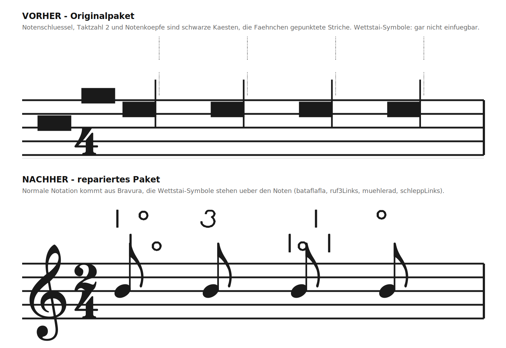
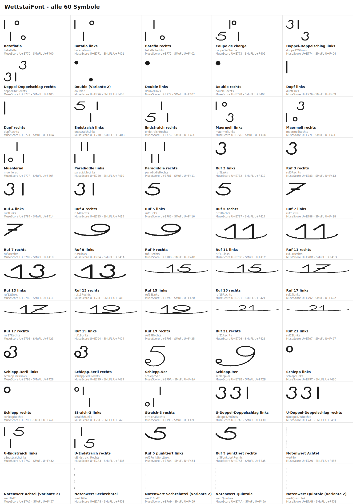

# WettstaiFont für MuseScore Studio

Basler Trommel-Notation („Wettstai“ / Hieroglyphen-Schrift) als Musiksymbol-Schriftart
für **MuseScore Studio 4.6+** unter Windows 10/11.

Das ursprüngliche Paket funktionierte nicht. Die Ursachen sind gefunden und behoben;
alles Nötige liegt im fertigen ZIP.

**→ [`WettstaiFont-MuseScore4-Setup.zip`](WettstaiFont-MuseScore4-Setup.zip) herunterladen,
entpacken, `Install-WettstaiFont.ps1` ausführen.**



*Oben das Originalpaket, unten das reparierte. Simulation nach den Regeln, die MuseScore
Studio v4.6.5 im Quelltext tatsächlich anwendet.*

---

## Inhalt

- [Kurzfassung: was war kaputt](#kurzfassung-was-war-kaputt)
- [Installation](#installation)
- [Symbole einfügen](#symbole-einfügen)
- [Alle 60 Symbole](#alle-60-symbole)
- [Die Befunde im Detail](#die-befunde-im-detail)
- [Warum die Symbole auf `U+E770` liegen](#warum-die-symbole-auf-ue770-liegen)
- [Projektaufbau, neu bauen und prüfen](#projektaufbau-neu-bauen-und-prüfen)
- [Grenzen und nächste Schritte](#grenzen-und-nächste-schritte)

---

## Kurzfassung: was war kaputt

Acht Fehler, davon drei so schwer, dass das Paket nicht funktionieren konnte:

| | Befund | Folge | Status |
|---|---|---|---|
| 1 | Die 60 Wettstai-Symbole lagen ausschließlich auf `U+F400`–`U+F43B`. MuseScore kennt nur Symbole bis `U+EF08`. | **Kein einziges Symbol war einfügbar.** | behoben |
| 2 | Zehn Platzhalter – identische schwarze Rechtecke – lagen auf echten Notationszeichen (`gClef`, `cClef`, `fClef`, `timeSig0/1/2`, `noteheadBlack`, `U+E000`–`E002`). | Schlüssel, Taktzahlen und Notenköpfe wurden als schwarze Kästen gezeichnet. | behoben |
| 3 | Sechs Kopien der „Wert“-Zeichen lagen auf den Fähnchen-Codepoints `U+E240`–`U+E245`. | Alle Achtel-, Sechzehntel- und Zweiunddreissigstel-Fähnchen wurden zu gepunkteten Strichen. | behoben |
| 4 | Der Installer setzte auf `Dokumente\MuseScore4\MusicFonts\`. Diesen Ordner durchsucht MuseScore ab Werk **gar nicht**. | Die Hauptinstallation lief ins Leere. | behoben |
| 5 | Drei JSON-Dateien landeten im selben Schriftart-Ordner. MuseScore 4.6 nimmt eine beliebige davon. | Zufällig richtig oder falsch. | behoben |
| 6 | Die Metadaten waren kein gültiges SMuFL (falsches Bounding-Box-Format, Font-Einheiten statt Notenzeilenabstände, vertauschte x/y-Werte, erfundene Schlüssel). | Andere Programme konnten nichts damit anfangen. | behoben |
| 7 | Die Vorschubbreiten lagen zwischen 45 und 833 Einheiten, obwohl Zeichnungen bis 4199 Einheiten breit sind. | Symbole überlappten. | behoben |
| 8 | Vertikale Metriken unpassend (`hhea.ascent` 2181 bei 1000 Einheiten pro Geviert, `sTypoDescender` 0 bei Zeichen bis −297). | Abgeschnittene Zeichen, falsche Zeilenhöhe. | behoben |

Die **Zeichnungen selbst sind unverändert** – der Build prüft das bei jedem Lauf, indem
er die Umrisse aller 60 Glyphen mit dem Original vergleicht.

Alle Aussagen über MuseScore sind am Quelltext des Release-Tags **v4.6.5** geprüft, nicht
aus der Dokumentation übernommen. Die Fundstellen stehen weiter unten und in
`tools/verify_musescore.py`.

---

## Installation

**Voraussetzung: MuseScore Studio 4.6 oder neuer** (*Hilfe → Über MuseScore*).
Ältere 4.x-Versionen können fremde SMuFL-Schriften überhaupt nicht laden.

1. MuseScore **komplett beenden** – auch im Infobereich neben der Uhr nachsehen.
2. [`WettstaiFont-MuseScore4-Setup.zip`](WettstaiFont-MuseScore4-Setup.zip) herunterladen
   und **vollständig entpacken**.
3. Rechtsklick auf `Install-WettstaiFont.ps1` → **„Mit PowerShell ausführen“**.
   Falls blockiert:
   ```powershell
   Set-ExecutionPolicy -Scope Process Bypass
   .\Install-WettstaiFont.ps1
   ```
4. MuseScore neu starten.

Das Skript legt an:

| Ziel | Zweck |
|---|---|
| `%LOCALAPPDATA%\Microsoft\Windows\Fonts\WettstaiFont.otf` + Registry-Eintrag | Windows-Schriftart, Benutzerkonto, kein Admin nötig |
| `%LOCALAPPDATA%\SMuFL\Fonts\WettstaiFont\WettstaiFont.json` | **der Weg, der ohne weitere Einstellung funktioniert** |
| `Dokumente\MuseScore4\MusicFonts\WettstaiFont\` | Reserve; wirkt nur, wenn der Ordner in den Einstellungen eingetragen ist |

Deinstallation: `Uninstall-WettstaiFont.ps1` genauso ausführen.

---

## Symbole einfügen

1. **Ansicht → Master-Palette** (`Umschalt + F9`)
2. Links **„Symbole“**
3. Oben im Auswahlfeld **Font: `WettstaiFont`**
4. Links die Gruppe **„Beaters pictograms“** – dort stehen alle 60 Wettstai-Symbole.
   Der Eintrag heisst auch in einer deutschen Oberfläche englisch: MuseScore übersetzt
   die Symbolgruppen nicht.
5. Note im Notenblatt anklicken, Symbol in der Palette doppelklicken, mit den
   Pfeiltasten fein positionieren

**Die Musiksymbol-Schriftart des Notenblatts muss nicht umgestellt werden.** Noten,
Schlüssel und Pausen kommen weiter aus Leland; jedes eingefügte Symbol speichert selbst,
dass es aus `WettstaiFont` stammt (MuseScore schreibt `<Symbol><font>WettstaiFont</font>`
in die Partiturdatei).

Für häufig genutzte Zeichen lohnt eine eigene Palette: **Ansicht → Paletten**, unten
**„+“ → Neue Palette erstellen**, dann Symbole per Drag & Drop hineinziehen.

---

## Alle 60 Symbole

Vollständige Tabelle mit allen Codepoints: **[`package/Symbolliste.md`](package/Symbolliste.md)**



---

## Die Befunde im Detail

### 1. Die Symbole waren für MuseScore unsichtbar

Der SMuFL-Standard sieht für eigene Zeichen den Bereich ab `U+F400` vor, und genau dort
lagen die 60 Wettstai-Symbole. Nur: MuseScores Symbolwelt ist fest einkompiliert.

`Smufl::loadGlyphNamesJson()` liest die **mitgelieferte** Datei
`:/fonts/smufl/glyphnames.json` und ordnet jedem eingebauten `SymId` einen Codepoint zu –
diese Datei reicht von `U+E000` bis `U+EF08`, 2932 Einträge, kein einziger ab `U+F000`.
Die Master-Palette (`SymbolDialog::createSymbols()`), der Sonderzeichen-Dialog und der
Schlagzeug-Editor laufen alle über `Smufl::smuflRanges()`, also über dieselbe eingebaute
Liste. `EngravingFont::ensureLoad()` liest aus den Metadaten einer fremden Schrift nur
`glyphsWithAnchors`, `glyphsWithAlternates` und `engravingDefaults` – der Block
`optionalGlyphs`, in dem eigene Symbole laut Standard angemeldet werden, wird **nie
gelesen**.

Damit gab es keinen Weg, ein Zeichen aus `U+F400`+ in eine Partitur zu bekommen.

**Behoben:** Jedes Symbol ist jetzt zusätzlich auf `U+E770`–`U+E7AB` erreichbar.
Die Original-Codepoints `U+F400`–`U+F43B` bleiben erhalten, damit die Schrift für
Dorico, Finale und andere SMuFL-Programme standardkonform bleibt.

### 2. Platzhalter statt Rückfall auf Bravura

Zehn Glyphen der Originalschrift waren **dasselbe schwarze Rechteck** (Umriss
identisch, Kasten von 146,190 bis 762,472): `uniE000`, `uniE001`, `uniE002`, `gClef`,
`cClef`, `fClef`, `timeSig0`, `timeSig1`, `timeSig2`, `noteheadBlack`.

Die alte Anleitung behauptete, MuseScore lade Standardzeichen automatisch aus Bravura
nach. Das stimmt – aber nur für Zeichen, die in der Schrift **fehlen**:

```cpp
// src/engraving/internal/engravingfont.cpp
bool EngravingFont::useFallbackFont(SymId id) const
{
    return MScore::useFallbackFont && !sym(id).isValid() && !engravingFonts()->isFallbackFont(this);
}
// Sym::isValid() == code != 0 && bbox.isValid()
```

Weil die Rechtecke vorhanden waren, galten sie als gültig – und wurden gezeichnet.

**Behoben:** Die zehn Platzhalter sind entfernt. MuseScore fällt jetzt für Schlüssel,
Taktzahlen und Notenköpfe auf Bravura zurück (siehe Bild oben).

### 3. Zerschossene Fähnchen

Auf `U+E240`–`U+E245` (`flag8thUp/Down`, `flag16thUp/Down`, `flag32ndUp/Down`) lagen
Kopien der „Wert“-Zeichen – dieselben Umrisse wie `wert8el`, `wert16tel`, `wertQuintole`,
nur vertikal verschoben. Sobald `WettstaiFont` als Musiksymbol-Schriftart eingestellt war,
wurde jedes Fähnchen zu einem dünnen gepunkteten Strich.

**Behoben:** Diese sechs Zuordnungen sind entfernt. Die Zeichen selbst bleiben als
normale Wettstai-Symbole erhalten (Nr. 55–60 in der Symbolliste).

> Falls das Absicht war und Achtel wirklich Wettstai-Wertzeichen statt Fähnchen tragen
> sollen: das ist möglich, aber es ist eine eigene Entscheidung mit Nebenwirkungen für
> die ganze Partitur. Sag Bescheid, dann baue ich es als bewusst gewählte Variante ein.

### 4. Der MusicFonts-Ordner wird ab Werk nicht durchsucht

```cpp
// src/notation/internal/notationconfiguration.cpp (v4.6.5)
settings()->setDefaultValue(USER_MUSIC_FONTS_PATH, Val(io::path_t {}));   // leer!

// src/notation/internal/engravingfontscontroller.cpp
muse::io::path_t userFontsPath = configuration()->userMusicFontsPath();
if (!userFontsPath.empty()) {
    scanDirectory(userFontsPath, true);
}
```

Der Standardwert ist ein **leerer Pfad** – zum Vergleich: `USER_STYLES_PATH` gleich
darüber bekommt einen echten Vorgabepfad. Solange in *Bearbeiten → Einstellungen →
Ordner → „Musiksymbol-Schriftarten“* nichts eingetragen ist, wird der private Ordner
übersprungen. Der alte Installer legte seine Hauptinstallation genau dort ab.

Immer durchsucht werden dagegen `%LOCALAPPDATA%\SMuFL\Fonts` und
`%CommonProgramFiles%\SMuFL\Fonts`.

**Behoben:** Der Installer schreibt jetzt in erster Linie den globalen SMuFL-Ordner. Der
MusicFonts-Ordner wird weiter befüllt, aber nur noch als Reserve; das Skript nennt am
Ende den Pfad, den man dafür in die Einstellungen eintragen müsste.

### 5. Drei JSON-Dateien in einem Ordner

```cpp
// src/notation/internal/engravingfontscontroller.cpp (v4.6.5), scanDirectory()
QDirIterator jsonFilesIterator(fontDir, { "*.json" }, QDir::Files);
while (jsonFilesIterator.hasNext()) {
    jsonFilesIterator.next();
    metadataPath = jsonFilesIterator.filePath();   // die letzte gewinnt
}
```

Der alte Installer kopierte `WettstaiFont.json`, `metadata.json` **und**
`glyphnames.json` in denselben Ordner. Welche davon MuseScore nimmt, hängt von der
Reihenfolge des Dateisystems ab.

**Behoben:** In jedem Schriftart-Ordner liegt genau eine JSON-Datei. Der Installer räumt
alte Reste vorher weg.

### 6. Die Metadaten waren kein SMuFL

Beispiel `ruf21Rechts` – tatsächlich 4199 Einheiten breit und 397 hoch:

```json
"ruf21Rechts": [19, -4007, 211, 0]
```

Falsches Format (SMuFL verlangt `{"bBoxNE": [...], "bBoxSW": [...]}`), Font-Einheiten
statt Notenzeilenabständen, und x und y vertauscht. Dazu die Schlüssel `glyphs`,
`glyphClasses` und `ranges`, die es im SMuFL-Metadatenformat nicht gibt, und Codepoints
ohne `U+`-Präfix in `glyphnames.json`.

Für MuseScore war das folgenlos – es liest diese Blöcke ohnehin nicht und nimmt die
Maße direkt aus der Schriftdatei (`EngravingFont::computeMetrics()`). Für jedes andere
SMuFL-Programm war die Datei unbrauchbar.

**Behoben:** Die Metadaten werden von `tools/build_metadata.py` aus der fertigen
Schriftdatei erzeugt und können damit nicht mehr auseinanderlaufen. `verify_musescore.py`
rechnet jeden Wert gegen die Schrift nach.

### 7. und 8. Vorschubbreiten und vertikale Metriken

Vorschubbreiten von 45 bis 833 Einheiten bei Zeichnungen bis 4199 Einheiten Breite;
`hhea.ascent` 2181 und `sTypoDescender` 0 bei 1000 Einheiten pro Geviert.

**Behoben:** Vorschub = Zeichnungsbreite + 30 Einheiten Seitenabstand; Metriken so
gesetzt, dass sie alle Zeichen einschliessen (Aufstrich 1206, Abstrich −250).

---

## Warum die Symbole auf `U+E770` liegen

`U+E770`–`U+E7EF` ist der SMuFL-Bereich **„Beaters pictograms“** (Schlägel-Piktogramme:
Pauken-, Xylophon- und Grosstrommelschlägel). 128 Plätze, von denen 60 gebraucht werden.

Der Bereich wurde gewählt, weil MuseScore ihn kennt, weil er in der Palette bei den
Schlaginstrumenten einsortiert ist – und weil Basler Trommelmusik keine Schlägel-Piktogramme
braucht. Das ist ein bewusster Kompromiss mit zwei Folgen:

- In der Master-Palette heissen die Felder weiterhin `pictBeater…`. Man sieht aber die
  Wettstai-Zeichen und kann sie so erkennen; die Zuordnung steht in `Symbolliste.md`.
- Eine Partitur speichert den SMuFL-Namen. Öffnet sie jemand ohne die Schrift, erscheinen
  dort Schlägel-Piktogramme statt Wettstai-Zeichen.

Ein anderer Bereich ist leicht einstellbar: `ALIAS_BLOCK_START` in
`tools/wettstai_glyphs.py` ändern und neu bauen.

---

## Projektaufbau, neu bauen und prüfen

```
README.md                            diese Datei
WettstaiFont-MuseScore4-Setup.zip    fertiges Paket zum Verteilen
package/                             Inhalt des ZIP, einzeln im Git nachvollziehbar
  WettstaiFont.otf                   reparierte Schrift
  WettstaiFont.json                  SMuFL-Metadaten
  glyphnames.json                    Namen und Codepoints
  Symbolliste.md                     Tabelle aller 60 Symbole (generiert)
  LIESMICH.md                        Kurzanleitung im Paket
  Install-WettstaiFont.ps1
  Uninstall-WettstaiFont.ps1
docs/                                Vorher/Nachher-Bild und Symbolübersicht (generiert)
tools/
  WettstaiFont-original.otf          unveränderte Originalschrift als Referenz
  wettstai_glyphs.py                 Glyphenliste und Codepoint-Zuordnung
  build_font.py                      baut die OTF aus dem Original
  build_metadata.py                  erzeugt Metadaten und Symbolliste
  render_preview.py                  erzeugt die Bilder in docs/
  verify_musescore.py                prüft alles gegen MuseScores Laderegeln
  build_package.py                   ruft alles auf und packt das ZIP
```

```bash
pip install fonttools            # cairosvg zusätzlich für die PNG-Ausgabe
python3 tools/build_package.py   # alles neu bauen
python3 tools/verify_musescore.py   # nur prüfen
```

`verify_musescore.py` bildet MuseScores Laderegeln nach und ist die Antwort auf die
Frage „funktioniert es jetzt wirklich?“, soweit sie ohne laufendes Windows-MuseScore
beantwortbar ist. Es prüft unter anderem, dass kein Standardzeichen mehr überschrieben
wird, dass alle 60 Symbole im erreichbaren Bereich liegen, dass in einem Schriftart-Ordner
genau eine JSON-Datei landet und dass sämtliche Umrisse mit dem Original übereinstimmen.

---

## Grenzen und nächste Schritte

- **Nicht auf echtem MuseScore getestet.** In dieser Umgebung war kein Windows und kein
  MuseScore-Download verfügbar (der Egress-Proxy blockt `musescore.org` und die
  GitHub-Releases). Geprüft ist gegen den Quelltext von v4.6.5 und mit dem
  Simulationsskript. Der erste echte Test ist der auf deinem Rechner – wenn etwas nicht
  passt, hilft die Ausgabe von `verify_musescore.py` beim Eingrenzen.
- **Keine SMuFL-Anker.** Die Symbole haben keine `glyphsWithAnchors`, hängen also nicht
  automatisch am Notenkopf oder am Hals. Für das Einfügen als Einzelsymbol mit
  anschliessendem Feinschieben ist das genau richtig.
- **Grössen und Höhenlage.** Die Zeichen sind unverändert übernommen. Beim Einfügen
  sitzen sie deshalb unterschiedlich hoch (gut im Vorher/Nachher-Bild zu sehen). Falls
  sie einheitlich auf einer Linie sitzen sollen, lässt sich das mit einer
  Vertikalverschiebung pro Glyphe im Build glattziehen – dazu bräuchte ich von dir die
  gewünschte Bezugslinie.
- **Eigene Schlagzeug-Definition (`.drm`).** Wenn ganze Stücke in Wettstai-Notation
  entstehen sollen statt einzelner Symbole, wäre eine Drumset-Definition mit den
  Wettstai-Zeichen als Notenkopf der nächste Schritt. Dafür müssten die Symbole allerdings
  in einen anderen Bereich umziehen: der Schlagzeug-Editor bietet als Notenköpfe nur die
  sechs Notenkopf-Bereiche an (`validNoteheadRanges` in `customizekitdialog.cpp`),
  „Beaters pictograms“ gehört nicht dazu. „Note name noteheads“ (`U+E150`, 96 Plätze)
  wäre gross genug. Sag Bescheid, wenn du in diese Richtung willst – dann baue ich eine
  zweite Variante der Schrift dafür.

---

## Quellen

- MuseScore Studio, Quelltext v4.6.5 – `engravingfontscontroller.cpp`,
  `engravingfont.cpp`, `notationconfiguration.cpp`, `smufl.cpp`, `symboldialog.cpp`
- [SMuFL-Spezifikation](https://w3c.github.io/smufl/latest/)
- [MuseScore-Handbuch: Music fonts](https://handbook.musescore.org/appendix/music-fonts)
- Bravura wird in dieser Dokumentation nur zur Darstellung der Rückfall-Zeichen in den
  Vorschaubildern verwendet (SIL Open Font License, Steinberg Media Technologies).
